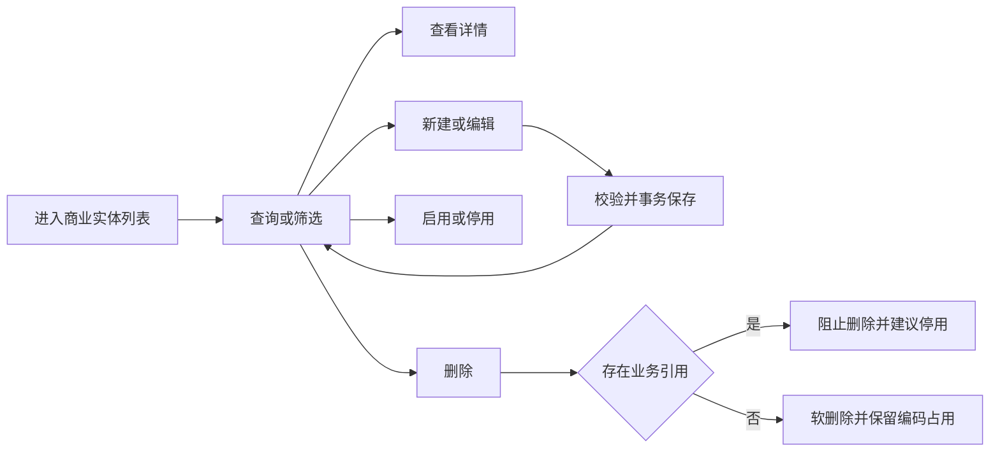

# 商业实体主数据产品方案

> 文档状态：待人工评审；需求来源：《ERP 商业实体模块 PRD（v1.1）》与 ERP-167 已确认设计决策。

## 一页结论

本期交付一个可独立验收的商业实体主数据闭环：用户按权限完成查询、查看、新建、编辑、启停和删除，并维护联系人、收款账户、多角色及供应商账期。角色是多值业务属性；`entity_type` 不再成为页面或接口输入。停用实体不进入任何新业务候选集，但历史单据继续按业务发生时快照展示；存在任一业务引用的实体不可删除。本期不改造采购、订单、库存、财务流程。（来源：PRD“一、2”“一、3”“一、4”；Issue 已确认设计决策1至3）

## 阶段1：领域事件

| ID | 事件 | 角色/触发 | 输入 | 输出 | 状态敏感 | 本期 |
|---|---|---|---|---|---|---|
| E01 | 查询商业实体 | 有查看权限用户 | 页签、关键词、角色、状态、分页 | 分页实体摘要 | 是，启停影响样式与操作 | 是 |
| E02 | 查看商业实体 | 有查看权限用户 | 实体编码 | 主体及子资料详情 | 否 | 是 |
| E03 | 创建商业实体 | 有新建权限用户 | 基础信息、至少一个角色及可选子资料 | 启用态实体 | 否 | 是 |
| E04 | 修改商业实体 | 有编辑权限用户 | 不含编码和`entity_type`的变更、版本条件 | 新版本主数据 | 是，并发冲突阻断 | 是 |
| E05 | 停用商业实体 | 有停用权限用户 | 启用态实体 | 停用态实体，从新业务候选集移除 | 是 | 是 |
| E06 | 启用商业实体 | 有启用权限用户 | 停用态实体 | 启用态实体，恢复新业务候选 | 是 | 是 |
| E07 | 删除商业实体 | 有删除权限用户 | 零业务引用实体 | 软删除实体，编码永久保留 | 是，有引用即阻断 | 是 |
| E08 | 保存查询偏好 | 列表用户 | 查询条件与用户/组织/角色/页面维度 | 隔离的查询偏好 | 否 | 是 |
| E09 | 离开未保存页面 | 编辑用户/浏览器事件 | 脏状态 | 确认离开或继续编辑 | 是，仅脏状态提示 | 是 |

术语：商业实体是主数据聚合；实体角色是可多选业务资格；实体类型是兼容技术字段；历史快照是业务发生时固化的名称、币种及必要展示信息。

## 阶段2：影响性与可行性

| 维度 | 结论 |
|---|---|
| 业务/用户 | 统一入口和操作权限，减少停用实体继续被选用 |
| 数据/一致性 | 主体与子资料事务保存；历史单据不回写；删除执行引用保护 |
| 接口/兼容 | 取消前端提交 `entity_type`；旧响应字段可暂留；编码永久不可复用 |
| 权限/安全 | 查看、创建、编辑、启用、停用、删除分别鉴权，前后端一致 |
| 性能/运维 | 列表分页；删除引用检查须有可维护的引用注册而非全库无界扫描 |
| 可逆性 | 停用可启用；删除仅零引用且软删除；编码不可恢复复用 |
| 技术可行性 | 现有主体、联系人、账户、角色、账期模型和事务保存可复用；状态接口、权限、并发控制需补齐 |

Go：主数据闭环可独立建设与测试。No-go 条件：引用清单未完成或权限标识未确定时，不得把切片晋升 READY。

## 阶段3：业务链路



历史链路与新业务链路分离：历史查询按快照回显；新业务选择只返回启用实体。两条链路不得共用“仅启用”过滤器。

## 阶段4：模块与责任边界

| 模块 | 聚合/职责 | 不负责 |
|---|---|---|
| 商业实体主数据 | 主体、联系人、账户、角色、账期的写入与查询 | 采购、订单、库存、财务流程 |
| 生命周期治理 | 启用、停用、删除、编码占用、引用保护 | 修改历史单据 |
| 权限与偏好 | 操作鉴权、列表查询偏好 | 自定义业务角色体系 |
| 引用适配 | 新业务候选过滤、历史快照读取契约 | 上下游业务规则重构 |

## 阶段5：功能设计

| 功能 | 关键规则 | 来源 |
|---|---|---|
| 列表 | 固定角色页签；关键词覆盖编码/名称/简称；角色多选、状态单选；分页；保存查询条件 | PRD“一、3” |
| 详情 | 展示基础信息、联系人、账户、签章、角色和账期；空值按规则处理 | PRD“一、4（1）（2）” |
| 新建/编辑 | 编码、名称、本位币、至少一角色必填；角色不可重复；编辑编码不可改 | PRD“一、4（3）” |
| 启停 | 操作互斥；停用阻止新选择，启用恢复 | PRD“一、2”第11条；Issue 决策3 |
| 删除 | 服务端检查全部业务引用；有引用禁止；无引用软删除；编码不可复用 | PRD“一、3（3）”“一、4（3）” |
| 并发 | 条件更新失败提示“数据已更新，请重新加载”，不覆盖 | PRD“一、4（3）” |
| 离开保护 | 仅脏状态触发，覆盖返回、菜单、浏览器返回、刷新、关闭 | PRD“一、2”第12条 |

状态×操作：启用态可编辑/停用/条件删除；停用态可查看历史/编辑/启用/条件删除；软删除态不可查询与恢复，但编码保持占用。权限不足时所有状态均拒绝对应操作。

```text
+---------------- 商业实体列表 ----------------+
| [全部][客户][供应商][核算组织]  [新建实体]    |
| 关键词 [____] 角色 [多选] 状态 [单选] [查询]  |
| 编码 | 名称 | 角色 | 本位币 | 责任人 | 状态 | 操作 |
| BE01 | 示例 | 客户 | CNY    | 张三   | 启用 | ...  |
+------------------------------------------------+
```

```text
+---------------- 商业实体详情 ----------------+
| [返回] 实体名称 [启用]                 [编辑] |
| 基本信息 | 联系人 | 收款账户 | LOGO与签章      |
| 角色卡片：角色专属字段；供应商账期规则        |
+------------------------------------------------+
```

## 阶段6：产品需求与验收

1. 前端不得展示或提交 `entity_type`；服务端新建和更新不得要求该字段。（Issue 决策1）
2. 编辑不得批量回写历史单据；新业务使用更新后主数据，历史业务使用原快照。（Issue 决策2）
3. 停用实体不得出现在新业务选择器；按既有编码查看历史单据仍成功。（Issue 决策3）
4. 仅零业务引用实体可删除；任一引用均返回可识别错误且数据不变。（PRD“一、3（3）”）
5. 所有写操作在服务端鉴权；隐藏前端按钮不能替代鉴权。（PRD“一、3（3）”权限条款）
6. 并发编辑不得静默覆盖。（PRD“一、4（3）”并发条款）

## 阶段7：切片发现

识别一个垂直切片 `ERP-SLICE-PLAT-001`：从列表入口到主数据维护、生命周期治理、权限和引用适配共同形成可观察业务结果，拆成前端/后端水平切片将无法独立验收。`blocked_by: []`；外部业务模块以 mock 的候选查询与历史快照契约验证，本期不要求其流程改造。

## 追溯与风险

| ID | 需求 | 事件 | 验收 |
|---|---|---|---|
| T01 | PRD“一、3”列表 | E01/E08 | AC01 |
| T02 | PRD“一、4”维护 | E02/E03/E04/E09 | AC02/AC03 |
| T03 | PRD“一、2”第11条 | E05/E06/E07 | AC04/AC05 |
| T04 | Issue 决策1至3 | E03至E07 | AC03至AC06 |

主要评审缺口：服务端权限标识、全量业务引用注册表、统一错误码需由技术方案固化；这些不改变产品边界，但在晋升 READY 前必须关闭。
