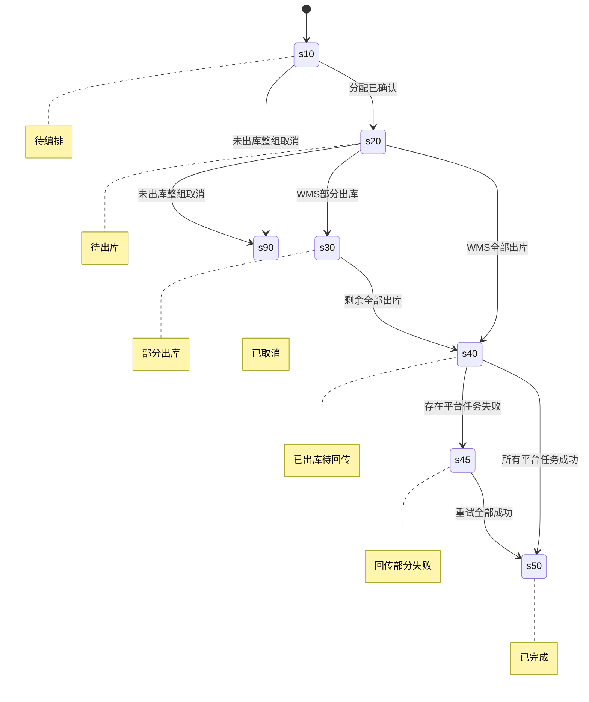

# Shopify 跨订单组合发货产品系统设计方案

> 任务映射：`0182` / `ERP-182` / `ERP-SLICE-B2C-001`  
> 来源锚点：需求分析 F/D 结论均来自 Issue 描述与评论 Q1-Q5；完整来源见同目录 `requirement-analysis.md`。

## 1. 一页结论

**本期新增“组合发货关系”，让运营可以手工把同店铺、同平台客户、同仓库的多张待履约单编排为一次或多次物理发货，同时保持每张原订单独立。**

三个核心设计决策：

1. 订单管交易归属，组合发货管数量编排，实际履约单管出库，平台回传任务管原订单状态；四者不互相替代。（D-05）
2. 合并与拆分统一为“来源商品行到实际履约单的数量分配”，每个来源行必须数量守恒。（D-05）
3. 仓库出库与 Shopify 回传分离；一张实际履约单可以生成多张原订单的回传任务，失败任务单独幂等重试。（D-05）

当前结论为有条件能做。上线前必须完成平台客户 ID 归一规则、并发防超分配、取消守卫、WMS 回调幂等和 Shopify 回传幂等的技术评审。本期不做自动合并、销售订单合并、资金与售后归属变化。（D-01、D-04、D-05）

### 读者路线

| 读者 | 先读 | 需确认 |
|---|---|---|
| 业务负责人 | 第1、3、8章 | 手工范围、候选规则、取消边界 |
| 后端 | 第4、5、7章 | 聚合、数量守恒、幂等与并发 |
| 前端 | 第6章 | 批量选择、校验反馈、组合详情 |
| 测试 | 第5、8、10章 | 状态、异常、AC 与 mock 边界 |

### 阶段责任矩阵

| 阶段 | 主责 | 动作 | 权威数据 | 风险归属 | 不做什么 |
|---|---|---|---|---|---|
| 选择候选 | 运营/ERP | 选择并校验待履约单 | 原履约单 | ERP | 不自动选单 |
| 创建组合 | ERP | 固化来源行和分配计划 | 组合发货 | ERP | 不改原订单 |
| 实际出库 | WMS | 形成包裹、运单、出库数量 | 实际履约单/出库结果 | WMS | 不决定交易归属 |
| 平台回传 | ERP/Shopify | 按原履约商品行回传 | 回传任务 | ERP 接口侧 | 不用组合状态覆盖订单 |
| 逆向处理 | 运营/ERP | 未出库整组取消重建；已出库禁止移除 | 审计与异常记录 | ERP/运营 | 不静默改历史 |

## 2. 术语、事实与事件账本

### 2.1 术语与四层命名

| ID | 标准名称 | 定义 | 产品能力 | 端侧名称 | 差异说明 |
|---|---|---|---|---|---|
| T-01 | 原订单 | 单张 ERP B2C/Shopify 销售订单 | 保留原订单归属 | B2C 订单 | 不称“子订单”，因为未生成新销售主单 |
| T-02 | 组合发货 | 多张原订单来源行的发货编排聚合 | 创建组合发货 | 组合发货 | 不称“合并订单”，因为交易主体不合并 |
| T-03 | 组合来源行 | 保留原订单、原商品行、平台履约行与数量的不可变来源 | 追溯来源商品行 | 来源商品 | 不与实际出库明细合并 |
| T-04 | 履约分配 | 来源行分配到实际履约单的数量关系 | 编排发货数量 | 发货分配 | 同时承载合单与拆单 |
| T-05 | 平台回传任务 | 一次出库按原 Shopify 履约单拆出的回传单元 | 重试平台回传 | 回传记录 | 与仓库出库状态分离 |

### 2.2 领域事件

| ID | 事件 | 类型/角色 | 输入 | 输出 | 状态敏感 | 来源 |
|---|---|---|---|---|---|---|
| E-01 | 运营已选择跨订单待履约单 | 人工批量/运营 | 候选履约单 | 待校验选择集 | 是 | D-01 |
| E-02 | 组合发货已创建 | 人工批量/运营 | 通过校验的来源行 | 组合发货、来源行、初始分配 | 是 | D-02、D-03、D-05 |
| E-03 | 组合发货已拆分或重组 | 人工单个/运营 | 来源行、目标履约分组、数量 | 新履约分配 | 是 | D-05 |
| E-04 | 实际履约单已推送 WMS | 系统连锁 | 履约分配 | WMS 出库请求 | 是 | D-05 |
| E-05 | WMS 已回传部分出库 | 外部回调 | 包裹、运单、来源数量 | 部分出库事实、回传任务 | 是 | D-05 |
| E-06 | WMS 已回传全部出库 | 外部回调 | 包裹、运单、来源数量 | 全部出库事实、回传任务 | 是 | D-05 |
| E-07 | Shopify 原订单履约已回传 | 系统连锁 | 按原履约单分组的回传任务 | 成功状态与平台标识 | 是 | D-05 |
| E-08 | Shopify 回传失败待重试 | 系统补偿 | 失败任务 | 失败原因、重试计划 | 是 | D-05 |
| E-09 | 未出库组合已取消并重建 | 人工逆向/运营 | 组合、取消原因 | 原组合作废、剩余成员新组合 | 是 | 来源守恒规则 |
| E-10 | 已出库组合成员移除已拒绝 | 人工逆向/运营 | 已出库组合 | 拒绝结果、审计记录 | 是 | 不可逆规则 |

事件总数 10；全部为本期实现。外部回调以“WMS 回调业务唯一号 + 实际履约单 + 包裹号”为幂等键；平台回传以“出库批次 + 原 Shopify 履约单 + 原履约商品行”为幂等键。乱序回调进入待核对，针对同一来源行的组合、拆分、取消与出库串行化。

## 3. 业务链路与模块

### 3.1 用户故事地图

| 活动 | 任务 | 子任务 | 对应事件 |
|---|---|---|---|
| 组合准备 | 选择候选 | 批量选择并查看资格 | E-01 |
| 组合准备 | 创建组合 | 校验同店铺、同客户、同仓库、可履约状态 | E-02 |
| 发货编排 | 调整分配 | 拆分数量或把多单来源行放入同一实际履约单 | E-03 |
| 仓库执行 | 推送出库 | 固化分配并推送 WMS | E-04 |
| 仓库执行 | 分批出库 | 接收部分出库包裹 | E-05 |
| 仓库执行 | 完成出库 | 接收剩余出库包裹 | E-06 |
| 平台同步 | 回传成功 | 按原 Shopify 履约单和商品行回传 | E-07 |
| 平台同步 | 失败恢复 | 仅重试失败来源任务 | E-08 |
| 逆向处理 | 未出库取消 | 整组取消并用剩余成员重建 | E-09 |
| 逆向处理 | 已出库拦截 | 拒绝移除并转异常处理 | E-10 |

子任务总数 10。

### 3.2 主链路


### 3.3 模块与责任边界

| 领域/子域 | 聚合根 | 写入对象 | 不做什么 | 对外承诺 |
|---|---|---|---|---|
| B2C/组合编排 | 组合发货 | 组合、来源行、分配 | 不改销售订单金额与售后 | 发布分配已固化、组合已取消 |
| B2C/实际履约 | 实际履约单 | 履约状态、包裹映射 | 不决定平台订单归属 | 发布部分/全部出库 |
| 平台/履约回传 | 平台回传任务 | 回传状态、平台结果 | 不回滚物理出库 | 幂等更新每张原订单 |
| B2C/逆向控制 | 组合发货 | 取消记录、审计 | 不移除已出库成员 | 未出库全取消重建、已出库拒绝 |

## 4. 核心对象与数量守恒

```text
组合发货 G1
+-- 来源订单 S1 / 商品行 c x 10
|   +-- 实际履约单 F1 / c x 5
|   +-- 实际履约单 F2 / c x 5
+-- 来源订单 S2 / 商品行 d x 10
    +-- 实际履约单 F2 / d x 10
```

领域不变量：

1. 每条组合来源行只属于一张原订单及一条原商品行。
2. 来源行已分配数量之和不得超过当前可履约数量。
3. 来源行累计出库数量不得超过来源数量，累计平台成功回传数量不得超过累计出库数量。
4. 组合状态只由来源行数量汇总，不反向覆盖原订单状态。
5. 已出库事实不可因平台回传失败回滚。
6. 一个包裹可对应多张原订单，但每条回传任务只属于一张原 Shopify 履约单。

## 5. 状态、逆向与异常

### 5.1 状态机



| 当前状态 | 调整分配 | 整组取消 | 接收出库 | 平台重试 |
|---|---|---|---|---|
| 待编排 | 允许，校验数量守恒 | 允许 | 拒绝 | 拒绝 |
| 待出库 | 仅未推送或 WMS 确认未执行时允许 | 仅所有成员未出库时允许 | 允许 | 拒绝 |
| 部分出库 | 禁止改已出库来源；未出库余量转异常处理 | 禁止 | 允许剩余出库 | 允许失败任务 |
| 已出库待回传 | 禁止 | 禁止 | 幂等忽略重复 | 允许失败任务 |
| 回传部分失败 | 禁止 | 禁止 | 幂等忽略重复 | 允许失败任务 |
| 已完成 | 禁止 | 禁止 | 幂等忽略重复 | 拒绝 |
| 已取消 | 禁止 | 拒绝重复取消 | 拒绝并告警 | 拒绝 |

N:1 逆向规则：全部成员均未执行下一步时，整组取消、原组合作废，并可用剩余成员重建；任一成员已发生实际出库时，禁止从原组合移除任何成员，转人工异常处理。

## 6. 功能与页面

### 6.1 功能清单

| 功能 | 可观察结果 | 事件 |
|---|---|---|
| F-01 筛选可组合待履约单 | 列表展示资格及不可选原因 | E-01 |
| F-02 创建跨订单组合发货 | 服务端再次校验并生成来源快照 | E-02 |
| F-03 调整来源数量分配 | 支持合并与拆分且数量守恒 | E-03 |
| F-04 固化并推送实际履约单 | WMS 获得来源清晰的出库任务 | E-04 |
| F-05 接收部分出库 | 组合显示部分出库并生成对应回传任务 | E-05 |
| F-06 接收全部出库 | 组合显示已出库并生成剩余回传任务 | E-06 |
| F-07 按原订单回传履约 | 每张 Shopify 原订单独立更新 | E-07 |
| F-08 重试失败平台任务 | 成功任务不重复，失败任务可恢复 | E-08 |
| F-09 取消未出库组合 | 整组作废并保留审计，可重建 | E-09 |
| F-10 拦截已出库成员移除 | 返回明确原因并记录审计 | E-10 |
| F-11 查询组合发货详情 | 可追溯原订单、来源行、实际履约、包裹和回传 | E-02 至 E-08 |
| F-12 导出组合发货追溯记录 | 导出来源、分配、包裹、回传状态 | E-02 至 E-08 |

事件 10 个，功能 12 个，未覆盖事件 0。

### 6.2 页面推导

| 页面 | 类型 | 来源 |
|---|---|---|
| P-01 待履约单列表 | 列表页 | F-01、F-02 |
| P-02 创建组合确认 | 批量弹窗 | F-02 |
| P-03 创建组合结果 | 结果弹窗 | F-02 |
| P-04 组合发货列表 | 列表页 | F-11、F-12 |
| P-05 组合发货详情 | 详情页 | F-03、F-04、F-08、F-11 |
| P-06 调整履约分配 | 弹窗 | F-03 |
| P-07 取消组合确认 | 逆向弹窗 | F-09、F-10 |

页面 P=7，线框 W=7。

### 6.3 关键线框

```text
P-01 待履约单列表
+----------------------------------------------------------------+
| 待履约单              [创建组合发货] [导出]                    |
| 店铺[下拉] 平台客户ID[输入] 仓库[下拉] 状态[待履约] [查][重置] |
+----------------------------------------------------------------+
| 选 | 履约单号 | 原订单号 | 店铺 | 平台客户ID | 仓库 | 可选状态 |
| [] | F001     | S001     | B店  | C001       | WH1  | 可选     |
+----------------------------------------------------------------+
| 已选 N 项                                      第1页 / 共N页    |
+----------------------------------------------------------------+

P-02 创建组合确认
+--------------------------------------------------------------+
| 创建组合发货（已选 N 张）                                     |
| 店铺: B店  平台客户ID: C001  仓库: WH1                        |
| 原订单数: N  来源商品行: N  总数量: N                         |
| 校验: 同店铺[通过] 同客户[通过] 同仓库[通过] 状态[通过]        |
|                                      [取消] [确认创建]         |
+--------------------------------------------------------------+

P-03 创建组合结果
+--------------------------------------------------------------+
| 创建完成                                                     |
| 成功: N 张  失败: M 张                                       |
| 失败明细: 履约单号 | 原因                                    |
|                                               [查看组合]      |
+--------------------------------------------------------------+

P-04 组合发货列表
+----------------------------------------------------------------+
| 组合发货                                      [导出]            |
| 组合编号[输入] 店铺[下拉] 状态[下拉] 原订单号[输入] [查][重置] |
+----------------------------------------------------------------+
| 组合编号 | 店铺 | 客户ID | 原订单数 | 包裹数 | 状态 | 操作      |
| G001     | B店  | C001   | 2        | 2      | 部分 | [详情]    |
+----------------------------------------------------------------+
|                                                第1页 / 共N页    |
+----------------------------------------------------------------+

P-05 组合发货详情
+----------------------------------------------------------------+
| 组合 G001                 [调整分配] [推送WMS] [重试] [取消]   |
+----------------------------------------------------------------+
| 店铺 B店 | 客户ID C001 | 仓库 WH1 | 状态 部分出库 | 版本 3     |
| 来源: 原订单 | 原商品行 | 来源数量 | 已分配 | 已出库 | 已回传    |
| 分配: 实际履约单 | 来源商品行 | 分配数量 | 包裹 | 运单         |
| 回传: 原Shopify履约单 | 商品行 | 数量 | 运单 | 状态 | 失败原因 |
+----------------------------------------------------------------+

P-06 调整履约分配
+--------------------------------------------------------------+
| 调整履约分配                                                 |
| 来源 S1/c 可履约10: [F1:5] [F2:5] 合计10                     |
| 来源 S2/d 可履约10: [F2:10]       合计10                     |
| 提示: 每个来源行分配总数不得超过当前可履约数量               |
|                                     [取消] [保存分配]         |
+--------------------------------------------------------------+

P-07 取消组合确认
+--------------------------------------------------------------+
| 警告：确认取消组合 G001？                                    |
| 影响: 原组合作废；未出库实际履约单取消；保留来源和审计记录   |
| 不可逆检查: 所有成员未出库[通过/不通过]                      |
| 取消原因*: [输入]                                            |
|                                   [返回] [确认取消组合]       |
+--------------------------------------------------------------+
```

字段枚举来源：店铺取现有店铺主数据；仓库取现有仓库主数据；履约状态取现有履约状态；组合状态由本方案状态机定义。运营角色具备创建、调整、取消和重试权限；只读角色仅查看与导出；所有权限必须服务端校验。

## 7. 数据与接口责任

| 数据流 | 权威输入 | 处理 | 输出 |
|---|---|---|---|
| 候选校验 | 原履约单、店铺、平台客户 ID、仓库、状态 | 归一客户 ID，提交时重校验 | 资格结果或逐单失败原因 |
| 履约编排 | 来源行可履约数量 | 锁定并校验分配总量 | 实际履约单与分配关系 |
| WMS 出库 | 实际履约单 | 幂等接收包裹、运单、数量 | 来源行累计出库数量 |
| Shopify 回传 | 已出库来源数量 | 按原履约单分组 | 独立回传任务和平台结果 |

不新增自动定时合并接口。候选查询、创建组合、保存分配、固化推送、取消组合、组合查询、回传重试均需服务端权限、版本号与审计；WMS 回调与 Shopify 调用需幂等键。

## 8. 验收规则

1. 同店铺、归一平台客户 ID 相同、同仓库且均待履约的记录可手工组合；任一不符时整次创建不产生部分组合。
2. 原 B2C/Shopify 订单与商品行保持独立并可从组合详情追溯。
3. 同一来源行可拆到多个实际履约单，不同原订单来源行可进入同一实际履约单。
4. 每个来源行所有分配数量之和不得超过当前可履约数量，并发提交不能超分配。
5. WMS 部分出库只增加对应来源行的出库数量，未出库来源不产生回传。
6. 一张实际履约单混合多张原订单时，ERP 为每张原 Shopify 履约单生成独立回传任务，并允许携带同一运单。
7. 某张原订单回传失败不回滚出库，不重复已成功任务，失败任务可幂等重试。
8. 未出库组合只能整组取消后重建；任一成员已出库后禁止移除成员。
9. 所有手工操作、资格失败、状态变化、回调、重试和取消均可审计。
10. 自动合并任务不存在，销售订单、支付、退款、退货与发票归属不变化。

## 9. 风险、依赖与上线条件

| ID | 风险/依赖 | 降级方案 | 上线条件 |
|---|---|---|---|
| R-01 | 客户 ID 归一规则错误 | 空值与异常格式禁止组合，展示原值供核对 | 归一规则单测与业务样本确认 |
| R-02 | 并发超分配 | 乐观锁冲突后刷新重选 | 并发 feature 测试通过 |
| R-03 | WMS 回调重复或乱序 | 重复幂等忽略；乱序进入待核对 | mock 覆盖重复、乱序、部分出库 |
| R-04 | Shopify 部分失败 | 失败任务单独重试 | mock 覆盖部分成功与重复重试 |
| R-05 | 已出库逆向 | 拒绝移除并转异常处理 | 逆向 E2E 与审计通过 |

## 10. 切片与交付

唯一垂直实现切片为 `ERP-SLICE-B2C-001`：从列表手工选择、创建组合、调整分配、WMS 出库 mock、按来源生成 Shopify 回传任务、失败重试到查询审计形成独立闭环。它不依赖其他未合入的同版本切片，外部系统通过显式 mock 验证。

| 功能 | 交付结果 | 验证 |
|---|---|---|
| F-01 至 F-03 | 可选择、创建并编排组合 | unit、feature、E2E |
| F-04 至 F-06 | 可固化推送并处理分批出库 | feature、WMS mock |
| F-07 至 F-08 | 可按原订单回传并恢复部分失败 | Shopify mock、feature |
| F-09 至 F-10 | 逆向边界可执行且可审计 | feature、E2E |
| F-11 至 F-12 | 全链路可查询和导出 | feature、E2E |

实现切片默认进入待规划 backlog；人工改为 todo 后 Developer 才会执行。

## 附录：Trace Ledger

| 对象 | ID | 上游 | 下游 | 责任域 |
|---|---|---|---|---|
| 决策 | D-01 至 D-05 | Q1-Q5 | E-01 至 E-10 | 产品 |
| 事件 | E-01 至 E-10 | D-01 至 D-05 | F-01 至 F-12 | B2C/平台 |
| 页面 | P-01 至 P-07 | F-01 至 F-12 | 用户验收 | B2C |
| 切片 | ERP-SLICE-B2C-001 | F-01 至 F-12 | AC-001 至 AC-010 | B2C |
| 风险 | R-01 至 R-05 | 状态与外部依赖 | 上线 Gate | B2C/平台 |

