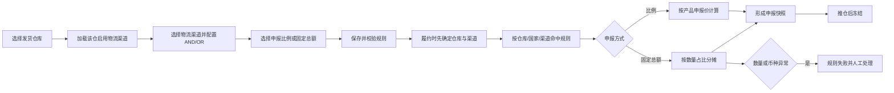

# 履约申报规则精细化产品方案

> 文档状态：待人工评审；需求来源：ERP-185 需求§1至§5与已确认 Q1至Q8。

## 一页结论

本期将履约申报从“仅支持整数比例”扩展为两种互斥方式：`0.1%～100.0%` 的申报比例，或单张履约单固定申报总额。workflow 新增物流渠道条件，但完整复用现有 AND/OR 条件组；配置物流渠道时按发货仓库级联。固定总额按履约数量占比分到 SKU 行，前 N-1 行截断，履约行 ID 最大的最后一行承接尾差。拆单、换仓后的新履约单重新命中并计算；推仓后申报快照冻结，修改必须取消并重建。（来源：需求§1至§4；确认 Q1至Q8）

## 阶段1：领域事件与 I/O

| ID | 事件 | 触发/输入 | 输出 | 状态敏感 | 自动化 | 来源 |
|---|---|---|---|---|---|---|
| E01 | 配置物流渠道条件 | 用户选择仓库、渠道、AND/OR | 合法 workflow 条件 | 是，仓库变化使渠道失效 | 人工配置 | 需求§2；Q5 |
| E02 | 配置申报比例动作 | 方式=比例、比例值 | 合法比例动作 | 否 | 人工配置 | 需求§1、§3；Q4 |
| E03 | 配置固定总额动作 | 方式=固定总额、金额 | 合法固定总额动作 | 否 | 人工配置 | 需求§3；Q1 |
| E04 | 命中申报规则 | 仓库、国家、已选物流渠道、条件组 | 命中或不命中 | 是，渠道须先存在 | 系统 | 需求§2；Q5、Q6 |
| E05 | 按比例计算申报值 | 比例、SKU 产品申报价 | 履约行申报单价 | 否 | 系统 | 需求§1；现状代码 |
| E06 | 按固定总额分摊 | 固定总额、履约行及数量 | 守恒的行申报金额/单价 | 是，零数量或币种异常失败 | 系统 | 需求§4；Q2、Q3、Q8 |
| E07 | 拆单或换仓后重算 | 新履约单上下文 | 独立命中与申报快照 | 是，新单状态 | 系统连锁 | Q7 |
| E08 | 推仓冻结申报快照 | 推仓成功 | 不可原地修改的申报快照 | 是，推仓状态 | 系统连锁 | Q7 |
| E09 | 取消并重建履约单 | 已推仓单需修改 | 新履约单重新计算 | 是，取消成功后执行 | 人工+系统补偿 | Q7 |
| E10 | 申报规则执行失败 | 数量权重为0、币种空/多币种、非法配置 | 订单异常并进入人工处理 | 是 | 系统补偿 | Q2、Q8 |

术语：固定总额指单张履约单申报总额；行分摊额指该履约行全部数量对应金额；行申报单价指写入履约行并供仓库接口按数量计算的单价；申报快照指推仓时固化的各履约行申报值与币种。

## 阶段2：影响性与可行性

| 维度 | 结论 |
|---|---|
| 业务/用户 | 用户可按目的国、仓库、渠道精确控制申报，并避免整数比例导致金额偏差 |
| 数据/一致性 | 固定总额必须满足 `Σ(行申报单价×履约数量)=固定总额`；最后一行承接尾差 |
| 接口/兼容 | 旧比例配置继续按比例解释；未选择固定总额时不改变原动作语义 |
| 权限/安全 | 沿用 workflow 配置权限；服务端不可只依赖前端校验 |
| 性能/运维 | 计算仅遍历单张履约单行；失败写入既有履约规则异常并支持人工重跑 |
| 可逆性 | 推仓前可重新执行；推仓后只能取消并重建，避免跨系统快照漂移 |
| 技术可行性 | 现有履约行、BCMath、仓库渠道枚举和拆单链可复用；固定总额算法及渠道条件需新增 |

Go：单个垂直切片可独立交付。晋升 READY 前，技术方案必须固定金额存储精度、最后一行反算单价精度及外部仓库接口精度，证明金额守恒不会在序列化时丢失。

## 阶段3：业务链路



逆向链路：已推仓履约单不直接回写申报值；先取消原履约单，重建后重新命中规则并生成新快照。（确认 Q7）

## 阶段4：模块与责任边界

| 模块 | 职责 | 不负责 |
|---|---|---|
| workflow 条件配置 | 组合 AND/OR；提供仓库、国家、物流渠道条件；仓库渠道级联 | 新建另一套三维规则引擎 |
| 履约申报动作 | 方式互斥、输入校验、比例计算、固定总额分摊 | 维护各国免税阈值 |
| 履约生命周期 | 拆单/换仓重算、推仓冻结、取消重建 | 修改仓库已接收的原单快照 |
| 异常与人工处理 | 记录可识别失败原因并允许修正后重跑 | 对零权重执行平均分摊 |

## 阶段5：功能与规则设计

### 5.1 workflow 条件

- 条件组合完全沿用现有 AND/OR；仓库、目的国家、物流渠道均为普通条件。（已确认 Q5）
- 物流渠道条件必须先选择发货仓库；仓库为空时渠道选项为空；仅显示该仓库绑定且启用的渠道。（Q5；代码 `EnumsController.php:48-60`）
- 修改仓库后清空不属于新仓库的已选渠道；服务端保存时再次校验仓库—渠道绑定。
- 执行顺序为“确定仓库与物流渠道 → 读取目的国家 → 评估申报规则”，禁止同一动作既生成渠道又依赖该渠道判断。（确认 Q6）

### 5.2 申报动作

| 字段 | 规则 |
|---|---|
| 申报方式 | 必填，单选“申报比例/固定总额” |
| 申报比例 | 方式为比例时必填；`0.1%～100.0%`；最多1位小数；步长0.1；0非法 |
| 固定申报总额 | 方式为固定总额时必填；必须大于0；币种沿用履约行，不单独选择 |
| 非当前方式字段 | 隐藏、清空且服务端忽略，避免双值冲突 |

### 5.3 固定总额算法

设按履约行 ID 升序排序后的有效行是 `1..N`，固定总额 `D>0`，各行履约数量 `q_i>0`，总数量 `Q=Σq_i`。

1. 若 `N=0`、`Q=0`、任一参与行数量不合法、币种为空或存在多币种，整体失败，不写入部分结果。（确认 Q2、Q8）
2. 分摊权重 `w_i=q_i/Q`，体现按 SKU 履约数量占比。（确认 Q2）
3. 对前 `N-1` 行，行分摊额 `A_i=truncate(D×w_i, 金额精度)`，采用截断法。（确认 Q3）
4. 最后一行 `A_N=D-ΣA_i`，承接全部尾差。（确认 Q3）
5. 行申报单价 `U_i=A_i/q_i`；保存前再次校验 `Σ(U_i×q_i)=D`。技术方案必须选定可满足该守恒式的存储与接口精度。
6. 同一输入重复执行必须得到相同行分摊；排序固定为履约行 ID 升序。（确认 Q3）

### 5.4 状态×操作

| 履约状态 | 初次计算/重算 | 修改已计算值 | 推仓 | 处理方式 |
|---|---|---|---|---|
| 待履约/待推仓 | 允许 | 允许通过重跑规则 | 允许 | 生成最新快照 |
| 推送中/已推仓 | 禁止原地重算 | 禁止 | 已执行 | 取消并重建 |
| 已取消 | 禁止 | 禁止 | 禁止 | 新履约单独立命中 |
| 拆单/换仓产生的新单 | 允许 | 推仓前允许 | 允许 | 按新单上下文重新计算 |

### 5.5 配置线框

```text
+----------- workflow 履约申报动作 -----------+
| 条件组：[AND/OR]                              |
| 发货仓库：[选择仓库]                          |
| 物流渠道：[按仓库加载；仓库为空时禁用]        |
| 目的国家：[多选]                              |
| 申报方式：(●申报比例 ○固定总额)              |
| 申报比例：[ 10.5 ] %                          |
| 固定总额：[方式切换后显示]                    |
|                         [取消] [保存]          |
+------------------------------------------------+
```

## 阶段6：验收摘要

1. 比例 `0.1`、一位小数中间值、`100.0` 可保存；0、负数、超过100、两位小数被前后端拒绝。（需求§1；Q4）
2. 选择仓库后仅展示其启用物流渠道；换仓使旧渠道失效并阻止保存。（需求§2；Q5）
3. 条件组合继续支持 AND/OR，运行时使用实际仓库、目的国家和已选渠道。（Q5、Q6）
4. 固定总额分摊后金额严格守恒，前 N-1 行截断、最后一行承差，顺序确定。（Q1至Q3）
5. 数量权重为0、空币种、多币种时不产生部分写入，记录异常并进入人工处理。（Q2、Q8）
6. 拆单和换仓新单独立重算；推仓后无法原地改值，只能取消并重建。（Q7）

## 阶段7：切片发现

识别一个垂直切片 `ERP-SLICE-ORD-001`：从 workflow 配置、渠道级联、规则命中、两种申报计算，到异常与推仓冻结共同构成可观察业务结果。拆成“前端配置”“后端计算”会失去独立验收能力，因此不拆水平切片。`blocked_by: []`；仓库接口通过 mock 验证推仓快照，不依赖同版本其他切片。

## 追溯与风险

| 追溯 | 需求/决策 | 事件 | 验收 |
|---|---|---|---|
| T01 | 需求§1；Q4 | E02/E05 | AC-001 |
| T02 | 需求§2；Q5/Q6 | E01/E04 | AC-002/AC-003 |
| T03 | 需求§3至§4；Q1至Q3 | E03/E06 | AC-004/AC-005 |
| T04 | Q7 | E07/E08/E09 | AC-007 |
| T05 | Q2/Q8 | E10 | AC-006 |

主要评审缺口：履约行金额与外部仓库接口的最终精度需要技术方案证明；在证据完成前切片保持 `DEFINED`，不得晋升 `READY`。

