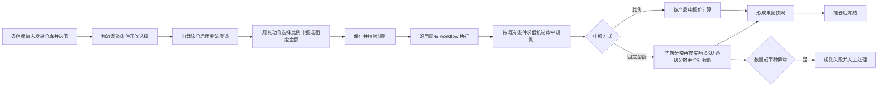

# 履约申报规则精细化产品方案

> 文档状态：待人工评审；需求来源：ERP-185 需求§1至§5、已确认 Q1至Q8、2026-11-04 三轮 PR 纠偏说明及 2026-11-06 业务调研变更说明。

## 一页结论

本期扩展现有 workflow 与履约单展示。固定申报金额展示“（USD）”；所选产品分类覆盖自身及全部层级子分类；按业务明确的 pcs 或销售价浮动公式计算后，结果回写并展示到履约商品申报金额。workflow 命中成功后如任一商品申报金额为0，推仓中断并停止后续流程。（来源：2026-11-06 补充§1至§2.3.1）

## 阶段1：领域事件与 I/O

| ID | 事件 | 触发/输入 | 输出 | 状态敏感 | 自动化 | 来源 |
|---|---|---|---|---|---|---|
| E01 | 配置物流渠道条件 | 同一条件组内已选值的发货仓库、渠道、AND/OR | 合法 workflow 条件 | 是，仓库条件变化使渠道失效 | 人工配置 | 需求§2；2026-11-04 PR 纠偏说明§1 |
| E02 | 配置申报比例动作 | 方式=比例、比例值 | 合法比例动作 | 否 | 人工配置 | 需求§1、§3；Q4 |
| E03 | 配置固定金额动作 | 方式=固定金额、两位小数金额、分类一级分摊方式与值、SKU 二级分摊方式 | 合法固定金额动作 | 是，分类变化会使配置失效 | 人工配置 | 需求§3至§4；2026-11-06 业务调研变更说明 |
| E04 | 命中申报规则 | 现有 workflow 对象属性与条件组 | 命中或不命中 | 是 | 系统 | 需求§2；Q5、Q6 |
| E05 | 按比例计算申报值 | 比例、SKU 产品申报价 | 履约行申报单价 | 否 | 系统 | 需求§1；现状代码 |
| E06 | 按分类与 SKU 两级分摊计算 | 固定金额、分类及全部子分类、商品数量、分类销售总额、履约单销售总额 | 回写并展示的履约商品申报金额 | 是，按选定公式计算 | 系统 | 2026-11-06 补充§2、§2.2、§2.3、§2.3.1 |
| E07 | 拆单或换仓后重算 | 新履约单上下文 | 独立命中与申报快照 | 是，新单状态 | 系统连锁 | Q7 |
| E08 | 推仓冻结申报快照 | 推仓成功 | 不可原地修改的申报快照 | 是，推仓状态 | 系统连锁 | Q7 |
| E09 | 取消并重建履约单 | 已推仓单需修改 | 新履约单重新计算 | 是，取消成功后执行 | 人工+系统补偿 | Q7 |
| E10 | 推仓前校验申报金额 | workflow 已成功命中、履约商品申报金额 | 非0继续推仓；0则中断且后续流程停止 | 是，推仓前 | 系统门槛 | 2026-11-06 补充§2.1 |

术语：固定申报金额指单张履约单申报总额，界面固定标识 USD；当前产品分类指所选分类自身及全部层级子分类；按 pcs 分摊指分类申报金额除以分类商品数量；按销售价浮动分摊指分类申报金额乘分类销售额占整张履约单销售额的比例后，再除以分类商品数量之和。

## 阶段2：影响性与可行性

| 维度 | 结论 |
|---|---|
| 业务/用户 | 用户可按目的国、仓库、渠道精确控制申报，并避免整数比例导致金额偏差 |
| 数据/一致性 | 分类递归范围、两种公式、结果回写与履约单展示保持一致；0值只在推仓门槛阻断 |
| 接口/兼容 | 旧比例配置继续按比例解释；未选择固定金额时不改变原动作语义 |
| 权限/安全 | 沿用 workflow 配置权限；服务端不可只依赖前端校验 |
| 性能/运维 | 计算仅遍历单张履约单行；失败写入既有履约规则异常并支持人工重跑 |
| 可逆性 | 推仓前可重新执行；推仓后只能取消并重建，避免跨系统快照漂移 |
| 技术可行性 | 现有履约行、产品分类关联、BCMath、仓库渠道枚举和拆单链可复用；两级分摊算法及渠道条件需新增 |

Go：单个垂直切片可独立交付。晋升 READY 前，技术方案必须确认分类金额、SKU 分摊金额、履约行申报单价与外部仓库接口精度，并证明全行截断规则在存储和序列化后一致。

## 阶段3：业务链路



逆向链路：已推仓履约单不直接回写申报值；先取消原履约单，重建后重新命中规则并生成新快照。（确认 Q7）

## 阶段4：模块与责任边界

| 模块 | 职责 | 不负责 |
|---|---|---|
| workflow 条件配置 | 组合 AND/OR；新增物流渠道条件；校验同组发货仓库前置选择 | 新建另一套三维规则引擎或改变既有执行顺序 |
| 履约申报动作 | 固定展示仓库、物流、条款、申报方式、签名服务、包材；按申报方式展示比例输入或固定总金额与分类分摊配置 | 条件描述、且/或关系、条件字段、计算符号、条件输入和条件组增删 |
| 履约生命周期 | 拆单/换仓重算、推仓冻结、取消重建 | 修改仓库已接收的原单快照 |
| 异常与人工处理 | workflow 命中成功后，推仓前逐商品校验申报金额；0值抛出指定异常并终止后续流程 | 把0值误判为 workflow 未命中 |

## 阶段5：功能与规则设计

### 5.1 workflow 条件

- 条件组合完全沿用现有 AND/OR；仓库、目的国家、物流渠道均为普通条件。（已确认 Q5）
- 物流渠道条件仅在同一条件组已存在且已选值的“发货仓库”条件时可选数据；此规则与条件组采用 AND 或 OR 无关。（2026-11-04 PR 纠偏说明§1）
- 物流渠道仅显示该仓库绑定且启用的渠道；仓库条件删除、清空或换值时立即清空已选渠道，服务端保存时复核同组依赖及仓库—渠道绑定。
- 修改仓库后清空不属于新仓库的已选渠道；服务端保存时再次校验仓库—渠道绑定。
- 本期不新增“先确定仓库与渠道再评估规则”的执行编排；运行时继续使用现有 workflow 条件求值机制。（2026-11-04 PR 纠偏说明“基于已完成 workflow 开发”）
- 条件节点独立展示描述、包含内容、关系（且/或）、新增条件、删除全部、条件字段、计算符号、输入值和删除条件行；“物流渠道”仅作为条件字段选项新增。（2026-11-04 第二轮 PR 纠偏说明§2及附件）
- 当条件字段选择“物流渠道”时，计算符号下拉仅提供“等于（=）”和“不等于（≠）”，不得出现大于、小于、包含或其他计算符号。（2026-11-04 第三轮 PR 纠偏说明）

### 5.2 申报动作

履约动作是独立动作节点，不承载描述、且/或关系、条件字段、计算符号、条件输入、条件组新增或条件组删除。无论申报方式为何，仓库、物流、条款、申报方式、签名服务、包材六个字段固定展示。（2026-11-04 第二轮 PR 纠偏说明§1）

| 字段 | 规则 |
|---|---|
| 申报方式 | 必填，单选“比例申报/固定金额” |
| 申报比例 | 方式为比例时必填；`0.1%～100.0%`；最多1位小数；步长0.1；0非法 |
| 固定申报金额（USD） | 方式为固定金额时必填；必须大于0；最多两位小数；字段名后固定展示“（USD）” |
| 分类分摊方式 | 固定金额时必填，动作级单选“人工输入固定值/占总申报金额百分比” |
| 产品分类 | 分摊卡片左列，必填且不可重复；匹配范围包含所选分类自身及全部层级子分类 |
| 分摊值 | 固定值模式录入分类金额，合计必须等于固定总金额；百分比模式录入 `0.1～100`，合计必须为100% |
| SKU 分摊方式 | 每个分类行右侧必填单选“按 pcs 直接均摊/按销售价格浮动分摊” |
| 非当前方式字段 | 隐藏、清空且服务端忽略，避免双值冲突 |

### 5.3 固定金额算法

设当前分类申报金额为 `A_c`，当前分类（含全部子分类）的商品数量为 `Q_c`、商品总销售金额为 `S_c`，当前履约单全部商品总销售金额为 `S_f`。

1. 保存配置时校验产品分类无重复。人工固定值模式下 `Σv_c=D`；百分比模式下每项 `0.1～100` 且 `Σv_c=100`。（2026-11-06 业务调研变更说明§2.1）
2. 运行时递归展开所选分类的全部子分类，以“所选分类+全部后代分类”的编码集合匹配履约商品。（2026-11-06 补充§2.3.1）
3. 按 pcs 分摊：每件商品申报金额 `U=A_c/Q_c`。（2026-11-06 补充§2.2）
4. 按销售价浮动分摊：每件商品申报金额 `U=[A_c×(S_c/S_f)]/Q_c`。（2026-11-06 补充§2.3）
5. 按系统申报金额精度截断 `U`，不设置末行承差；把结果回写到当前履约商品的申报金额字段，并在履约单商品明细展示。（2026-11-06 补充§2）
6. workflow 命中和结果回写成功后，任一履约商品申报金额为0时不回滚命中结果；用户推仓时立即中断，抛出“缺少履约必要信息，请检查物流、条款、申报货值信息。”，且不得调用仓库或继续任何后续流程。（2026-11-06 补充§2.1）
7. 同一输入重复执行必须得到相同结果。

### 5.4 状态×操作

| 履约状态 | 初次计算/重算 | 修改已计算值 | 推仓 | 处理方式 |
|---|---|---|---|---|
| 待履约/待推仓 | 允许 | 允许通过重跑规则 | 允许 | 生成最新快照 |
| 推送中/已推仓 | 禁止原地重算 | 禁止 | 已执行 | 取消并重建 |
| 已取消 | 禁止 | 禁止 | 禁止 | 新履约单独立命中 |
| 拆单/换仓产生的新单 | 允许 | 推仓前允许 | 允许 | 按新单上下文重新计算 |
| workflow 命中成功且任一商品申报金额为0 | 已完成 | 允许推仓前修正 | 禁止 | 抛出指定异常，仓库调用及后续流程均不执行 |

### 5.5 页面推导表

| 页面编号 | 页面名称 | 页面类型 | 来源 | 边界 |
|---|---|---|---|---|
| P01 | workflow 条件节点 | 表单节点 | E01、E04；第二轮 PR 纠偏说明§2及附件 | 只配置条件，不展示履约动作字段 |
| P02 | workflow 履约动作节点 | 表单节点 | E02、E03；第二轮 PR 纠偏说明§1 | 只配置履约动作，不展示条件节点字段 |
| P03 | 履约单商品明细 | 详情区块 | E06、E10；2026-11-06 补充§2、§2.1 | 展示回写后的商品申报金额，并在推仓时执行0值门槛 |

页面总数 `P=3`；线框图总数 `W=3`；`W=P`。

### 5.6 W01：workflow 条件节点线框

页面类型：表单节点。新增项使用 `+` 标记。

```text
+---------------- workflow 条件节点 ----------------+
| 描述                                                |
| [____________________________________________] 0/50 |
|                                                     |
| 包含内容                                            |
| 关系: [且 v]                                        |
|                                                     |
| [+ 新增条件] [删除全部]                             |
| +-------------------------------------------------+ |
| | 条件字段: [+ 物流渠道 v]              [删除行] | |
| | 计算符号: [= v（可选 = / ≠）]                 | |
| | 输入值:   [请选择物流渠道 v]                   | |
| +-------------------------------------------------+ |
|                                                     |
|                                    [取消] [保存]    |
+-----------------------------------------------------+
```

字段表：

| 字段名 | 控件 | 规则 | 来源 |
|---|---|---|---|
| 描述 | 文本输入框 | 最多 50 个字符，显示计数 | 第二轮 PR 纠偏附件 |
| 关系 | 单选下拉 | 选项为“且”“或” | 第二轮 PR 纠偏说明§2及附件 |
| 条件字段 | 下拉选择 | 在现有选项中新增“物流渠道” | 第二轮 PR 纠偏说明§2及附件 |
| 计算符号 | 下拉选择 | 物流渠道条件仅支持“等于（=）”“不等于（≠）” | 第三轮 PR 纠偏说明 |
| 输入值 | 条件值控件 | 物流渠道仅在同组发货仓库已有选值后可选，仅展示该仓启用渠道 | 第一轮 PR 纠偏说明§1；第二轮 PR 纠偏说明§2 |

按钮表：

| 按钮名 | 位置 | 显示条件 | 触发功能 | 来源 |
|---|---|---|---|---|
| 新增条件 | 包含内容顶部 | 始终显示 | 新增一条条件行 | 第二轮 PR 纠偏附件 |
| 删除全部 | 包含内容顶部 | 存在条件行 | 删除当前节点全部条件行 | 第二轮 PR 纠偏附件 |
| 删除行 | 条件行右侧 | 当前条件行存在 | 删除当前条件行 | 第二轮 PR 纠偏说明§2及附件 |
| 保存 | 节点底部 | 始终显示 | 校验并保存条件节点 | 现有 workflow 节点操作 |
| 取消 | 节点底部 | 始终显示 | 放弃本次节点编辑 | 现有 workflow 节点操作 |

### 5.7 W02：workflow 履约动作节点线框

页面类型：表单节点。动作公共字段固定展示；申报方式区域展示两种状态。

```text
+---------------- workflow 履约动作节点 -------------+
| 仓库:      [选择仓库 v]                              |
| 物流:      [选择物流 v]                              |
| 条款:      [选择条款 v]                              |
| 申报方式:  [比例申报 v]                              |
| 签名服务:  [选择签名服务 v]                          |
| 包材:      [选择包材 v]                              |
|                                                     |
| + 比例申报 ---------------------------------------+ |
| | 申报比例: [ 10.5 ] %                            | |
| +-------------------------------------------------+ |
|                                                     |
|                                    [取消] [保存]    |
+-----------------------------------------------------+
```

固定总金额状态：

```text
+---------------- workflow 履约动作节点 -------------+
| 仓库:      [选择仓库 v]                              |
| 物流:      [选择物流 v]                              |
| 条款:      [选择条款 v]                              |
| 申报方式:  [固定总金额 v]                            |
| 签名服务:  [选择签名服务 v]                          |
| 包材:      [选择包材 v]                              |
|                                                     |
| 固定申报金额（USD）: [ 100.00 ]                      |
| 分类分摊: (o)人工固定值 ( )占总额百分比               |
| +---------------- 产品分类分摊 --------------------+ |
| | 产品分类 | 分摊值 | SKU分摊方式          | 操作  | |
| | [手机 v] | [60.00]| (o)按pcs ( )按销售价 | [删除]| |
| | [配件 v] | [40.00]| ( )按pcs (o)按销售价 | [删除]| |
| |                              [+ 新增产品分类行] | |
| +-------------------------------------------------+ |
|                                    [取消] [保存]    |
+-----------------------------------------------------+
```

字段表：

| 字段名 | 展示 | 控件与规则 | 来源 |
|---|---|---|---|
| 仓库 | 固定展示 | 沿用现有履约动作仓库控件 | 第二轮 PR 纠偏说明§1 |
| 物流 | 固定展示 | 沿用现有履约动作物流控件 | 第二轮 PR 纠偏说明§1 |
| 条款 | 固定展示 | 沿用现有履约动作条款控件 | 第二轮 PR 纠偏说明§1 |
| 申报方式 | 固定展示 | 单选“比例申报”“固定总金额” | 第二轮 PR 纠偏说明§1 |
| 签名服务 | 固定展示 | 沿用现有履约动作签名服务控件 | 第二轮 PR 纠偏说明§1 |
| 包材 | 固定展示 | 沿用现有履约动作包材控件 | 第二轮 PR 纠偏说明§1 |
| 申报比例 | 比例申报时展示 | 输入范围 `0.1～100.0`，最多一位小数 | 需求§1；确认 Q4 |
| 固定申报金额（USD） | 固定总金额时展示 | 大于 0，最多两位小数；固定展示 USD | 2026-11-06 补充§1 |
| 分类分摊方式 | 固定总金额时展示 | 单选“人工输入固定值”“占总申报金额百分比” | 2026-11-06 业务调研变更说明§2.1 |
| 产品分类 | 固定总金额时展示 | 选择现有产品分类，不可重复 | 2026-11-06 业务调研变更说明§2.1.1 |
| 分摊值 | 固定总金额时展示 | 随一级分摊方式解释为金额或百分比，并校验合计 | 2026-11-06 业务调研变更说明§2.1 |
| SKU 分摊方式 | 每个分类行右侧展示 | 单选“按 pcs 直接均摊”“按销售价格浮动分摊” | 2026-11-06 业务调研变更说明§2.1.1 |

按钮表：

| 按钮名 | 位置 | 显示条件 | 触发功能 | 来源 |
|---|---|---|---|---|
| 新增产品分类行 | 分类卡片底部 | 申报方式为固定总金额 | 新增一条产品分类分摊配置 | 2026-11-06 业务调研变更说明§2.1 |
| 删除 | 分类行右侧 | 当前分类行存在 | 删除当前产品分类分摊配置 | 2026-11-06 业务调研变更说明§2.1 |
| 保存 | 节点底部 | 始终显示 | 校验并保存履约动作节点 | 现有 workflow 节点操作 |
| 取消 | 节点底部 | 始终显示 | 放弃本次节点编辑 | 现有 workflow 节点操作 |

### 5.8 W03：履约单商品明细

```text
+---------------- 履约单商品明细 -------------------+
| SKU      | 商品名称 | 数量 | 申报金额（USD）       |
| ABC-001  | 商品A    |  2   | 12.34                |
| ABC-002  | 商品B    |  1   | 0.00                 |
|                                                   |
| [推送仓库]                                        |
+---------------------------------------------------+
```

字段“申报金额（USD）”展示 workflow 计算后回写的当前商品结果。点击“推送仓库”时，若任一行申报金额为0，页面展示异常“缺少履约必要信息，请检查物流、条款、申报货值信息。”，不发起仓库请求。

线框自检：条件节点、履约动作节点与履约单商品明细边界独立；三个页面/区块均有字段或按钮规则；`P=3`、`W=3`。

## 阶段6：验收摘要

1. 比例 `0.1`、一位小数中间值、`100.0` 可保存；0、负数、超过100、两位小数被前后端拒绝。（需求§1；Q4）
2. 条件节点独立展示描述、且/或关系、条件行新增/删除、条件字段、计算符号和输入值；条件选项新增物流渠道，同组没有已选值的发货仓库时不可选择渠道，物流渠道计算符号仅允许“等于（=）”和“不等于（≠）”。（2026-11-04 三轮 PR 纠偏说明及附件）
3. 履约动作节点固定展示仓库、物流、条款、申报方式、签名服务、包材，不展示条件节点字段；比例申报显示比例输入框，固定总金额显示金额输入框及产品分类分摊卡片。（2026-11-04 第二轮 PR 纠偏说明§1；2026-11-06 业务调研变更说明）
4. 固定申报金额字段展示“（USD）”；产品分类匹配所选分类及其全部层级子分类。（2026-11-06 补充§1、§2.3.1）
5. 按 pcs 的商品申报金额等于分类申报金额除以分类商品数量；按销售价浮动的商品申报金额等于分类申报金额乘分类销售额占履约单销售额比例后，再除以分类商品数量之和。（2026-11-06 补充§2.2、§2.3）
6. 计算结果回写并展示到履约单当前商品申报金额；任一商品为0时 workflow 仍命中成功，但推仓抛出指定异常，仓库请求与所有后续流程均不执行。（2026-11-06 补充§2、§2.1）
7. 拆单和换仓新单独立重算；推仓后无法原地改值，只能取消并重建。（Q7）

## 阶段7：切片发现

识别一个垂直切片 `ERP-SLICE-ORD-001`：从 workflow 配置、渠道级联、规则命中、两种申报计算，到异常与推仓冻结共同构成可观察业务结果。拆成“前端配置”“后端计算”会失去独立验收能力，因此不拆水平切片。`blocked_by: []`；仓库接口通过 mock 验证推仓快照，不依赖同版本其他切片。

## 追溯与风险

| 追溯 | 需求/决策 | 事件 | 验收 |
|---|---|---|---|
| T01 | 需求§1；Q4 | E02/E05 | AC-001 |
| T02 | 需求§2；Q5/Q6；第二轮 PR 纠偏说明§2 | E01/E04 | AC-002/AC-003/AC-004 |
| T03 | 需求§3至§4；2026-11-06 业务调研变更说明 | E02/E03/E06 | AC-005/AC-006/AC-007 |
| T04 | Q7 | E07/E08/E09 | AC-009/AC-010 |
| T05 | 2026-11-06 补充§2.1 | E10 | AC-008/AC-010 |

主要评审缺口：两种公式使用的商品数量与销售金额事实字段、递归子分类查询、最终截断精度及0值推仓门槛位置需要技术方案证明；在证据完成前切片保持 `DEFINED`，不得晋升 `READY`。

