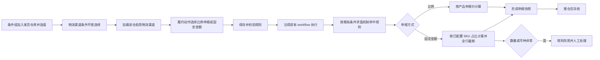

# 履约申报规则精细化产品方案

> 文档状态：待人工评审；需求来源：ERP-185 需求§1至§5、已确认 Q1至Q8及 2026-11-04 PR 纠偏说明。

## 一页结论

本期只扩展系统现有 workflow：条件组新增“物流渠道”，且仅在同组已有选值的“发货仓库”条件时开放渠道选择，AND/OR 不影响该依赖；现有履约动作的“申报比例”扩展为“比例申报/固定金额”二选一。固定金额支持两位小数，并在动作行下配置启用商品 SKU 与 `0.1～100` 的固定申报占比；所有履约行统一截断，不设置末行承差。拆单、换仓后的新履约单重新命中并计算；推仓后申报快照冻结。（来源：需求§1至§4；确认 Q1至Q8；2026-11-04 PR 纠偏说明）

## 阶段1：领域事件与 I/O

| ID | 事件 | 触发/输入 | 输出 | 状态敏感 | 自动化 | 来源 |
|---|---|---|---|---|---|---|
| E01 | 配置物流渠道条件 | 同一条件组内已选值的发货仓库、渠道、AND/OR | 合法 workflow 条件 | 是，仓库条件变化使渠道失效 | 人工配置 | 需求§2；2026-11-04 PR 纠偏说明§1 |
| E02 | 配置申报比例动作 | 方式=比例、比例值 | 合法比例动作 | 否 | 人工配置 | 需求§1、§3；Q4 |
| E03 | 配置固定金额动作 | 方式=固定金额、两位小数金额、启用 SKU 与占比 | 合法固定金额动作 | 是，商品停用会使配置失效 | 人工配置 | 需求§3至§4；Q1、Q2；2026-11-04 PR 纠偏说明§2 |
| E04 | 命中申报规则 | 现有 workflow 对象属性与条件组 | 命中或不命中 | 是 | 系统 | 需求§2；Q5、Q6 |
| E05 | 按比例计算申报值 | 比例、SKU 产品申报价 | 履约行申报单价 | 否 | 系统 | 需求§1；现状代码 |
| E06 | 按固定金额与 SKU 占比计算 | 固定金额、SKU 占比、履约行及数量 | 全部截断后的行申报单价 | 是，SKU 未覆盖、零数量或币种异常失败 | 系统 | 需求§4；Q2、Q8；2026-11-04 对 Q3 的调整 |
| E07 | 拆单或换仓后重算 | 新履约单上下文 | 独立命中与申报快照 | 是，新单状态 | 系统连锁 | Q7 |
| E08 | 推仓冻结申报快照 | 推仓成功 | 不可原地修改的申报快照 | 是，推仓状态 | 系统连锁 | Q7 |
| E09 | 取消并重建履约单 | 已推仓单需修改 | 新履约单重新计算 | 是，取消成功后执行 | 人工+系统补偿 | Q7 |
| E10 | 申报规则执行失败 | 数量权重为0、币种空/多币种、非法配置 | 订单异常并进入人工处理 | 是 | 系统补偿 | Q2、Q8 |

术语：固定金额指单张履约单申报总额；固定申报占比指用户为 SKU 配置的总额分配百分比；行申报单价指固定金额乘 SKU 占比后再除以该 SKU 履约总数量并截断的单价；申报快照指推仓时固化的各履约行申报值与币种。

## 阶段2：影响性与可行性

| 维度 | 结论 |
|---|---|
| 业务/用户 | 用户可按目的国、仓库、渠道精确控制申报，并避免整数比例导致金额偏差 |
| 数据/一致性 | SKU 占比合计必须为 100；所有履约行采用截断法，允许产生截断余量且任何行均不承接尾差 |
| 接口/兼容 | 旧比例配置继续按比例解释；未选择固定金额时不改变原动作语义 |
| 权限/安全 | 沿用 workflow 配置权限；服务端不可只依赖前端校验 |
| 性能/运维 | 计算仅遍历单张履约单行；失败写入既有履约规则异常并支持人工重跑 |
| 可逆性 | 推仓前可重新执行；推仓后只能取消并重建，避免跨系统快照漂移 |
| 技术可行性 | 现有履约行、BCMath、仓库渠道枚举和拆单链可复用；固定金额算法、SKU 配置及渠道条件需新增 |

Go：单个垂直切片可独立交付。晋升 READY 前，技术方案必须确认固定金额、SKU 占比、履约行申报单价与外部仓库接口精度，并证明全行截断规则在存储和序列化后一致。

## 阶段3：业务链路



逆向链路：已推仓履约单不直接回写申报值；先取消原履约单，重建后重新命中规则并生成新快照。（确认 Q7）

## 阶段4：模块与责任边界

| 模块 | 职责 | 不负责 |
|---|---|---|
| workflow 条件配置 | 组合 AND/OR；新增物流渠道条件；校验同组发货仓库前置选择 | 新建另一套三维规则引擎或改变既有执行顺序 |
| 履约申报动作 | 方式互斥、输入校验、比例计算、SKU 占比配置与固定金额计算 | 维护各国免税阈值 |
| 履约生命周期 | 拆单/换仓重算、推仓冻结、取消重建 | 修改仓库已接收的原单快照 |
| 异常与人工处理 | 记录可识别失败原因并允许修正后重跑 | 对零权重执行平均分摊 |

## 阶段5：功能与规则设计

### 5.1 workflow 条件

- 条件组合完全沿用现有 AND/OR；仓库、目的国家、物流渠道均为普通条件。（已确认 Q5）
- 物流渠道条件仅在同一条件组已存在且已选值的“发货仓库”条件时可选数据；此规则与条件组采用 AND 或 OR 无关。（2026-11-04 PR 纠偏说明§1）
- 物流渠道仅显示该仓库绑定且启用的渠道；仓库条件删除、清空或换值时立即清空已选渠道，服务端保存时复核同组依赖及仓库—渠道绑定。
- 修改仓库后清空不属于新仓库的已选渠道；服务端保存时再次校验仓库—渠道绑定。
- 本期不新增“先确定仓库与渠道再评估规则”的执行编排；运行时继续使用现有 workflow 条件求值机制。（2026-11-04 PR 纠偏说明“基于已完成 workflow 开发”）

### 5.2 申报动作

| 字段 | 规则 |
|---|---|
| 申报方式 | 必填，单选“比例申报/固定金额” |
| 申报比例 | 方式为比例时必填；`0.1%～100.0%`；最多1位小数；步长0.1；0非法 |
| 固定金额 | 方式为固定金额时必填；必须大于0；最多两位小数；币种沿用履约行，不单独选择 |
| SKU | 固定金额时展示小卡片左列；支持模糊下拉搜索；数据仅来自产品模块状态为“启用”的商品；不可重复选择 |
| 固定申报占比 | 小卡片右列；每个 SKU 必填 `0.1～100`，0 无效；所有 SKU 占比合计必须为 100 |
| 非当前方式字段 | 隐藏、清空且服务端忽略，避免双值冲突 |

### 5.3 固定金额算法

设固定金额为 `D>0`，SKU `s` 的配置占比为 `p_s`，该 SKU 在本履约单中的总履约数量为 `Q_s`。

1. 保存配置时校验所有 SKU 均启用、无重复、单项占比在 `0.1～100` 且合计为 100。（2026-11-04 PR 纠偏说明§2）
2. 若履约单任一 SKU 未配置、配置 SKU 未出现在履约单、`Q_s≤0`、币种为空或存在多币种，整体失败，不写入部分结果。（确认 Q2、Q8）
3. SKU 分配金额 `A_s=D×p_s/100`；SKU 申报单价 `U_s=truncate(A_s/Q_s, 系统申报单价精度)`。（确认 Q2；2026-11-04 对 Q3 的调整）
4. 同一 SKU 的每条履约行均写入截断后的 `U_s`；所有履约行均采用相同截断规则，不按履约行 ID 排序，不设置末行承差。（2026-11-04 对 Q3 的调整）
5. 记录截断余量 `D-Σ(U_s×Q_s)` 供测试与审计；余量不自动分配给任一 SKU 或履约行。
6. 同一输入重复执行必须得到相同结果。

### 5.4 状态×操作

| 履约状态 | 初次计算/重算 | 修改已计算值 | 推仓 | 处理方式 |
|---|---|---|---|---|
| 待履约/待推仓 | 允许 | 允许通过重跑规则 | 允许 | 生成最新快照 |
| 推送中/已推仓 | 禁止原地重算 | 禁止 | 已执行 | 取消并重建 |
| 已取消 | 禁止 | 禁止 | 禁止 | 新履约单独立命中 |
| 拆单/换仓产生的新单 | 允许 | 推仓前允许 | 允许 | 按新单上下文重新计算 |

### 5.5 配置线框

```text
+----------- workflow 履约申报动作 -----------+
| 条件组：[AND/OR]                              |
| 发货仓库：[选择仓库]                          |
| 物流渠道：[按仓库加载；仓库为空时禁用]        |
| 目的国家：[多选]                              |
| 申报方式：(●比例申报 ○固定金额)              |
| 申报比例：[ 10.5 ] %                          |
| 固定金额：[ 100.00 ]                          |
| +---------------- 固定金额配置 -------------+ |
| | SKU（启用商品模糊搜索） | 固定申报占比    | |
| | [ABC-001             v] | [ 60.0 ] %      | |
| | [ABC-002             v] | [ 40.0 ] %      | |
| |                              [+ 添加 SKU] | |
| +-------------------------------------------+ |
|                         [取消] [保存]          |
+------------------------------------------------+
```

## 阶段6：验收摘要

1. 比例 `0.1`、一位小数中间值、`100.0` 可保存；0、负数、超过100、两位小数被前后端拒绝。（需求§1；Q4）
2. 同一条件组没有已选值的发货仓库条件时，物流渠道不可选；补齐仓库后只展示该仓启用渠道；AND/OR 均遵守此规则。（2026-11-04 PR 纠偏说明§1）
3. 固定金额支持两位小数；小卡片只能模糊搜索启用 SKU；占比单项 `0.1～100`、0 无效且合计为 100。（2026-11-04 PR 纠偏说明§2）
4. 固定金额按 SKU 配置占比计算，所有履约行截断且无末行承差；截断余量不回填。（Q1、Q2；2026-11-04 对 Q3 的调整）
5. SKU 未覆盖、数量非法、空币种、多币种时不产生部分写入，记录异常并进入人工处理。（Q2、Q8）
6. 拆单和换仓新单独立重算；推仓后无法原地改值，只能取消并重建。（Q7）

## 阶段7：切片发现

识别一个垂直切片 `ERP-SLICE-ORD-001`：从 workflow 配置、渠道级联、规则命中、两种申报计算，到异常与推仓冻结共同构成可观察业务结果。拆成“前端配置”“后端计算”会失去独立验收能力，因此不拆水平切片。`blocked_by: []`；仓库接口通过 mock 验证推仓快照，不依赖同版本其他切片。

## 追溯与风险

| 追溯 | 需求/决策 | 事件 | 验收 |
|---|---|---|---|
| T01 | 需求§1；Q4 | E02/E05 | AC-001 |
| T02 | 需求§2；Q5/Q6 | E01/E04 | AC-002/AC-003 |
| T03 | 需求§3至§4；Q1至Q3 | E03/E06 | AC-004/AC-005 |
| T04 | Q7 | E07/E08/E09 | AC-007 |
| T05 | Q2/Q8 | E10 | AC-006 |

主要评审缺口：履约行申报单价与外部仓库接口的最终截断精度需要技术方案证明；在证据完成前切片保持 `DEFINED`，不得晋升 `READY`。

