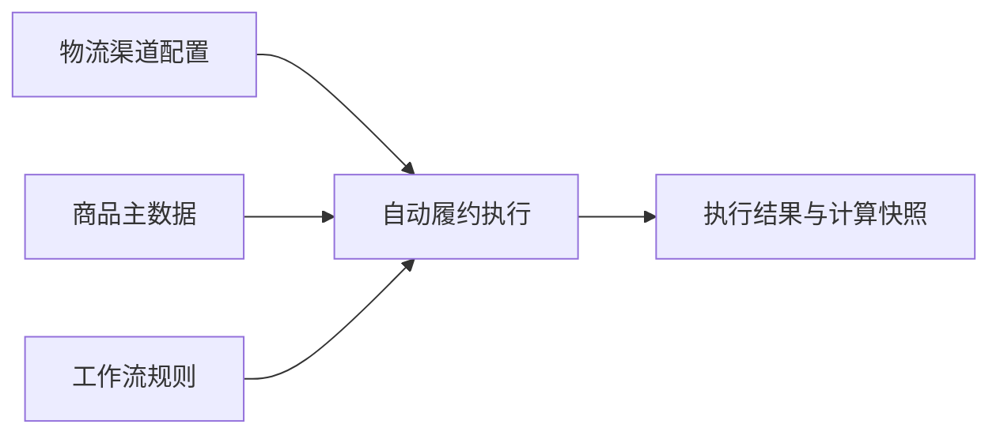

# ERP-189 产品系统设计方案

## 总体概要

**系统以物流渠道配置为权威系数，以商品主数据为重量和尺寸权威源，在自动履约执行时生成不可覆盖的计算快照。** 一个切片覆盖配置、计算、异常和审计，避免出现“规则可配但运行时不可安全执行”的半成品。

## 领域设计

### 平台配置

物流渠道负责体积重系数的生命周期，只校验可空正整数，不参与重量计算。历史数据保持空值，不实施迁移回填。

### 订单与履约

自动履约负责校验、计算、比较、阻断与留痕。主链路为读取当前配置、校验计算前提、计算四位中间值、生成两位计费重量、按大于、大于等于、小于、小于等于、等于、不等于之一比较阈值、记录快照、决定是否执行动作。任何前提错误都进入可处理异常，不得转成“条件未命中”。

### 商品

商品域继续维护 SKU 重量和长宽高，只作为读取方参与本方案。自动履约不修改或补齐商品数据。

## 横切关注点

计算使用十进制定点语义；重试产生新执行快照；并发配置变更以实际读取时点为准；异常必须包含履约单、物流渠道、SKU 和缺失字段。权限复用现有角色，其他工作流属性必须回归验证。

## 实施路径

唯一实现切片为 `ERP-SLICE-ORD-001`，无前置实现切片，可通过测试夹具模拟商品、履约单和渠道数据独立验证。人工评审通过前保持 DEFINED；实现任务应由 Orchestrator 登记为 backlog，人工改为 todo 后 Developer 才执行。

## 源文件索引

- `需求分析.md`
- `领域事件清单.md`
- `影响性与可行性分析.md`
- `业务链路与模块.md`
- `功能设计说明.md`
- `product-plan.md`
- `specs/v0.28.4/slices/ERP-SLICE-ORD-001/contract.md`
