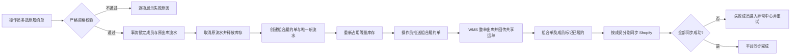

# ERP-190 组合履约产品方案

## 一页结论

本期新增“组合履约单”作为仓库执行聚合根：Shopify 原单、B2C 订单和原履约单身份不变，多张严格同构且未推仓的原履约单人工组合后，取消各自初始化出库流水并释放库存，再创建组合履约单的唯一出库流水并重新占用等量库存。只有组合履约单可以推仓。仓库整单出库后，组合单和全部成员立即记为已履约；各成员再按自己的 Shopify fulfillment order 独立回写共享运单号，失败只影响平台同步状态并幂等重试。（依据：requirement-analysis F-002、F-005 至 F-011）

核心不变量：原订单归属不变；有效组合成员唯一；库存释放量等于重占量；一个组合单只有一个有效出库流水；出库事实不因平台同步失败回滚。

## 1. 术语与对象

| 术语 | 定义 | 数据关系 |
|---|---|---|
| 原履约单 | 继续承载一张 B2C/Shopify 原单的商品、退款与平台归属 | B2C 订单 1:N 原履约单 |
| 组合履约单 | 本期新增的仓库执行聚合根和唯一推仓主体 | 组合履约单 1:N 原履约单 |
| 出库流水 | 库存域执行凭证，不是用户侧推仓主体 | 组合履约单 1:1 有效出库流水 |
| 平台同步状态 | 单个成员向 Shopify 回写的技术结果 | 每成员独立 |

## 2. 领域事件清单

| ID | 类型 | 事件 | 前置 | 输入 | 输出/连锁 | 逆向/补偿 | 来源 |
|---|---|---|---|---|---|---|---|
| E-01 | 人工批量 | 选择原履约单 | 待履约、未推仓 | 履约单号集合 | 资格预校验 | 移除选择 | F-006、F-007 |
| E-02 | 人工单个 | 确认创建组合履约单 | 预校验通过 | 版本、幂等键 | 锁成员和原流水 | 事务回滚 | F-007、F-011 |
| E-03 | 系统连锁 | 取消原初始化出库流水 | E-02 | 原流水集合 | 释放库存、保留审计 | 整体回滚 | F-010、F-011 |
| E-04 | 系统连锁 | 创建组合履约与新出库流水 | E-03 | 规则快照、商品合计 | 重新占用等量库存 | 整体回滚 | F-011 |
| E-05 | 人工单个 | 推送组合履约单 | 组合待推仓 | 组合单号 | WMS 接单/失败 | 幂等重试 | F-011 |
| E-06 | 人工单个 | 挂起/取消挂起 | 未出库 | 组合单号、原因 | WMS 与组合状态更新 | 失败保持原态 | F-003 |
| E-07 | 人工逆向 | 解组/成员取消/退款重建 | 未出库 | 成员、原因 | 取消整张仓库单后重建 | 取消失败则不变 | F-008 |
| E-08 | 人工逆向 | 拆分/更换仓库 | 未推仓或 WMS 取消成功 | 新成员/仓库 | 新组合或恢复原履约 | 事务回滚 | F-003、F-008 |
| E-09 | 外部回调 | 仓库确认出库 | 已接单 | 外部请求号、运单、明细 | 组合与成员已履约 | 重复回调幂等 | F-009 |
| E-10 | 系统连锁 | 分成员回写 Shopify | E-09 | 原 fulfillment order、共享运单 | 成员同步结果 | 失败重试 | F-009 |
| E-11 | 人工/系统补偿 | 重试平台同步 | 同步失败 | 成员号 | 已同步或保留异常 | 幂等重试 | F-009 |
| E-12 | 人工单个 | 更新运单 | 未完成且 WMS 允许 | 新运单 | 组合、成员和 Shopify 更新 | 记录前值并重试 | F-003、F-009 |

自动化决策：E-10、E-11 为系统自动；其余业务入口由用户或外部回调触发。本期明确不实现自动候选与自动组合。

## 3. 业务链路



逆向链路：未推仓直接解组并恢复成员执行凭证；WMS 已接单未出库必须先整单取消成功再重建；已出库禁止解组、拆分或更换仓库，退款继续按原订单行处理。

## 4. 模块与责任边界

| 子域 | 聚合根/对象 | 负责 | 不负责 | 对外接口 |
|---|---|---|---|---|
| B2C 履约域 | 组合履约单 | 资格、成员、状态、推仓入口、平台同步汇总 | 库存账实和 Shopify 原单定义 | 创建、推仓、挂起、解组、详情、重试 |
| 库存域 | 出库流水 | 原流水取消、释放、组合流水、新占用、出库回调 | 用户侧组合状态决策 | 原子替换执行凭证、出库回调 |
| 平台集成 | 成员同步记录 | 按原 fulfillment order 回写共享运单、幂等重试 | 改写物理出库事实 | 成员同步、重试、结果查询 |
| WMS 集成 | 外部仓库单 | 接单、取消、挂起、出库、运单回传 | Shopify 商品归属 | 推送、取消、状态回调 |

## 5. 功能清单

| FP | 功能 | 规则 | 对应事件 |
|---|---|---|---|
| FP-01 | 履约单列表多选组合 | 至少两张；只显示有权限数据 | E-01 |
| FP-02 | 资格预检与预览 | 展示共同属性、成员、SKU/数量、失败原因 | E-01 |
| FP-03 | 原子创建组合 | 锁、取消旧流水、释放、建单、建新流水、重占同事务 | E-02~E-04 |
| FP-04 | 组合履约列表/详情 | 查询成员、原单、旧/新流水、库存、WMS、同步状态 | E-04~E-11 |
| FP-05 | 组合推仓 | 唯一入口、幂等、防重复 | E-05 |
| FP-06 | 挂起与取消挂起 | 组合级执行并记录原因 | E-06 |
| FP-07 | 解组/取消/退款重建 | 按 WMS 阶段选择直接重建或先整单取消 | E-07 |
| FP-08 | 拆分与更换仓库 | 已出库禁止；资格重新计算 | E-08 |
| FP-09 | 出库回调与共享运单 | 重复/乱序回调幂等；明细须与快照一致 | E-09 |
| FP-10 | Shopify 成员同步 | 每成员只提交本原单商品范围 | E-10 |
| FP-11 | 异常中心与重试 | 成功成员不重放，失败成员独立重试 | E-11 |
| FP-12 | 更新运单 | 组合和成员展示一致，外部同步可追踪 | E-12 |
| FP-13 | 操作审计 | 保存规则快照、前后状态、外部请求号、操作者 | 全部 |
| FP-14 | 权限与并发 | 服务端鉴权、乐观版本、成员/流水行锁 | E-01~E-08 |

## 6. 状态设计

组合发运状态：`待推仓 → 推仓中 → 已接单 → 已出库`；旁路状态为`已挂起`、`取消中`、`已取消`、`异常`。平台同步状态独立为`不适用/待同步/同步中/部分失败/已完成`。

| 发运阶段 | 推仓 | 挂起 | 解组/取消 | 拆分/换仓 | 退款 |
|---|---|---|---|---|---|
| 待推仓 | 允许 | 本地挂起 | 允许，恢复成员 | 允许，重算资格 | 重建 |
| 推仓中 | 禁止重复 | 等结果 | 结果未知，先查 WMS | 禁止 | 排队处理 |
| 已接单未出库 | 禁止 | 允许 | 先整单取消成功 | 先整单取消成功 | 先整单取消成功后重建 |
| 已出库 | 禁止 | 禁止 | 禁止改写事实 | 禁止 | 原订单行售后 |
| 已取消 | 禁止 | 禁止 | 幂等成功 | 可重新选择成员 | 原订单处理 |

并发规则：创建组合时按履约单号排序加锁；任何成员状态或规则快照版本变化均整体失败；同一幂等键返回同一组合单；外部结果未知不得盲目重试创建。

## 7. 库存守恒

| 路径 | 原成员占用 | 组合占用 | 净变化 | 结论 |
|---|---:|---:|---:|---|
| 组合成功 | `-Q` | `+Q` | `0` | 守恒 |
| 组合任一步失败 | `0`（事务回滚） | `0` | `0` | 守恒 |
| 待推仓解组 | `+Q` 恢复 | `-Q` | `0` | 守恒 |
| WMS 取消后重建 | 按剩余成员 `+R` | 旧组合 `-Q`，新组合 `+(Q-R)` | `0` | 守恒 |
| 已出库退款 | 不改出库事实 | 不改出库事实 | 售后链路另记 | 发运事实守恒 |

## 8. 页面设计

### 8.1 原履约单列表

```text
+ 筛选：项目 | 店铺 | 仓库 | 状态 | 推仓状态 | 下单时间 | 关键词 +
| [ ] 履约单号 | 原订单号 | 收件人/地址 | 仓库 | 物流 | 出库流水 | 状态 |
| [ ] F001       | O001     | ...         | WH-A | DHL  | OUT001   | 待履约 |
+ 已选 2 张                                      [组合履约] +
```

筛选不少于：项目、店铺、仓库、履约状态、推仓状态、下单时间、履约/订单/出库流水关键词。组合按钮需权限且至少选择两张。

### 8.2 组合预览弹窗

```text
+ 组合履约预览 -----------------------------------------+
| 共同属性：项目/店铺/地址/仓库/库区/物流/币种/贸易条款 |
| 成员：履约单、原订单、原出库流水、SKU、数量           |
| 校验结果：[通过] 或逐成员错误                          |
| 提示：原出库流水将取消，新建唯一组合出库流水           |
|                                  [取消] [确认组合]      |
+-------------------------------------------------------+
```

### 8.3 组合履约列表与详情

列表筛选：组合单号、成员履约/订单号、项目、店铺、仓库、发运状态、同步状态、创建时间；操作含查看、推仓、挂起、取消挂起、取消/解组、重试同步。详情分为基本信息、成员与商品、库存流水、WMS 执行、Shopify 同步、操作日志六个区块。

## 9. 字段与校验

| 字段 | 必填 | 规则 |
|---|---|---|
| 组合单号 | 系统 | 全局唯一、不可编辑 |
| 成员履约单号 | 是 | 至少 2 个，同一时刻只属于一个有效组合 |
| 规则快照 | 是 | 保存资格字段标准化值，后续变化可审计 |
| 发运状态 | 系统 | 与 WMS 状态机映射，禁止人工直接改值 |
| 平台同步汇总状态 | 系统 | 由成员状态聚合，不覆盖发运状态 |
| 有效出库流水号 | 系统 | 一个有效组合恰好一个 |
| 版本号 | 系统 | 乐观并发控制 |

资格失败必须返回字段级原因，不允许只返回“不可组合”。地址比较采用系统统一标准化结果；若现有系统没有可信地址标准化能力，本期退化为收件人、电话、邮编及所有地址字段规范化后完全一致。

## 10. 接口与领域事件（产品契约）

| 接口/事件 | 幂等键 | 结果 |
|---|---|---|
| 组合资格预检 | 请求摘要 | 共同属性、成员明细、错误集合 |
| 创建组合履约单 | 客户端请求 ID | 组合单号或一致的失败结果 |
| 推仓/挂起/取消/更新运单 | 组合单号+操作版本 | 最新状态、外部请求号 |
| WMS 出库回调 | WMS 事件 ID | 幂等确认或明细冲突异常 |
| Shopify 成员同步 | 组合单号+成员号+版本 | 单成员同步结果 |
| `CombinedFulfillmentCreated` | 组合单号 | 成员、规则快照、出库流水 |
| `CombinedFulfillmentShipped` | 组合单号 | 运单、成员、出库时间 |
| `MemberPlatformSyncFailed` | 成员号 | 错误分类、下次重试时间 |

## 11. 权限、审计与通知

| 角色 | 查看 | 创建 | 推仓 | 逆向操作 | 同步重试 |
|---|---|---|---|---|---|
| 履约操作员 | 授权项目 | 允许 | 允许 | 待推仓允许 | 允许 |
| 履约主管 | 授权项目 | 允许 | 允许 | WMS 已接单后的取消需主管权限 | 允许 |
| 客服 | 原订单范围 | 禁止 | 禁止 | 仅发起退款/取消请求 | 禁止 |
| 审计/只读 | 授权项目 | 禁止 | 禁止 | 禁止 | 禁止 |

组合失败、WMS 取消失败、出库明细冲突和 Shopify 重试耗尽进入异常中心；日志必须能从组合单追到成员原单、原/新出库流水和外部请求。

## 12. 验收、风险与回滚

主要风险：重复库存占用、并发成员重复组合、WMS 结果未知、Shopify 部分同步、共享运单引发客户通知混淆。缓解措施分别是单事务守恒、唯一约束与行锁、查询后补偿、成员级幂等状态、前台明确展示“同一包裹”。

发布采用功能开关，默认关闭；先对测试店铺开放。关闭开关后禁止新建组合，但已存在组合继续完成或按规则取消，禁止直接删除关系。数据库变更只做向前兼容；回滚应用版本时必须先确认没有处于推仓中/取消中的组合。

## 13. Trace Ledger

| 来源 | 事件 | 功能 | 页面/对象 | AC |
|---|---|---|---|---|
| F-006、F-007 | E-01~E-04 | FP-01~FP-03 | 原履约列表、预览、组合单 | AC-001~AC-003 |
| F-010、F-011 | E-03~E-04 | FP-03 | 组合单、出库流水 | AC-003、AC-004 |
| F-003、F-008 | E-05~E-08 | FP-05~FP-08 | 组合详情 | AC-005、AC-006 |
| F-009 | E-09~E-11 | FP-09~FP-11 | 同步区、异常中心 | AC-007、AC-008 |
| F-003、F-004 | E-12 | FP-12~FP-14 | 日志、权限 | AC-009、AC-010 |

## 14. 产品自检

- 12 个事件均映射到 14 个功能点，`M ≥ N`：通过。
- 正向、逆向、外部回调、补偿、幂等、乱序与并发均覆盖：通过。
- 状态×操作表、依赖顺序和库存守恒均明确：通过。
- 页面推导为原履约列表、组合预览、组合列表/详情、异常中心；对应交互均已描述：通过。
- Shopify、WMS 为外部依赖，切片测试允许显式 mock：通过。
