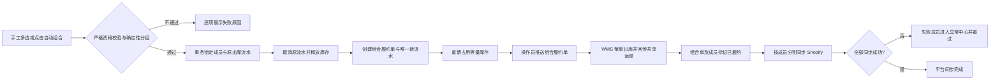

# ERP-190 组合履约产品方案

## 一页结论

本期新增“组合履约单”作为仓库执行聚合根：Shopify 原单、B2C 订单和原履约单身份不变，多张严格同构且未推仓的原履约单可由操作员手工多选组合，也可在列表右上角点击“自动组合”后按当前查询范围自动分组。每个有效分组取消成员初始化出库流水并释放库存，再创建组合履约单的唯一出库流水并重新占用等量库存。只有组合履约单可以推仓。组合单号按项目展示编码、业务类型展示编码、商城 ID、日期和独立日流水生成。原履约单同时具有独立的组合状态与履约状态；组合期间成员履约状态随组合履约单同步，原履约单级变更被拦截，订单编辑和退款仅处理未组合成员。仓库整单出库后，组合单和全部成员立即记为已履约；各成员再按自己的 Shopify fulfillment order 独立回写共享运单号，失败只影响平台同步状态并幂等重试。（依据：requirement-analysis F-002、F-005、F-007 至 F-011、F-014 至 F-016）

核心不变量：原订单归属不变；有效组合成员唯一；库存释放量等于重占量；一个组合单只有一个有效出库流水；出库事实不因平台同步失败回滚。

## 1. 术语与对象

| 术语 | 定义 | 数据关系 |
|---|---|---|
| 原履约单 | 继续承载一张 B2C/Shopify 原单的商品、退款与平台归属 | B2C 订单 1:N 原履约单 |
| 组合履约单 | 本期新增的仓库执行聚合根和唯一推仓主体 | 组合履约单 1:N 原履约单 |
| 出库流水 | 库存域执行凭证，不是用户侧推仓主体 | 组合履约单 1:1 有效出库流水 |
| 平台同步状态 | 单个成员向 Shopify 回写的技术结果 | 每成员独立 |
| 组合状态 | 原履约单是否属于一个有效组合；独立于履约状态 | 已组合/未组合 |

## 2. 领域事件清单

| ID | 类型 | 事件 | 前置 | 输入 | 输出/连锁 | 逆向/补偿 | 来源 |
|---|---|---|---|---|---|---|---|
| E-01 | 人工批量 | 选择原履约单 | 待履约、未推仓 | 履约单号集合 | 资格预校验 | 移除选择 | F-006、F-007 |
| E-02 | 人工单个 | 确认创建组合履约单 | 预校验通过 | 版本、幂等键 | 锁成员和原流水 | 事务回滚 | F-007、F-011 |
| E-03 | 系统连锁 | 取消原初始化出库流水 | E-02 | 原流水集合 | 释放库存、保留审计 | 整体回滚 | F-010、F-011 |
| E-04 | 系统连锁 | 创建组合履约与新出库流水 | E-03 | 规则快照、商品合计 | 重新占用等量库存 | 整体回滚 | F-011 |
| E-05 | 人工单个 | 推送组合履约单 | 组合待推仓 | 组合单号 | WMS 接单/失败 | 幂等重试 | F-011 |
| E-06 | 人工单个 | 挂起/取消挂起 | 未出库 | 组合单号、原因 | WMS 与组合状态更新 | 失败保持原态 | F-003 |
| E-07 | 人工逆向 | 解组/成员取消/退款重建 | 未出库 | 成员、原因 | 取消整张仓库单后重建 | 取消失败则不变 | F-008 |
| E-08 | 人工逆向 | 拆分/更换仓库 | 未推仓或 WMS 取消成功 | 新成员/仓库 | 新组合或恢复原履约 | 事务回滚 | F-003、F-008 |
| E-09 | 外部回调 | 仓库确认出库 | 已接单 | 外部请求号、运单、明细 | 组合与成员已履约 | 重复回调幂等 | F-009 |
| E-10 | 系统连锁 | 分成员回写 Shopify | E-09 | 原 fulfillment order、共享运单 | 成员同步结果 | 失败重试 | F-009 |
| E-11 | 人工/系统补偿 | 重试平台同步 | 同步失败 | 成员号 | 已同步或保留异常 | 幂等重试 | F-009 |
| E-12 | 人工单个 | 更新运单 | 未完成且 WMS 允许 | 新运单 | 组合、成员和 Shopify 更新 | 记录前值并重试 | F-003、F-009 |
| E-13 | 系统连锁 | 同步成员履约状态 | 组合履约单状态变化 | 组合单状态、有效成员 | 全部有效成员映射为相同业务履约状态 | 整体重试并告警 | F-014 |
| E-14 | 人工单个 | 操作已组合原履约单 | 组合状态为已组合 | 履约单号、操作类型 | 拒绝挂起、发起履约、拆分履约、合并履约、更换仓库 | 不产生数据变更 | F-014 |
| E-15 | 人工单个 | 取消含已组合成员的 B2C 订单 | 任一有效成员已组合 | 订单号 | 整单拒绝取消 | 不产生数据变更 | F-014 |
| E-16 | 人工单个 | 编辑 B2C 订单 | 订单含已组合成员 | 订单号 | 编辑数据源排除已组合履约单及其商品范围 | 无可编辑成员时禁用入口 | F-014 |
| E-17 | 人工单个 | 退款 B2C 订单 | 订单含已组合成员 | 订单号 | 退款数据源排除已组合履约单及其商品范围 | 无可退款成员时禁用入口 | F-014 |
| E-18 | 人工单个 | 触发自动组合 | 有自动组合权限 | 当前列表查询条件、客户端请求 ID | 创建候选快照并启动一次批处理 | 同一请求 ID 返回同一批次 | F-015 |
| E-19 | 系统批处理 | 自动划分组合候选 | E-18 | 权限范围、候选快照、F-007 标准化等价键 | 过滤不合格记录；按等价键分组；不足 2 张跳过 | 单组校验失败记录原因，不阻断其他组 | F-007、F-015 |
| E-20 | 系统连锁 | 生成组合单号 | E-02 或 E-19 | 项目展示编码、业务类型展示编码、商城 ID、业务日期 | 返回全局唯一组合单号 | 唯一冲突时取下一流水并重试 | F-015、F-016 |
| E-21 | 系统批处理 | 汇总自动组合结果 | E-19 各组处理结束 | 成功、跳过、失败明细 | 返回批次汇总并写操作日志 | 可按失败组重新触发新批次 | F-015 |

自动化决策：E-10、E-11 为系统自动；E-19 至 E-21 由用户点击“自动组合”后自动执行。系统不按时间或等待窗口主动触发，不改变用户本次查询范围之外的数据。

## 3. 业务链路



逆向链路：未推仓直接解组并恢复成员执行凭证；WMS 已接单未出库必须先整单取消成功再重建；已出库禁止解组、拆分或更换仓库，退款继续按原订单行处理。

## 4. 模块与责任边界

| 子域 | 聚合根/对象 | 负责 | 不负责 | 对外接口 |
|---|---|---|---|---|
| B2C 履约域 | 组合履约单 | 资格、成员、状态、推仓入口、平台同步汇总 | 库存账实和 Shopify 原单定义 | 创建、推仓、挂起、解组、详情、重试 |
| 库存域 | 出库流水 | 原流水取消、释放、组合流水、新占用、出库回调 | 用户侧组合状态决策 | 原子替换执行凭证、出库回调 |
| 平台集成 | 成员同步记录 | 按原 fulfillment order 回写共享运单、幂等重试 | 改写物理出库事实 | 成员同步、重试、结果查询 |
| WMS 集成 | 外部仓库单 | 接单、取消、挂起、出库、运单回传 | Shopify 商品归属 | 推送、取消、状态回调 |

## 5. 功能清单

| FP | 功能 | 规则 | 对应事件 |
|---|---|---|---|
| FP-01 | 履约单列表多选组合 | 至少两张；只显示有权限数据 | E-01 |
| FP-02 | 资格预检与确认 | 只展示组合影响提示；确认后进入加载态；资格不满足时返回不定位具体单据的汇总提示 | E-01 |
| FP-03 | 原子创建组合 | 锁、取消旧流水、释放、建单、建新流水、重占同事务 | E-02~E-04 |
| FP-04 | 组合履约列表/详情 | 查询成员、原单、旧/新流水、库存、WMS、同步状态 | E-04~E-11 |
| FP-05 | 组合推仓 | 唯一入口、幂等、防重复 | E-05 |
| FP-06 | 挂起与取消挂起 | 组合级执行并记录原因 | E-06 |
| FP-07 | 解组/取消/退款重建 | 按 WMS 阶段选择直接重建或先整单取消 | E-07 |
| FP-08 | 拆分与更换仓库 | 已出库禁止；资格重新计算 | E-08 |
| FP-09 | 出库回调与共享运单 | 重复/乱序回调幂等；明细须与快照一致 | E-09 |
| FP-10 | Shopify 成员同步 | 每成员只提交本原单商品范围 | E-10 |
| FP-11 | 异常中心与重试 | 成功成员不重放，失败成员独立重试 | E-11 |
| FP-12 | 更新运单 | 组合和成员展示一致，外部同步可追踪 | E-12 |
| FP-13 | 操作审计 | 保存规则快照、前后状态、外部请求号、操作者 | 全部 |
| FP-14 | 权限与并发 | 服务端鉴权、乐观版本、成员/流水行锁 | E-01~E-08 |
| FP-15 | 原履约单组合状态展示 | 列表在履约状态后一列显示已组合/未组合；详情卡片标题先显示组合状态 | E-04、E-13 |
| FP-16 | 成员履约状态同步 | 组合单每次有效状态迁移必须在同一事务或可靠事件链中同步全部有效成员 | E-13 |
| FP-17 | 已组合成员统一拦截 | 原履约单所有写入口由服务端复核有效组合关系并返回固定提示 | E-14 |
| FP-18 | B2C 订单取消保护 | 任一有效成员已组合即拒绝整张 B2C 订单取消并返回固定提示 | E-15 |
| FP-19 | B2C 编辑/退款过滤 | 查询与提交两阶段均排除已组合成员，禁止通过旧页面或伪造请求绕过 | E-16、E-17 |
| FP-20 | 自动组合批次 | 以当前查询条件和权限生成候选快照，不受分页或勾选限制；按 F-007 等价键分组，组内至少 2 张 | E-18、E-19 |
| FP-21 | 自动组合结果反馈 | 展示候选数、成功组数、成功单数、跳过数、失败组数；失败只给分类汇总并可重试 | E-21 |
| FP-22 | 组合单号生成 | 独立日序列、至少 5 位、超出自然扩位、数据库唯一约束与冲突重试 | E-20 |

## 6. 状态设计

组合发运状态：`待推仓 → 推仓中 → 已接单 → 已出库`；旁路状态为`已挂起`、`取消中`、`已取消`、`异常`。平台同步状态独立为`不适用/待同步/同步中/部分失败/已完成`。

原履约单采用两个正交维度：组合状态仅为`未组合/已组合`，履约状态继续使用`待履约/履约中/已履约/挂起/预售挂起/已取消`。创建有效组合后成员变为已组合；有效组合解除或取消且成员恢复独立执行后变为未组合。组合期间，成员履约状态按组合履约单业务状态同步：待推仓映射待履约，推仓中或已接单映射履约中，已出库映射已履约，已挂起映射挂起，已取消映射已取消。不得以组合状态替代履约状态，也不得新增“组合中”第三枚举。

| 组合状态 | 履约状态 | 原履约单写操作 | B2C 取消 | B2C 编辑/退款 |
|---|---|---|---|---|
| 未组合 | 任一现有状态 | 按现有履约状态规则判定 | 按现有订单规则判定 | 按现有可编辑/可退款规则纳入 |
| 已组合 | 待履约 | 全部拒绝，先取消组合 | 整单拒绝 | 自动排除该成员及其商品 |
| 已组合 | 履约中 | 全部拒绝，先取消组合 | 整单拒绝 | 自动排除该成员及其商品 |
| 已组合 | 已履约 | 全部拒绝，先取消组合 | 整单拒绝 | 自动排除该成员及其商品 |
| 已组合 | 挂起 | 全部拒绝，先取消组合 | 整单拒绝 | 自动排除该成员及其商品 |
| 已组合 | 已取消 | 仅允许从组合履约单执行恢复/解组流程 | 整单拒绝，直至有效组合关系解除 | 自动排除该成员及其商品 |

| 发运阶段 | 推仓 | 挂起 | 解组/取消 | 拆分/换仓 | 退款 |
|---|---|---|---|---|---|
| 待推仓 | 允许 | 本地挂起 | 允许，恢复成员 | 允许，重算资格 | 重建 |
| 推仓中 | 禁止重复 | 等结果 | 结果未知，先查 WMS | 禁止 | 排队处理 |
| 已接单未出库 | 禁止 | 允许 | 先整单取消成功 | 先整单取消成功 | 先整单取消成功后重建 |
| 已出库 | 禁止 | 禁止 | 禁止改写事实 | 禁止 | 原订单行售后 |
| 已取消 | 禁止 | 禁止 | 幂等成功 | 可重新选择成员 | 原订单处理 |

并发规则：创建组合时按履约单号排序加锁；任何成员状态或规则快照版本变化均使该组整体失败；同一幂等键返回同一组合单或自动组合批次；手工组合与自动组合竞争同一成员时，只允许先取得成员锁且通过最终校验的一方成功。自动批次各组独立事务，单组失败不回滚已成功组。外部结果未知不得盲目重试创建。

## 7. 库存守恒

| 路径 | 原成员占用 | 组合占用 | 净变化 | 结论 |
|---|---:|---:|---:|---|
| 组合成功 | `-Q` | `+Q` | `0` | 守恒 |
| 组合任一步失败 | `0`（事务回滚） | `0` | `0` | 守恒 |
| 待推仓解组 | `+Q` 恢复 | `-Q` | `0` | 守恒 |
| WMS 取消后重建 | 按剩余成员 `+R` | 旧组合 `-Q`，新组合 `+(Q-R)` | `0` | 守恒 |
| 已出库退款 | 不改出库事实 | 不改出库事实 | 售后链路另记 | 发运事实守恒 |

## 8. 页面设计

### 8.1 原履约单列表

```text
+--------------------------------------------------------------------------------------+
| 履约单                                                                               |
| 【全部】【待处理】【部分处理】【处理中】【已完成】【已取消】【已挂起】【预售挂起】       | [自动组合] |
| [搜索/筛选] [列设置] [刷新]                                                          |
+--------------------------------------------------------------------------------------+
| （选择 0 张时本行不展示；选择 1 张时显示“已选 1 张 [组合履约·禁用]”）             |
| 已选 X 张（X 大于 1）                                               [组合履约]       |
+--------------------------------------------------------------------------------------+
| [ ] 履约单号 | 原订单号 | 收件人/地址 | 仓库 | 物流 | 出库流水 | 履约状态 | 组合状态 | 操作 |
| [ ] F001      | O001     | 客户/地址   | WH-A | DHL  | OUT001   | 待履约   | 已组合   | [详情] |
+--------------------------------------------------------------------------------------+
| 共 X 条                         [20条/页] [上一页] 1 [下一页]                         |
+--------------------------------------------------------------------------------------+
```

原履约单列表沿用现有筛选条件、默认值、联动和查询能力，本需求不新增、删减或约束筛选项。列表新增“组合状态”列，固定紧随“履约状态”，显示“已组合”或“未组合”。选择操作区位于既有筛选区下一行并按选择数量动态展示：选择 0 张时整行隐藏；选择 1 张时显示“已选 1 张”和禁用的“组合履约”；选择大于 1 张且具备权限时显示计数并启用“组合履约”（F-013、F-014）。列表右上角操作区固定展示“自动组合”；它读取操作员有权访问且符合当前查询条件的全部记录，不受当前页分页或勾选状态限制（F-015）。

### 8.1.1 自动组合确认与结果

点击“自动组合”后先确认本次作用范围；确认提交后按钮禁用并展示批次处理中。服务端以提交时的查询条件和权限创建候选快照，排除已组合及不满足基础状态的记录，再按 F-007 全部限制字段的标准化值构造等价键；每个等价组按履约单号升序处理，成员数至少为 2 时创建一张组合履约单。处理完成后展示候选数、成功组数、成功单数、跳过数和失败组数；跳过包含不合格记录与不足 2 张的等价组，失败按原因分类汇总，不展示其他权限范围的数据。关闭结果弹窗后刷新列表。

### 8.2 组合预览弹窗

```text
+ 组合履约确认 -----------------------------------------------------+
| 确认将已选 X 张原履约单组合为一张组合履约单？                     |
|                                                                   |
| 影响提示：                                                        |
| · 原履约单身份、原订单归属和售后归属保持不变。                    |
| · 原初始化出库流水将取消并释放占用。                              |
| · 系统将创建唯一组合出库流水并重新占用等量库存。                  |
| · 创建成功后仅组合履约单可推送仓库。                              |
|                                                   [取消] [确认组合]|
+-------------------------------------------------------------------+

+ 组合履约处理中 ---------------------------------------------------+
|                         [加载中]                                  |
|                   正在创建组合履约单                              |
|                 请勿关闭页面或重复提交                            |
+-------------------------------------------------------------------+

+ 无法组合 ---------------------------------------------------------+
| 当前所选履约单不满足组合条件，请调整选择后重试。                  |
| 不展示具体履约单号或逐单失败原因。                                |
|                                                        [我知道了] |
+-------------------------------------------------------------------+
```

弹窗不展示共同属性、成员、SKU、数量或逐单校验明细。确认按钮提交后立即禁用并展示加载态；成功后关闭弹窗并进入组合履约单详情，失败时保留原选择并展示统一提示（F-012）。

### 8.3 组合履约列表与详情

#### 8.3.1 组合履约列表

```text
+------------------------------------------------------------------------------------------------------------------------------------------------------------------+
| 组合履约单                                                                                                                                                       |
| 【全部】【待履约】【履约中】【已履约】【已挂起】【已取消】                                                     [搜索/筛选] [列设置] [刷新]                  |
+------------------------------------------------------------------------------------------------------------------------------------------------------------------+
| 已选 X 张                                                                                                      [取消] [挂起] [取消挂起]                           |
+------------------------------------------------------------------------------------------------------------------------------------------------------------------+
| [ ] | 组合履约单号* | 履约单号 | 平台订单ID | 短单号 | 项目 | 店铺 | 国家 | 邮箱 | 仓库 | 物流 | 运单号 | 条款 | SKU | 异常类型 | 挂起原因 | 履约状态 | 出库时间 | 推单时间 | 操作* |
+------------------------------------------------------------------------------------------------------------------------------------------------------------------+
| [ ] | CF0001          | F001 [展开2] | P001 [展开2] | S001 [展开2] | P1 | 店铺A | US | a***@x.com | WH-A | DHL | T001 | DDP | SKU-A [展开3] | - | - | 待履约 | - | - | [详情] |
|     | 展开：F002、F003 / P002、P003 / S002、S003 / SKU-B、SKU-C、SKU-D                                                                                           |
+------------------------------------------------------------------------------------------------------------------------------------------------------------------+
| 共 X 条                                                                                 [20条/页] [上一页] 1 [下一页]                                            |
+------------------------------------------------------------------------------------------------------------------------------------------------------------------+
```

列表规则（F-012）：

| 项目 | 规则 |
|---|---|
| 状态卡片 | 固定为全部、待履约、履约中、已履约、已挂起、已取消；不展示“预售挂起”。 |
| 固定列 | 组合履约单号、操作默认展示且不允许隐藏；操作列固定展示“详情”。 |
| 成员展开 | 履约单号、平台订单ID、短单号默认各展示第一条，其余内容点击“展开N”在当前行下方展开。 |
| SKU 展开 | 默认展示第一个 SKU，其余 SKU 沿用履约单列表交互，在当前行下方展开。 |
| 批量操作 | 勾选后显示已选数量；“取消”“挂起”“取消挂起”均支持一次选择一张或多张执行，按钮文案不使用“批量取消”。前端按所选记录状态控制可用性，服务端必须逐单再次校验权限、版本和状态。 |
| 宽表 | 表格支持横向滚动与列设置；固定列不进入隐藏选项。 |

列表字段完整顺序：组合履约单号、履约单号、平台订单ID、短单号、项目、店铺、国家、邮箱、仓库、物流、运单号、条款、SKU、异常类型、挂起原因、履约状态、出库时间、推单时间、操作（F-012）。

#### 8.3.2 组合履约详情

```text
+--------------------------------------------------------------------------------------------------------------+
| [返回] 组合履约单 > CF0001                                                                                   |
| CF0001  [待履约·履约状态]                                                               [取消] [挂起]       |
+--------------------------------------------------------------------------------------------------------------+
| + 商品履约 -----------------------------------------------------------------------------------------------+ |
| | 仓库：WH-A      物流：DHL      条款：DDP      运单号：T001 [查看轨迹]      出库时间：2026-11-05 10:00    | |
| +----------------------------------------------------------------------------------------------------------+ |
| | 商品                       | 申报价格              | 单价                  | 数量          | 总计          | |
| | SKU-A / 商品A              | 10.00 USD             | 20.00 USD             | 2             | 40.00 USD     | |
| +----------------------------------------------------------------------------------------------------------+ |
|                                                                                                              |
| + 订单信息 ------------------------------------------------------------------------------------------------+ |
| | 订单类型：B2C          平台销售来源：Shopify       店铺：店铺A          主体：主体A                      | |
| | 项目：项目A            渠道：线上                  区域：北美            平台订单：P001 [展开2]           | |
| | 短单号：S001 [展开2]   原履约单：[F001] [F002] [F003]（点击跳转对应原履约单）                             | |
| +----------------------------------------------------------------------------------------------------------+ |
|                                                                                                              |
| + 客户信息 ------------------------------------------------------------------------------------------------+ |
| | 客户名称：张三                       联系方式（邮箱）：a***@x.com                                          | |
| | 收件地址                                                                                                 | |
| | 国家/地区：US  省/州：CA  城市：Los Angeles  邮编：90001  公司：Company A  门牌号：100                    | |
| | 手机号码：***1234  地址1：Street 1  地址2：Suite 2                                                        | |
| +----------------------------------------------------------------------------------------------------------+ |
|                                                                                                              |
| + 操作日志 ------------------------------------------------------------------------------------------------+ |
| | 2026-11-05 10:00 - 用户A（创建组合履约单）                                                               | |
| | 2026-11-05 10:10 - 用户B（挂起组合履约单）                                                               | |
| +----------------------------------------------------------------------------------------------------------+ |
+--------------------------------------------------------------------------------------------------------------+
```

详情固定为四个区块（F-012）：

| 区块 | 字段与交互 |
|---|---|
| 商品履约 | 仓库、物流、条款、运单号、“查看轨迹”、出库时间；商品列表列为商品、申报价格、单价、数量、总计。 |
| 订单信息 | 订单类型、平台销售来源、店铺、主体、项目、渠道、区域、平台订单、短单号、原履约单；原履约单逐项可点击跳转。 |
| 客户信息 | 客户名称、联系方式（邮箱）；收件地址包含国家/地区、省/州、城市、邮编、公司、门牌号、手机号码、地址1、地址2。 |
| 操作日志 | 按时间倒序展示“时间 - 用户名（操作内容）”。 |

#### 8.3.3 页面按钮与来源

| 页面 | 按钮 | 位置 | 显示/可用条件 | 来源 |
|---|---|---|---|---|
| 原履约单列表 | 组合履约 | 筛选区下一行的动态选择工具栏 | 选择 0 张时工具栏与按钮隐藏；选择 1 张时按钮展示但禁用；选择大于 1 张且有创建权限时按钮启用 | E-01、F-013 |
| 原履约单列表 | 自动组合 | 右上角操作区 | 有自动组合权限时固定展示；提交处理中禁用；作用于当前查询条件与权限范围内全部候选，不受分页或勾选影响 | E-18~E-21、F-015 |
| 组合确认弹窗 | 确认组合 | 弹窗底部 | 未提交；提交后禁用并显示加载态 | E-02、F-012 |
| 组合履约列表 | 取消 | 选择工具栏 | 已选一张或多张记录均满足可取消状态且有权限 | E-07、F-013 |
| 组合履约列表 | 挂起 | 选择工具栏 | 已选一张或多张记录均满足可挂起状态且有权限 | E-06、F-013 |
| 组合履约列表 | 取消挂起 | 选择工具栏 | 已选一张或多张记录均处于已挂起状态且有权限 | E-06、F-013 |
| 组合履约列表 | 详情 | 行内固定操作列 | 有查看权限 | E-04、F-012 |
| 组合履约详情 | 查看轨迹 | 商品履约区运单号后 | 存在运单号 | E-09、F-012 |
| 组合履约详情 | 原履约单号 | 订单信息区 | 对对应原履约单有查看权限 | E-04、F-012 |

### 8.4 B2C 订单详情中的原履约单卡片

```text
+ 原履约单 ---------------------------------------------------------+
| 已组合-待履约（X）-F001                                          |
| 仓库：WH-A                         库区：A区                       |
| [挂起] [发起履约] [拆分履约] [合并履约] [更换仓库]                |
+-------------------------------------------------------------------+
```

卡片标题顺序固定为“组合状态-履约状态（数量）-履约单号”。当组合状态为已组合时，用户触发挂起、发起履约、拆分履约、合并履约或更换仓库，前端展示且服务端返回“{履约单号}履约单正在组合中，请取消组合后在编辑履约单！”。B2C 订单取消前只要发现任一已组合成员，整单拒绝并提示“{履约单号}履约单正在组合中，请取消组合后在编辑当前B2C订单。”；存在多个已组合成员时按履约单号排序展示第一张，日志记录全部命中成员。编辑与退款页面不弹拦截提示，而是在接口数据源和提交校验中自动排除已组合成员及其商品；过滤后为空时入口禁用并说明无可操作数据（F-014）。

## 9. 字段与校验

| 字段 | 必填 | 规则 |
|---|---|---|
| 组合单号 | 系统 | 格式为`{项目展示编码}{业务类型展示编码}-{商城ID}-{YYMMDD}{流水号}`，全局唯一、不可编辑；流水号每日按商城使用独立组合序列，1 至 99999 左补零为 5 位，从 100000 起自然扩位且不截断 |
| 成员履约单号 | 是 | 至少 2 个，同一时刻只属于一个有效组合 |
| 规则快照 | 是 | 保存资格字段标准化值，后续变化可审计 |
| 发运状态 | 系统 | 与 WMS 状态机映射，禁止人工直接改值 |
| 平台同步汇总状态 | 系统 | 由成员状态聚合，不覆盖发运状态 |
| 有效出库流水号 | 系统 | 一个有效组合恰好一个 |
| 版本号 | 系统 | 乐观并发控制 |
| 原履约单组合状态 | 系统 | 对外仅已组合/未组合；须与有效成员关系一致，解除有效组合后立即变为未组合 |

资格预检服务必须在后台完成字段级校验并记录可审计错误分类，但本期前端按 F-012 只展示“当前所选履约单不满足组合条件，请调整选择后重试”，不得暴露具体履约单号或逐单失败原因。地址比较采用系统统一标准化结果；若现有系统没有可信地址标准化能力，本期退化为收件人、电话、邮编及所有地址字段规范化后完全一致。

编号服务复用现有 B2C 单号的展示编码和日期口径，但必须使用独立于订单号的计数键；计数维度为商城 ID 与 `YYMMDD`。Redis 原子自增用于取号，组合单号数据库唯一索引作为最终防线；缓存丢失或并发初始化时，以当日同前缀最大有效流水续号，若插入仍发生唯一冲突则取下一号重试。业务日期和计数器过期时间统一使用系统业务时区。

## 10. 接口与领域事件（产品契约）

| 接口/事件 | 幂等键 | 结果 |
|---|---|---|
| 组合资格预检 | 请求摘要 | 共同属性、成员明细、错误集合 |
| 创建组合履约单 | 客户端请求 ID | 组合单号或一致的失败结果 |
| 自动组合 | 客户端请求 ID+查询条件摘要 | 批次号、候选数、成功组数、成功单数、跳过数、失败组数与失败分类 |
| 推仓/挂起/取消/更新运单 | 组合单号+操作版本 | 最新状态、外部请求号 |
| 原履约单列表/详情查询 | 查询条件 | 同时返回组合状态与履约状态；列表列序和卡片标题由前端按契约展示 |
| 原履约单写操作 | 履约单号+操作版本 | 已组合时固定拒绝并返回履约单号和提示文案 |
| B2C 取消/编辑/退款 | 订单号+操作版本 | 取消遇已组合成员整单拒绝；编辑/退款返回并提交未组合成员范围 |
| WMS 出库回调 | WMS 事件 ID | 幂等确认或明细冲突异常 |
| Shopify 成员同步 | 组合单号+成员号+版本 | 单成员同步结果 |
| `CombinedFulfillmentCreated` | 组合单号 | 成员、规则快照、出库流水 |
| `CombinedFulfillmentShipped` | 组合单号 | 运单、成员、出库时间 |
| `MemberPlatformSyncFailed` | 成员号 | 错误分类、下次重试时间 |

## 11. 权限、审计与通知

| 角色 | 查看 | 创建 | 推仓 | 逆向操作 | 同步重试 |
|---|---|---|---|---|---|
| 履约操作员 | 授权项目 | 允许 | 允许 | 待推仓允许 | 允许 |
| 履约主管 | 授权项目 | 允许 | 允许 | WMS 已接单后的取消需主管权限 | 允许 |
| 客服 | 原订单范围 | 禁止 | 禁止 | 仅发起退款/取消请求 | 禁止 |
| 审计/只读 | 授权项目 | 禁止 | 禁止 | 禁止 | 禁止 |

组合失败、WMS 取消失败、出库明细冲突和 Shopify 重试耗尽进入异常中心；日志必须能从组合单追到成员原单、原/新出库流水和外部请求。

## 12. 验收、风险与回滚

主要风险：重复库存占用、并发成员重复组合、WMS 结果未知、Shopify 部分同步、共享运单引发客户通知混淆。缓解措施分别是单事务守恒、唯一约束与行锁、查询后补偿、成员级幂等状态、前台明确展示“同一包裹”。

发布采用功能开关，默认关闭；先对测试店铺开放。关闭开关后禁止新建组合，但已存在组合继续完成或按规则取消，禁止直接删除关系。数据库变更只做向前兼容；回滚应用版本时必须先确认没有处于推仓中/取消中的组合。

## 13. Trace Ledger

| 来源 | 事件 | 功能 | 页面/对象 | AC |
|---|---|---|---|---|
| F-006、F-007 | E-01~E-04 | FP-01~FP-03 | 原履约列表、预览、组合单 | AC-001~AC-003 |
| F-010、F-011 | E-03~E-04 | FP-03 | 组合单、出库流水 | AC-003、AC-004 |
| F-003、F-008 | E-05~E-08 | FP-05~FP-08 | 组合详情 | AC-005、AC-006 |
| F-009 | E-09~E-11 | FP-09~FP-11 | 同步区、异常中心 | AC-007、AC-008 |
| F-003、F-004 | E-12 | FP-12~FP-14 | 日志、权限 | AC-009、AC-010 |
| F-014 | E-13~E-17 | FP-15~FP-19 | 原履约列表、详情、订单操作 | AC-011~AC-013 |
| F-015、F-016 | E-18~E-21 | FP-20~FP-22 | 原履约列表、自动组合批次、组合单号 | AC-014~AC-016 |
| F-014 | E-13~E-17 | FP-15~FP-19 | 原履约列表、B2C 详情、取消、编辑、退款 | AC-011~AC-013 |

## 14. 产品自检

- 17 个事件均映射到 19 个功能点，`M ≥ N`：通过。
- 正向、逆向、外部回调、补偿、幂等、乱序与并发均覆盖：通过。
- 状态×操作表、依赖顺序和库存守恒均明确：通过。
- 页面推导为原履约列表、组合确认及反馈、组合列表、组合详情、异常中心；对应交互均已描述：通过。
- F-012 指定的六个状态卡片、十九个列表字段、四个详情区块和选择工具栏位置均已逐项落图：通过。
- F-014 指定的双维状态、列表列序、详情卡片标题、五类原履约操作拦截、订单取消拦截及编辑/退款过滤均已进入状态矩阵和 AC：通过。
- Shopify、WMS 为外部依赖，切片测试允许显式 mock：通过。
