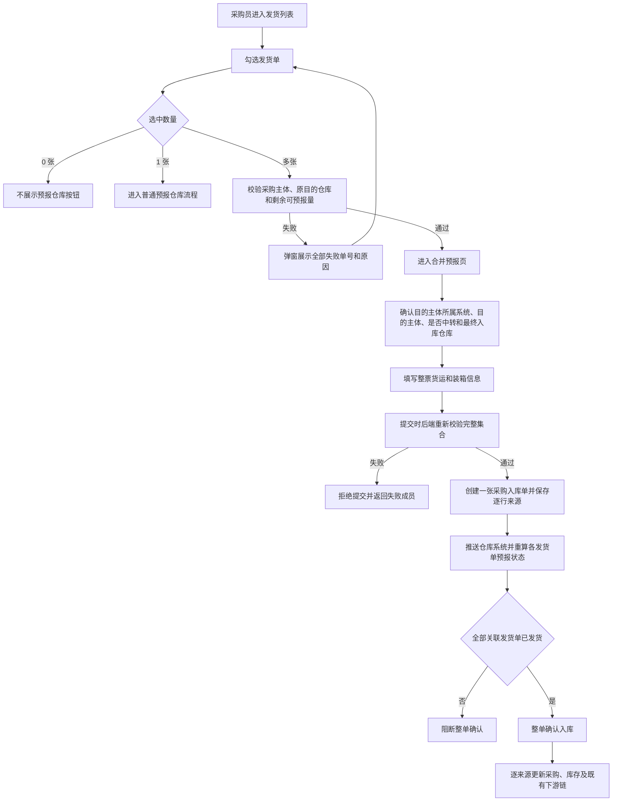

# ERP-192 多个采购发货单合并预报仓库 PRD

> 任务号：0192  
> Multica ERP 编号：ERP-192  
> Slice ID：ERP-SLICE-PUR-001  
> 文档状态：待人工评审  
> 需求基线：RQ-BG、RQ-1 至 RQ-6、RQ-C1 至 RQ-C6

## 一页结论

本需求在“发货”列表提供统一的“预报仓库”入口：选中一张发货单时沿用普通预报，选中多张时进入合并预报。多张发货单仅需采购主体与原目的仓库（或收货仓库）一致，供应商可以不同；预报成功后只生成一张采购入库单，但商品、供应商、价格、币种、核算维度及采购来源继续按发货明细 1:1 保留。[RQ-1][RQ-C2][RQ-C3][RQ-C5]

合并预报页不锁定最终入库仓库，用户仍可按普通预报规则修改目的主体所属系统、目的主体、是否中转及最终入库仓库。运费以本次合并预报填写的整票货运信息为准，不汇总来源发货单运费。[RQ-C1][RQ-C3][RQ-C4]

## 1. 本次需求新增功能清单

下表是本次交付范围的权威功能清单，开发与测试均按“触发条件—系统行为—结果”验收。

| 功能点 | 所在界面/节点 | 触发条件 | 功能与规则描述 |
|---|---|---|---|
| 发货单多选 | 发货模块／发货列表 | 用户勾选列表行 | 支持跨分页保留选择；任一筛选条件变化后立即清空全部已选项。[RQ-C1][RQ-C5] |
| 统一预报入口 | 发货模块／更多筛选条件下一行 | 至少选中一张发货单 | 无选中时不展示“预报仓库”；选中一张走普通预报；选中多张走合并预报。[RQ-C5][RQ-C6] |
| 合并资格校验 | 点击“预报仓库”及提交合并预报时 | 选中两张及以上发货单 | 前端进入前校验，提交时后端重新校验：采购主体一致、原目的仓库（或收货仓库）一致、单据有剩余可预报量、无重复或失效成员。[RQ-C1][RQ-C3][RQ-C4] |
| 校验失败反馈 | 发货列表／校验失败弹窗 | 任一选中单据不符合合并条件 | 展示全部失败发货单号及失败原因；明细区达到最大高度后支持上下滚动，标题、提示和关闭按钮固定；不展示“处理规则”。[RQ-C6] |
| 合并预报数据加载 | 合并预报页 | 多选资格校验通过 | 加载所有来源发货单的剩余可预报商品，商品行保持来源 1:1，不因 SKU 相同而合并。[RQ-C1][RQ-C2] |
| 普通预报字段复用 | 合并预报页／基本信息 | 进入合并预报页 | 支持修改目的主体所属系统、目的主体、是否中转、最终入库仓库；字段校验和后续链路与普通预报一致。[RQ-C3][RQ-C4] |
| 整票货运信息 | 合并预报页／货运信息 | 用户填写并提交 | 运费及其他货运信息以本次填写的整票数据为准，不对来源发货单头运费求和。[RQ-C1] |
| 预报页来源供应商 | 合并预报页／产品明细 | 商品行加载完成 | 在每条 SKU 下一行展示“供应商：名称”，值取该商品行来源供应商。[RQ-C3] |
| 创建一张采购入库单 | 合并预报提交节点 | 后端完整校验通过 | 一次提交只生成一张采购入库单；逐行保存来源发货明细、采购明细和供应商关系；任一步失败整体回滚。[RQ-1][RQ-3][RQ-5] |
| 发货单状态重算 | 合并预报创建或取消后 | 来源发货单的已预报数量发生变化 | 按每张发货单独立重算待预报、部分预报或已预报状态。[RQ-2] |
| 全部供应商展示 | 采购入库单详情／基本信息 | 入库单包含一个或多个供应商 | 展示去重后的全部供应商；空间不足时以“...”省略，鼠标悬浮展示完整名单。[RQ-C2][RQ-C3] |
| 入库明细来源供应商 | 采购入库单详情／产品明细／入库明细 | 入库单包含多来源商品 | 在每条 SKU 下一行展示“供应商：名称”，值取该商品行来源供应商。[RQ-C2][RQ-C3] |
| 合并入库确认 | 采购入库确认节点 | 所有关联发货单均已发货 | 整单确认；逐来源更新采购、库存、付款及既有内采/调拨链。任一发货单未发货则整单阻断并列出单号。[RQ-5][RQ-C1] |
| 合并入库取消 | 采购入库取消节点 | 入库单仍可逆且全部成员未进入不可逆阶段 | 采用“全取消或全禁止”：逐来源回退数量并重算发货单状态；任一成员已确认入库时禁止取消，不支持移除单个成员。[RQ-5] |

关键结论：列表入口以选择数量分流；合并资格与最终入库仓是两个独立口径；数据聚合只发生在可加总指标，来源属性始终逐行保留。

## 2. 背景与问题

不同供应商或仓库的采购业务仍需分别形成采购单和发货单，但工厂在实际履约时可能将多张发货单合并发货、合并入库。现状按单张发货单预报，会产生重复填写货运信息、多个入库单与实际一票货物不一致的问题。[RQ-BG]

本次需要让采购员对供应商不同、但采购主体和原目的仓库一致的多张采购发货单一次预报，只生成一张采购入库单。同时，系统不能因为单据聚合而丢失商品的采购来源、供应商、价格、币种、核算维度及后续库存和财务处理依据。[RQ-1][RQ-3][RQ-6]

本期不修改采购单拆分或发货单创建规则，不允许跨原目的仓库合并，不支持已确认入库后的拆单，也不重做普通预报的跨系统、中转和库存链路。[RQ-BG][RQ-1][RQ-5][RQ-C3]

## 3. 当前需求对应用户系统操作流程图



主流程的系统边界是：前端负责选择、分流、填写与反馈；后端负责提交时的完整集合校验、幂等、事务和来源关系；仓库及既有下游系统继续消费一张入库单，但明细输入是全部来源数据。[RQ-C3]

## 4. 新增交互及规则

### 4.1 列表选择与入口

1. 发货列表允许多选，选择可以跨分页保留。
2. 任一筛选条件发生变化时，立即清空选择，避免旧集合与当前查询口径混用。
3. “已选 X 单”和“预报仓库”位于更多筛选条件的下一行，与系统现有批量操作布局一致。
4. 无选中时整行选择操作栏不展示；选中一张时进入普通预报；选中多张时进入合并预报。

### 4.2 资格校验

1. 多选集合的采购主体必须一致。
2. 多选集合比较发货单原数据中的目的仓库（或收货仓库），该值必须一致。
3. 待预报和部分预报且有剩余数量的发货单可参与；已无剩余可预报量的单据不可参与。
4. 提交时后端必须重新校验完整集合，前端校验不作为最终依据。
5. 校验失败时展示全部失败成员；失败明细区域支持上下滚动，不展示“处理规则”。

### 4.3 合并预报页

1. 目的主体所属系统、目的主体、是否中转及其组合校验与普通预报一致。
2. 最终入库仓库不锁定，允许用户修改；最终入库单、WMS 入库仓和库存归属以本次提交值为准。
3. 产品明细不跨来源合并，同一 SKU 也保持逐发货明细展示，并在 SKU 下展示来源供应商。
4. 货运和装箱信息按一票填写，运费取本次整票值。

### 4.4 入库详情、确认与取消

1. 基本信息展示去重后的全部供应商，溢出省略并支持悬浮查看完整值。
2. 入库明细逐行展示来源供应商。
3. 全部关联发货单已发货后才可确认；任一未发货则整单阻断。
4. 取消采用全取消或全禁止，不支持从聚合入库单删除单个来源发货单。

## 4.1 交互原型

### 原型一：发货列表选择态

```text
┌───────┬─────────────────────────────────────┐
│ DTC+  │[收起]                               │
│  …    ├─────────────────────────────────────┤
│ 发货＞│发货                     [创建发货单]│
│  …    │┌───────────────────────────────────┐│
│       ││[发货单/SKU][取消][保存][列][刷新] ││
│       ││[+状态][+采购主体][+收货仓库][更多…]││
│       │├───────────────────────────────────┤│
│       ││已选X单                 [预报仓库] ││
│       │├───────────────────────────────────┤│
│       ││[□][字段A][字段B][字段C][操作]     ││
│       │├───────────────────────────────────┤│
│       ││[□][内容A][内容B][内容C][…]        ││
│       ││              ……                   ││
│       │├───────────────────────────────────┤│
│       ││共X条 [20条/页] [＜] 1… [＞]       ││
│       │└───────────────────────────────────┘│
└───────┴─────────────────────────────────────┘
```

### 原型二：合并预报资格校验失败

```text
┌─────────────────────────────────────────────┐
│ 合并预报校验失败                         [×]│
├─────────────────────────────────────────────┤
│ 以下选中单据不符合合并预报条件，请调整后重试│
│                                             │
│ 发货单号       失败原因                  ▲ │
│ SHP-001        与其他单据的采购主体不一致│ │
│ SHP-002        与其他单据的原收货仓库不一致│
│ SHP-003        无剩余可预报数量          █ │
│ ……                                      ▒ │
│ SHP-0XX        失败原因                  ▼ │
├─────────────────────────────────────────────┤
│                                      [关闭] │
└─────────────────────────────────────────────┘
```

失败明细区固定最大高度，支持鼠标滚轮、触控板和拖动滚动条上下浏览；标题、说明和关闭按钮固定。

## 5. 新增字段及规则

**结论：未确认新增数据库业务字段。** 现有入库明细来源关系继续作为多发货事实源，禁止新增逗号拼接发货单号字段；是否增加组合索引由技术方案根据查询执行计划决定。[RQ-3][RQ-C2]

本次新增或扩展的是页面与接口逻辑字段，以下名称为产品语义，最终技术命名以接口设计为准。

| 逻辑字段 | 所在对象 | 类型/形态 | 必填规则 | 取值与校验规则 |
|---|---|---|---|---|
| 选中发货单集合 | 合并预报请求 | 发货单号数组 | 多选时必填，至少 2 个 | 去重；提交时逐单校验采购主体、原目的仓库、状态和剩余量。 |
| 来源发货明细 | 合并预报商品行 | 明细标识 | 必填 | 每条入库明细有且仅有一个来源发货明细，禁止跨来源合并。 |
| 目的主体所属系统 | 合并预报表单 | 复用普通预报字段 | 按普通预报组合规则 | 可编辑；后端重复校验组合合法性。 |
| 目的主体 | 合并预报表单 | 复用普通预报字段 | 按普通预报组合规则 | 可编辑；与所属系统、是否中转联动。 |
| 是否中转 | 合并预报表单 | 布尔/枚举 | 按普通预报组合规则 | 可编辑；下游按普通预报既有流程执行。 |
| 最终入库仓库 | 合并预报表单 | 仓库标识 | 按普通预报规则 | 不锁定；可以不同于来源单原目的仓库，库存归属以本次值为准。 |
| 来源供应商 | 预报页及入库详情商品行 | 名称展示 | 只读 | 取该行来源采购/发货关系中的供应商。 |
| 全部供应商 | 入库详情基本信息 | 去重名称集合 | 只读 | 按来源供应商去重展示；溢出省略，悬浮展示完整集合。 |
| 整票运费 | 合并预报货运信息 | 金额 | 按普通预报规则 | 取本次用户填写值，不汇总来源单运费。 |

## 6. 数据计算逻辑

### 6.1 剩余可预报量

`剩余可预报量 = 发货数量 - 已预报入库数量`

仅当结果大于 0 时，该发货明细可参与预报；并发提交时必须在事务内重新计算，禁止使用页面打开时的旧值。[RQ-C1]

### 6.2 发货单预报状态

按每张发货单的全部明细计算：已预报数量为 0 时是“待预报”；大于 0 且小于发货数量时是“部分预报”；全部明细均达到发货数量时是“已预报”。创建和取消必须调用同一口径重算。[RQ-2]

### 6.3 合并来源数据

数量、重量、体积等可加总指标按全部来源逐行求和；价格、币种、核算维度、供应商、采购明细和发货明细不求和、不覆盖，按来源逐行保留。[RQ-C2][RQ-C3]

### 6.4 供应商集合

基本信息供应商集合由全部来源商品行的供应商去重得到；商品行供应商不去重到单头，仍取当前行来源供应商。[RQ-C2]

### 6.5 运费

运费等于本次合并预报填写的整票运费，不等于来源发货单运费之和。[RQ-C1]

## 6.1 具体数据例子

假设用户选择两张采购主体均为“主体 A”、原收货仓库均为“仓库 X”的发货单：

| 发货单 | 供应商 | SKU | 发货数量 | 已预报数量 | 剩余量 | 采购价/币种 |
|---|---|---|---:|---:|---:|---|
| SHP-001 | 供应商甲 | SKU-100 | 10 | 3 | 7 | 100 CNY |
| SHP-002 | 供应商乙 | SKU-100 | 8 | 0 | 8 | 12 USD |

用户进入合并预报页后将最终入库仓库改为“仓库 Y”，填写整票运费 300 CNY 并提交：

1. 本次可预报数量为 `7 + 8 = 15`，但系统仍生成两条来源明细，不能把相同 SKU 合并成一条。
2. 第一行保留供应商甲、100 CNY 和 SHP-001 来源；第二行保留供应商乙、12 USD 和 SHP-002 来源。
3. 入库详情基本信息展示“供应商甲、供应商乙”，两条商品行分别展示各自供应商。
4. 入库单、WMS 入库仓和库存归属使用“仓库 Y”；资格校验仍基于两张来源单共同的原收货仓库“仓库 X”。
5. 入库单运费为 300 CNY，不读取或合计 SHP-001、SHP-002 原有运费。

## 7. 边界异常

| 场景 | 系统处理 | 用户反馈/恢复方式 |
|---|---|---|
| 未选中发货单 | 不展示选择操作栏和“预报仓库”按钮 | 用户先勾选单据。 |
| 仅选中一张 | 不进入合并校验，复用普通预报 | 页面与既有普通预报一致。 |
| 采购主体不一致 | 拒绝进入或提交合并预报 | 弹窗列出失败发货单及原因。 |
| 原目的仓库（或收货仓库）不一致 | 拒绝进入或提交合并预报 | 弹窗列出失败发货单及原因。 |
| 最终入库仓与来源原目的仓不同 | 允许，按普通预报规则校验 | 明确以本次填写仓库生成入库及库存归属。 |
| 部分预报单仍有剩余量 | 允许，仅加载剩余数量 | 提交时后端重新计算剩余量。 |
| 已无剩余可预报量 | 拒绝该成员参与 | 展示“无剩余可预报数量”。 |
| 任一筛选条件变化 | 清空全部跨页选择 | 选择计数归零，用户重新勾选。 |
| 两个合并请求包含同一发货单 | 集合按固定顺序加锁，后到请求失败 | 返回发生冲突的发货单，避免重复增加已预报量。 |
| 提交前来源数据被修改 | 后端校验失败，不创建入库单 | 返回实际失败成员和原因。 |
| WMS 创建失败、超时或结果未知 | 不允许留下部分业务数据；按幂等键查询或整体回滚 | 用户可在结果明确后重试，重复成功响应不得重复建单。 |
| 同 SKU 的价格、币种或供应商不同 | 保持来源 1:1，不合并 | 页面逐行展示来源供应商和原始属性。 |
| 任一关联发货单未发货 | 阻断整单确认 | 列出未发货单号，全部发货后重试。 |
| 待入库单取消 | 逐来源回退数量，逐发货单重算状态 | 整单取消成功后可重新预报。 |
| 任一成员已确认入库 | 禁止取消聚合入库单 | 不支持删除单个来源成员。 |
| 供应商名称过多 | 基本信息以“...”省略 | 鼠标悬浮展示完整供应商集合。 |
| 校验失败单据过多 | 仅失败明细区上下滚动 | 标题、提示和关闭按钮保持可见。 |
| 历史单发货入库单 | 继续兼容单一来源读取 | 不要求离线回填为多关联。 |

## 追溯与交付

- 需求事实源：`requirement-analysis.md` 的 RQ-BG、RQ-1 至 RQ-6、RQ-C1 至 RQ-C6。
- 业务决策源：`decision-log.md`。
- 产品方案源：`product-plan.md`。
- 实现契约：`ERP-SLICE-PUR-001/contract.md`，当前状态为 `DEFINED`，等待人工评审。
- 实现切片需默认进入待规划 backlog；人工改为 todo 后 Developer 才会执行。
