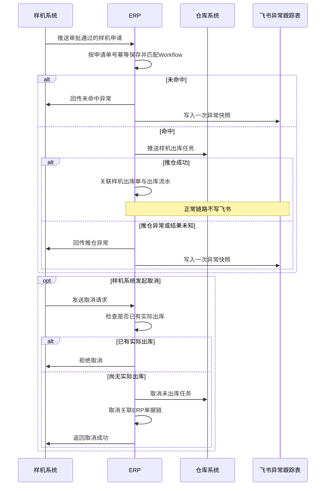

# ERP-210 样机申请自动建单推仓与异常闭环 PRD

## 1. 业务背景

当前样机出库需要业务人员从样机系统导出已确认申请，按 ERP 导入模板补全数据后导入 ERP，再人工生成样机出库单并处理推仓。随着单据量增加，重复导出、补录和导入成为效率瓶颈。[来源：ERP-210 业务背景]

本期由 ERP 接收样机系统已审批申请，自动匹配样机出库 Workflow 并推仓，同时处理取消校验。ERP 保存所有推送申请；只有形成可识别异常的申请才写入飞书异常跟踪表，正常单据不写飞书，异常记录写入后不持续更新。[来源：ERP-210 第 1-5 条；确认 D1、D3、D4]

本 PRD 仅定义 ERP 系统功能。样机系统和仓库系统仅作为外部输入或输出对象，不展开内部实现。[来源：ERP-210 范围限定]

## 2. 系统使用时序图



飞书写入均为异常形成时的一次性快照，不因后续处理或状态变化持续更新。[来源：确认 D4]

## 3. 功能清单

| ID | 功能 | 业务结果 | 来源 |
|---|---|---|---|
| F-01 | 样机出库 Workflow 配置 | 独立配置样机触发器、条件和推仓动作 | ERP-210 第 1 条 |
| F-02 | 样机申请接收与记录 | 记录全部推送申请，重复推送不重复建单 | ERP-210 第 2、5 条 |
| F-03 | 自动匹配与推仓 | 命中后自动推仓，异常时终止自动办理 | ERP-210 第 2 条 |
| F-04 | 异常回传与飞书快照 | 可识别异常回传并写入一次异常记录 | ERP-210 第 2、4 条；确认 D1、D3、D4 |
| F-05 | 取消校验与单据联动 | 无实际出库时允许取消，有实际出库时拒绝 | ERP-210 第 3 条 |

### 3.1 样机出库 Workflow 配置

#### 3.1.1 功能描述

ERP Workflow 新增“样机出库”触发器、样机申请条件和“样机出库推仓”动作。触发器、条件和动作沿用现有分步配置结构，样机申请与订单 Workflow 的条件值域相互隔离。[来源：ERP-210 第 1 条；ERP-208 PRD 3.1]

#### 3.1.2 新增交互及规则

- 触发器、条件和动作分开展示。[来源：ERP-208 PRD 3.1]
- 项目仅可选择当前账号 TAP 数据权限范围。[来源：ERP-208 PRD 3.1]
- 条件支持渠道、样机物流渠道、设备状态、活动、计划和 SKU。[来源：ERP-208 PRD 3.1]
- 选择仓库后，库区和 ERP 物流渠道仅展示该仓库下有效选项；切换仓库时清空原选择。[来源：ERP-208 PRD 3.1]
- Workflow 命中后默认推仓。[来源：ERP-210 第 2 条]

#### 3.1.2.1 文字线稿图

```text
+ 触发器配置：样机出库 ---------------------------------+
| Workflow名称* [____________________________________]  |
| 项目*          [请选择授权项目 v]                     |
| 触发器*        [样机出库 v]                           |
|                                      [取消] [应用配置]|
+--------------------------------------------------------+

+ 编辑配置：条件 ---------------------------------------+
| 条件字段 [渠道/样机物流渠道/设备状态/活动/计划/SKU v] |
| 操作符   [请选择 v]    条件值 [____________________]  |
| [ + 添加条件 ]                       [取消] [应用配置]|
+--------------------------------------------------------+

+ 动作配置：样机出库推仓 -------------------------------+
| 仓库* [请选择 v]  库区* [所选仓库下库区 v]           |
| ERP物流渠道* [所选仓库下渠道 v]                       |
| 主体* [请选择 v] ERP渠道* [请选择 v] ERP区域* [请选择]|
|                                          [取消] [保存]|
+--------------------------------------------------------+
```

#### 3.1.3 新增字段及规则

| 对象 | 字段 | 必填 | 规则 | 来源 |
|---|---|---|---|---|
| 触发器 | Workflow 名称、项目、触发器 | 是 | 项目受 TAP 权限；新增“样机出库” | ERP-210 第 1 条；ERP-208 PRD 3.1 |
| 条件 | 条件字段、操作符、条件值 | 是 | 字段限渠道、样机物流渠道、设备状态、活动、计划、SKU | ERP-208 PRD 3.1 |
| 动作 | 仓库、库区、ERP 物流渠道、主体、ERP 渠道、ERP 区域 | 是 | 库区和物流渠道受仓库过滤 | ERP-208 PRD 3.1 |

### 3.2 样机申请接收与记录

#### 3.2.1 功能描述

ERP 接收已审批申请并按样机申请单号保存。ERP 记录全部推送申请；相同申请重复推送不得重复生成样机出库单或重复推仓。[来源：ERP-210 第 2、5 条]

#### 3.2.2 新增交互及规则

无。该功能为自动处理，不新增 ERP 人工页面。[来源：ERP-210 第 2、5 条]

#### 3.2.2.1 文字线稿图

无。

#### 3.2.3 新增字段及规则

| 字段 | 规则 | 来源 |
|---|---|---|
| 样机申请单号 | 外部业务唯一键，用于幂等和关联 ERP 单据链 | ERP-210 第 5 条 |
| 接收状态 | 记录已接收；不设计“接收失败且可识别”业务状态 | ERP-210 第 5 条；需求调整 2026-11-25 |
| 当前办理环节 | 接收、匹配、推仓、完成或异常 | ERP-210 第 2、5 条 |
| 关联样机出库单号、出库流水号 | 形成单据后记录，用于取消校验 | ERP-210 第 2、3 条 |

### 3.3 自动匹配与推仓

#### 3.3.1 功能描述

ERP 接收成功后匹配已启用的样机出库 Workflow。命中时按动作配置推仓；未命中、推仓失败或结果未知时终止本次自动办理并形成可识别异常。[来源：ERP-210 第 2 条；确认 D3]

#### 3.3.2 新增交互及规则

无。匹配和推仓由 ERP 自动执行。[来源：ERP-210 第 2 条]

#### 3.3.2.1 文字线稿图

无。

#### 3.3.3 新增字段及规则

| 字段 | 规则 | 来源 |
|---|---|---|
| 命中 Workflow | 记录实际命中项，未命中时为空 | ERP-210 第 2 条 |
| 推仓结果 | 成功、失败、结果未知 | ERP-210 第 2 条 |
| 异常环节、异常原因 | 记录未命中、推仓失败或结果未知及可理解原因 | ERP-210 第 2 条；需求调整 2026-11-25 |

### 3.4 异常回传与飞书快照

#### 3.4.1 功能描述

ERP 接收申请后，Workflow 未命中、推仓失败或推仓结果未知时，将异常回传样机系统并在飞书异常跟踪表新增一条快照。系统联调保证不存在“推送后 ERP 接收失败且可识别”的业务分支，因此不设计对应回传和飞书写入。正常申请不写飞书；异常记录写入后不持续更新。[来源：ERP-210 第 2、4 条；确认 D1、D4；需求调整 2026-11-25]

#### 3.4.2 新增交互及规则

- 飞书仅承接 ERP 自动写入，不提供重试或修改 ERP 单据入口。[来源：ERP-210 第 4 条]
- 同一次异常重复通知不得重复新增。[来源：确认 D3、D4]
- 正常接收、命中、推仓成功和出库完成均不写飞书。[来源：确认 D1、D3、D4]
- 异常快照形成后保持不变，最新更新时间记录首次成功写入时间。[来源：确认 D4]

#### 3.4.2.1 文字线稿图

```text
+ 样机出库异常跟踪表 --------------------------------------+
| 样机申请单号 | 当前异常          | 最新更新时间       |
+----------------------------------------------------------+
| SA-001       | Workflow未命中    | 2026-11-25 10:30   |
| SA-002       | 推仓失败：仓库停用 | 2026-11-25 10:42   |
+----------------------------------------------------------+
```

#### 3.4.3 新增字段及规则

| 字段 | 必填 | 规则 | 来源 |
|---|---|---|---|
| 样机申请单号 | 是 | 标识异常所属申请 | ERP-210 第 4 条 |
| 当前异常 | 是 | 展示异常环节与业务可理解原因 | ERP-210 第 4 条 |
| 最新更新时间 | 是 | 异常快照首次写入时间，后续不持续更新 | ERP-210 第 4 条；确认 D4 |

### 3.5 取消校验与单据联动

#### 3.5.1 功能描述

ERP 收到取消请求后检查关联样机出库单和出库流水。全部商品均未实际出库时允许取消并取消关联单据链；任一商品已有实际出库时拒绝取消并返回原因。[来源：ERP-210 第 3 条]

#### 3.5.2 新增交互及规则

无。取消由样机系统发起，ERP 不新增人工取消入口。[来源：ERP-210 第 3 条；范围限定]

#### 3.5.2.1 文字线稿图

无。

#### 3.5.3 新增字段及规则

无。取消使用申请单号、关联单据号和实际出库数量判断。[来源：ERP-210 第 3 条]

## 4. 边界异常

| 场景 | ERP 处理 | 飞书处理 | 返回样机系统 | 来源 |
|---|---|---|---|---|
| Workflow 未命中 | 终止自动办理 | 新增一次快照 | 未命中原因 | ERP-210 第 2 条；确认 D3、D4 |
| 推仓失败或结果未知 | 不按成功继续办理 | 新增一次快照 | 推仓异常 | ERP-210 第 2 条；确认 D3、D4 |
| 正常办理成功 | 继续 ERP 与仓库链路 | 不写飞书 | 正常结果 | 确认 D1、D3、D4 |
| 同一异常重复通知 | 返回原异常结果 | 不重复新增 | 原异常结果 | ERP-210 第 5 条；确认 D4 |
| 异常后重新推送 | 按幂等和业务状态处理新一轮 | 原快照不更新；新异常新增快照 | 本轮结果 | 确认 D4 |
| 取消时已有实际出库 | 拒绝取消并保留单据链 | 不写飞书 | 不允许取消及原因 | ERP-210 第 3 条；确认 D1 |
| 取消时无实际出库 | 取消任务和关联单据链 | 不写飞书 | 取消成功 | ERP-210 第 3 条；确认 D1 |

“样机系统推送后 ERP 接收失败且可识别”不属于本期业务边界，不产生样机系统异常回传或飞书异常记录。[来源：需求调整 2026-11-25]

