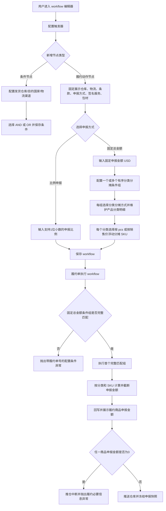

# 履约申报规则精细化 PRD

> 版本：v0.28.6  
> 任务映射：0185 ↔ ERP-185 ↔ ERP-SLICE-ORD-001  
> 文档状态：待人工评审（Definition revision 7）  
> 固定金额币种：USD

## 1. 背景与问题

GL 区域部分发货国家存在免税政策，需要严格控制履约单申报金额处于合理区间，并避免超过目的国免税区间。现有履约动作主要采用申报比例，且比例精度不足；不同 SKU 售价差异会使整数比例计算结果偏高或偏低。

本次需求基于现有 workflow 扩展：

1. 申报比例支持填写到小数点后1位；填写范围、0值合法性及其他既有校验不做调整。
2. workflow 条件字段新增“物流渠道”；只有同一条件组存在已选择的发货仓库时，物流渠道才可选择，并仅显示该仓库绑定且启用的渠道。
3. 履约动作的申报方式支持“比例申报”和“固定总金额”。
4. 固定总金额按产品分类分摊，再按履约单实际 SKU 分摊；配置阶段不需要预知 SKU。
5. 产品分类分摊支持多个有序条件组；系统顺序匹配并执行首个完整覆盖履约商品分类的条件组。
6. 固定总金额从配置、计算、履约单展示到推仓载荷统一使用 USD。

本期不建设目的国免税阈值主数据，也不自动判断目的国税则。

### 1.1 本次需求新增功能点清单

| 编号 | 新增功能点 | 所在界面/节点 | 触发条件 | 功能与规则描述 |
|---|---|---|---|---|
| F01 | 申报比例支持一位小数 | workflow 履约动作节点 | 申报方式选择“比例申报” | 本次只新增支持填写到小数点后1位；填写范围、0值合法性及其他既有校验保持不变 |
| F02 | 条件字段新增物流渠道 | workflow 条件节点 | 用户新增条件行并选择条件字段 | 在现有条件字段中新增“物流渠道”；计算符号仅支持“等于（=）”“不等于（≠）” |
| F03 | 仓库与物流渠道联动 | workflow 条件节点 | 同一条件组存在已选择的发货仓库 | 物流渠道只展示该仓库绑定且启用的渠道；删除、清空或更换仓库时清理失效渠道，保存时服务端再次校验绑定关系 |
| F04 | 申报方式切换 | workflow 履约动作节点 | 用户编辑履约动作 | 新增“比例申报/固定总金额”单选；两种方式互斥，切换后隐藏、清空并忽略非当前方式字段 |
| F05 | 固定申报总金额配置 | workflow 履约动作节点 | 申报方式选择“固定总金额” | 展示固定申报金额（USD），要求大于0、最多2位小数；配置、计算、履约单展示和推仓载荷统一使用USD |
| F06 | 多个分类分摊条件组 | workflow 履约动作节点 | 申报方式选择“固定总金额” | 支持新增、删除多个条件组；每组由分类分摊方式与产品分类分摊明细组成；页面显示顺序即运行时匹配顺序 |
| F07 | 产品分类固定值/百分比分摊 | 分类分摊条件组 | 用户配置条件组 | 分类分摊方式支持“人工输入固定值”和“占固定总金额百分比”；固定值合计必须等于总金额，百分比合计必须为100% |
| F08 | 产品分类递归匹配 | workflow 执行阶段 | 固定总金额条件组开始匹配 | 所选产品分类覆盖分类自身及全部层级子分类；只有完整覆盖当前履约单全部商品分类的条件组才算匹配 |
| F09 | 条件组顺序命中 | workflow 执行阶段 | 存在多个分类分摊条件组 | 按顺序执行首个完整匹配组；部分覆盖不产生写入并继续下一组；全部组不匹配时整体失败且不产生部分结果 |
| F10 | SKU 按 pcs 分摊 | workflow 固定金额计算 | 生效分类行选择“按 pcs” | SKU 单件申报金额等于分类固定金额除以分类商品总数量；除不尽时截断，不设置末行承差 |
| F11 | SKU 按销售价浮动分摊 | workflow 固定金额计算 | 生效分类行选择“按销售价浮动” | 先按当前 SKU 行销售金额占分类全部 SKU 行销售金额之比分配分类固定金额，再除以当前 SKU 销售数量得到单件申报金额 |
| F12 | 申报金额回写与展示 | 履约单商品明细 | workflow 命中并完成计算 | 将截断后的 SKU 单件申报金额回写履约商品并以USD展示；相同输入重复执行结果一致 |
| F13 | 全组未匹配异常 | workflow 执行阶段 | 所有分类分摊条件组均无法完整匹配 | 抛出“{履约单号}履约单不符合固定申报金额配置条件，请检查”，不写入部分计算结果 |
| F14 | 0值推仓门槛 | 履约单推送仓库 | 任一履约商品申报金额为0 | workflow 命中结果保留，但推仓中断，展示履约必要信息异常，不调用仓库接口、不执行后续流程 |
| F15 | 拆单/换仓重算与推仓冻结 | 履约生命周期 | 拆单、换仓或成功推仓 | 拆单、换仓产生的新履约单按自身上下文重新命中计算；推仓成功后冻结申报快照，修改需取消并重建 |

## 2. 当前需求对应用户系统操作流程图



## 3. 新增交互及规则

### 3.1 workflow 条件节点

1. 条件字段新增“物流渠道”。
2. 同一条件组未选择发货仓库时，物流渠道选项不可用。
3. 选择发货仓库后，物流渠道只展示该仓库绑定且启用的渠道。
4. 删除、清空或更换发货仓库后，立即清理不再有效的物流渠道值。
5. 物流渠道计算符号仅支持“等于（=）”和“不等于（≠）”。
6. 条件节点继续复用现有 AND/OR 求值机制，不新增三维规则引擎。

### 3.2 workflow 履约动作节点

1. 仓库、物流、条款、申报方式、签名服务、包材固定展示。
2. 申报方式选择“比例申报”时，只展示申报比例输入框。
3. 申报方式选择“固定总金额”时，展示固定申报金额（USD）和分类分摊条件组。
4. 分类分摊条件组至少一组，支持新增和删除；页面显示顺序即执行顺序。
5. 每个条件组由“分类分摊方式+产品分类分摊明细”组成。
6. 分类分摊方式支持“人工输入固定值”和“占固定总金额百分比”。
7. 每个产品分类行选择 SKU 分摊方式：“按 pcs”或“按销售价浮动”。
8. 产品分类匹配范围包含所选分类自身及全部层级子分类。
9. 系统顺序检查条件组，只执行首个完整覆盖当前履约单全部商品分类的条件组；部分覆盖视为该组不匹配，不产生部分写入，继续下一组。
10. 全部条件组不匹配时，整体失败且不产生部分写入。

### 3.3 履约单与推仓

1. 计算结果回写履约商品申报金额，并在履约单商品明细展示。
2. 拆单、换仓产生的新履约单按自身上下文重新命中和计算。
3. 推仓后冻结申报快照；需要修改时取消原履约单并重建。
4. workflow 命中和计算完成后，任一商品申报金额为0，仍保留 workflow 命中结果，但推仓时中断。

### 3.4 原型图

本需求已有低保真 ASCII 原型，共3个页面/区块；后续由人工维护高保真视觉稿。

#### 原型1：workflow 条件节点

```text
+---------------- workflow 条件节点 ----------------+
| 描述                                                |
| [____________________________________________] 0/50 |
|                                                     |
| 包含内容                                            |
| 关系: [且 v]                                        |
|                                                     |
| [+ 新增条件] [删除全部]                             |
| +-------------------------------------------------+ |
| | 条件字段: [+ 物流渠道 v]              [删除行] | |
| | 计算符号: [= v（可选 = / ≠）]                 | |
| | 输入值:   [请选择物流渠道 v]                   | |
| +-------------------------------------------------+ |
|                                    [取消] [保存]    |
+-----------------------------------------------------+
```

#### 原型2：workflow 履约动作节点（固定总金额）

```text
+---------------- workflow 履约动作节点 -------------+
| 仓库:      [选择仓库 v]                              |
| 物流:      [选择物流 v]                              |
| 条款:      [选择条款 v]                              |
| 申报方式:  [固定总金额 v]                            |
| 签名服务:  [选择签名服务 v]                          |
| 包材:      [选择包材 v]                              |
|                                                     |
| 固定申报金额（USD）: [ 120.00 ]                      |
| +------------ 分类分摊条件组 1 --------------------+ |
| | 分摊方式: (o)人工固定值 ( )占总额百分比          | |
| | 产品分类 | 分摊值 | SKU分摊方式          | 操作  | |
| | [手机 v] | [72.00]| (o)按pcs ( )按销售价 | [删除]| |
| | [配件 v] | [48.00]| ( )按pcs (o)按销售价 | [删除]| |
| |                              [+ 新增产品分类行] | |
| +-------------------------------------------------+ |
| [+ 新增分类分摊条件组]                              |
|                                    [取消] [保存]    |
+-----------------------------------------------------+
```

#### 原型3：履约单商品明细

```text
+---------------- 履约单商品明细 -------------------+
| SKU      | 商品名称 | 数量 | 申报金额（USD）       |
| PHONE-C  | 手机C    |  2   | 19.38                |
| PHONE-D  | 手机D    |  3   | 11.07                |
| ACC-C    | 配件C    |  4   | 6.85                 |
| ACC-D    | 配件D    |  1   | 20.57                |
|                                                   |
| [推送仓库]                                        |
+---------------------------------------------------+
```

原型维护规则：若后续高保真原型形成，应在本节替换或追加对应图片；若原型被撤销，则本节明确展示“无，由后续人工进行手动维护”，不得省略原型状态。

## 4. 新增字段及规则

| 字段 | 所属节点/对象 | 展示条件 | 类型与规则 |
|---|---|---|---|
| 物流渠道条件 | workflow 条件节点 | 条件字段选择物流渠道 | 必须依赖同组已选发货仓库；只允许等于、不等于 |
| 申报方式 | 履约动作节点 | 固定展示 | 必填单选：比例申报、固定总金额 |
| 申报比例 | 履约动作节点 | 申报方式=比例申报 | 支持最多1位小数；范围、0值合法性及其他校验沿用系统现状 |
| 固定申报金额（USD） | 履约动作节点 | 申报方式=固定总金额 | 必填，大于0，最多2位小数，币种固定USD |
| 分类分摊条件组 | 履约动作节点 | 申报方式=固定总金额 | 至少一组；保存稳定顺序；组间顺序匹配 |
| 分类分摊方式 | 分类分摊条件组 | 每组固定展示 | 必填单选：人工输入固定值、占固定总金额百分比 |
| 产品分类 | 产品分类分摊明细 | 每行固定展示 | 必填；组内不可重复；覆盖自身及全部子分类 |
| 分类分摊值 | 产品分类分摊明细 | 每行固定展示 | 固定值模式为USD金额；百分比模式为 `0.1%～100%` |
| SKU 分摊方式 | 产品分类分摊明细 | 每行固定展示 | 必填单选：按 pcs、按销售价浮动 |
| 商品申报金额（USD） | 履约单商品明细 | workflow 计算后 | 展示并保存截断后的 SKU 单件申报金额；推仓载荷使用冻结值 |

保存校验：

- 固定值模式下，每组分类固定值合计必须等于固定申报总金额。
- 百分比模式下，每组分类百分比合计必须为100%。
- 非当前申报方式字段隐藏、清空，服务端忽略。

## 5. 数据计算逻辑

### 5.1 分类固定金额

设履约单固定申报总金额为 `D`，分类 `c` 的固定金额为 `A_c`。

- 人工固定值：`A_c=用户输入的分类固定金额`，并校验 `ΣA_c=D`。
- 百分比分摊：`A_c=D×分类百分比`，并校验分类百分比合计为100%。

### 5.2 SKU 按 pcs 分摊

设分类 `c` 的履约商品总数量为 `Q_c`：

`SKU单件申报金额=A_c÷Q_c`

同一分类内所有 SKU 单件申报金额相同，SKU 行申报金额等于单件申报金额乘 SKU 履约数量。

### 5.3 SKU 按销售价浮动分摊

设当前 SKU 为 `i`，其行销售金额为 `L_i`、销售数量为 `q_i`，当前分类全部 SKU 行销售金额之和为 `S_c`：

`SKU行申报金额=A_c×(L_i÷S_c)`

`SKU单件申报金额=[A_c×(L_i÷S_c)]÷q_i`

不得引用履约单全部商品销售总金额。旧公式“分类销售金额÷履约单销售总金额后再按分类商品总数量均摊”已撤销。

### 5.4 精度和尾差

1. pcs 与销售价浮动遇到除不尽时，均按系统申报金额精度截断，禁止四舍五入。
2. 不设置末行承差，截断余量不补给任何 SKU。
3. 分类 SKU 行申报金额合计不得大于分类固定金额。
4. 履约单商品申报金额合计不得大于固定申报总金额。
5. 相同输入、相同条件组顺序重复执行必须得到相同结果。

### 5.5 具体数据例子

假设统一按小数点后2位截断。

履约单 `OF20261110002`，固定申报总金额 `120.00 USD`：

| 产品分类 | SKU | 履约数量 | 销售单价 | SKU 行销售金额 |
|---|---|---:|---:|---:|
| 手机 | PHONE-C | 2 | 35.00 | 70.00 |
| 手机 | PHONE-D | 3 | 20.00 | 60.00 |
| 配件 | ACC-C | 4 | 10.00 | 40.00 |
| 配件 | ACC-D | 1 | 30.00 | 30.00 |

分类汇总：手机数量5、销售金额130；配件数量5、销售金额70。

两种分类分摊配置：

| 分类分摊方式 | 手机分类金额 | 配件分类金额 |
|---|---:|---:|
| 人工固定值 | 72.00 | 48.00 |
| 百分比：手机55%、配件45% | 66.00 | 54.00 |

#### 组合1：分类固定值 + SKU 按 pcs

| 分类 | SKU | 数量 | 单件申报金额 | 行申报金额 |
|---|---|---:|---:|---:|
| 手机 | PHONE-C | 2 | 14.40 | 28.80 |
| 手机 | PHONE-D | 3 | 14.40 | 43.20 |
| 配件 | ACC-C | 4 | 9.60 | 38.40 |
| 配件 | ACC-D | 1 | 9.60 | 9.60 |

手机合计72.00，配件合计48.00，履约单合计120.00，截断余量0.00。

#### 组合2：分类固定值 + SKU 按销售价浮动

| 分类 | SKU | 单件计算 | 截断后单件金额 | 行申报金额 |
|---|---|---|---:|---:|
| 手机 | PHONE-C | `[72×(70÷130)]÷2` | 19.38 | 38.76 |
| 手机 | PHONE-D | `[72×(60÷130)]÷3` | 11.07 | 33.21 |
| 配件 | ACC-C | `[48×(40÷70)]÷4` | 6.85 | 27.40 |
| 配件 | ACC-D | `[48×(30÷70)]÷1` | 20.57 | 20.57 |

手机合计71.97，配件合计47.97，履约单合计119.94，截断余量0.06。

#### 组合3：分类百分比 + SKU 按 pcs

| 分类 | SKU | 数量 | 单件申报金额 | 行申报金额 |
|---|---|---:|---:|---:|
| 手机 | PHONE-C | 2 | 13.20 | 26.40 |
| 手机 | PHONE-D | 3 | 13.20 | 39.60 |
| 配件 | ACC-C | 4 | 10.80 | 43.20 |
| 配件 | ACC-D | 1 | 10.80 | 10.80 |

手机合计66.00，配件合计54.00，履约单合计120.00，截断余量0.00。

#### 组合4：分类百分比 + SKU 按销售价浮动

| 分类 | SKU | 单件计算 | 截断后单件金额 | 行申报金额 |
|---|---|---|---:|---:|
| 手机 | PHONE-C | `[66×(70÷130)]÷2` | 17.76 | 35.52 |
| 手机 | PHONE-D | `[66×(60÷130)]÷3` | 10.15 | 30.45 |
| 配件 | ACC-C | `[54×(40÷70)]÷4` | 7.71 | 30.84 |
| 配件 | ACC-D | `[54×(30÷70)]÷1` | 23.14 | 23.14 |

手机合计65.97，配件合计53.98，履约单合计119.95，截断余量0.05。

## 6. 边界异常

| 场景 | 处理规则 | 异常/结果 |
|---|---|---|
| 申报比例超过1位小数 | 前后端拒绝保存 | 展示精度校验错误；原有范围、0值合法性及其他边界行为保持不变 |
| 同一条件组没有已选发货仓库 | 物流渠道不可选择 | 不允许保存无仓库依赖的渠道值 |
| 发货仓库删除、清空或变更 | 清理失效物流渠道 | 服务端保存时再次校验绑定关系 |
| 固定申报金额小于等于0或超过2位小数 | 拒绝保存 | 展示字段校验错误 |
| 固定值合计不等于总金额 | 拒绝保存当前条件组 | 提示分类固定金额合计不一致 |
| 百分比合计不等于100% | 拒绝保存当前条件组 | 提示分类百分比合计不一致 |
| 条件组只覆盖部分履约商品分类 | 当前组不生效且不产生写入 | 继续匹配下一条件组 |
| 所有条件组均不完整匹配 | 整体失败且不产生部分写入 | `{履约单号}履约单不符合固定申报金额配置条件，请检查` |
| 分类商品数量为0或缺失 | pcs 公式无法计算 | 计算失败，不得静默使用其他公式 |
| 分类全部 SKU 行销售金额之和为0或缺失 | 销售价浮动公式无法计算 | 计算失败，不得静默降级为 pcs |
| SKU 销售数量为0或缺失 | 单件金额除数非法 | 计算失败，不得写入部分结果 |
| 计算结果除不尽 | 按系统精度截断 | 不四舍五入、不末行承差 |
| 任一商品申报金额为0 | workflow 命中结果保留，推仓中断 | `缺少履约必要信息，请检查物流、条款、申报货值信息。`；仓库接口调用次数为0 |
| 拆单或换仓 | 新履约单重新命中并计算 | 不沿用原单计算结果 |
| 已推仓后要求修改申报金额 | 禁止原地重算 | 取消原履约单并重建 |
| 非USD交易币种或多币种来源 | 固定金额链路仍统一使用USD | 不读取来源币种改变固定金额口径 |

## 7. 验收与交付状态

本需求切片为 `ERP-SLICE-ORD-001`，当前状态 `DEFINED`。技术评审需确认有序条件组存储与原子匹配、SKU 行销售金额和销售数量事实字段、递归分类查询、USD 存储与仓库载荷表达、申报金额截断精度和0值推仓门槛位置。人工评审通过后方可晋升 `READY`。

实现切片默认进入待规划 backlog；人工改为 todo 后 Developer 才会执行。
