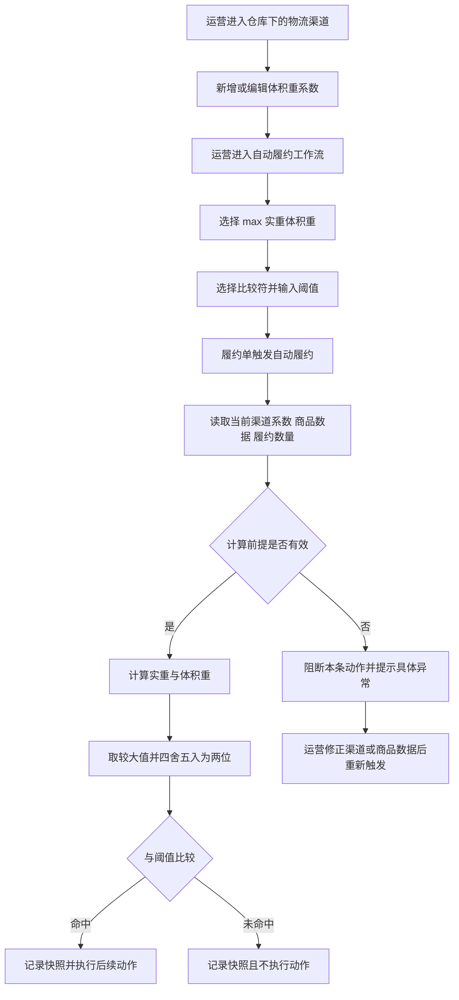

# V0.28.6-ERP-189-PRD

> 任务映射：四位任务号 `0189` ｜ Multica `ERP-189` ｜ Slice `ERP-SLICE-ORD-001`  
> 文档状态：待评审 ｜ 更新日期：2026-11-10

## 文档结论

本需求在仓库下的物流渠道中增加可选的体积重系数，并在自动履约工作流中增加 `max（实重，体积重）` 条件。系统执行该条件时，使用商品主数据和履约数量计算计费重量；计算前提不完整时阻断本条自动履约动作并提示具体原因，禁止按零值或“条件未命中”降级处理。来源：需求第 1 至 3 条；用户 Q1 至 Q6 答复；用户 2026-11-06 补充反馈。

## 1 新增功能清单

| 功能点 | 所在界面或节点 | 触发条件 | 功能与规则描述 | 来源 |
|---|---|---|---|---|
| 维护体积重系数 | 仓库管理下的编辑物流渠道界面 | 用户新增或编辑物流渠道 | 新增非必填字段；填写时只能输入 1 至 9,999,999,999 的正整数；允许清空；不批量回填历史渠道 | 需求第 1 条；用户 Q1、Q2 |
| 配置计费重量条件 | 编辑自动履约工作流的条件配置节点 | 用户新增或编辑工作流条件 | 条件选择项新增 `max（实重，体积重）`；比较符支持大于、大于等于、小于、小于等于、等于、不等于；阈值范围为 0.00 至 99,999,999.99，最多两位小数 | 需求第 2 条；用户 Q4；用户 2026-11-06 补充反馈 |
| 计算实重 | 自动履约执行节点 | 履约单执行含该条件的工作流 | 汇总每个 SKU 的重量乘履约数量；重量取自产品模块 | 需求第 3 条 |
| 计算体积重 | 自动履约执行节点 | 履约单执行含该条件的工作流 | 汇总每个 SKU 的长乘宽乘高乘履约数量，再除以当前仓库与物流渠道对应的体积重系数；中间结果保留四位小数 | 需求第 3 条；用户 Q5、Q6 |
| 计算并比较计费重量 | 自动履约条件判定节点 | 实重、体积重计算前提全部有效 | 取实重与体积重较大值，四舍五入至两位后，按已配置的比较符与阈值比较 | 需求第 3 条；用户 Q4、Q5；用户 2026-11-06 补充反馈 |
| 阻断并提示异常 | 自动履约条件判定节点 | 系数、SKU 重量或任一尺寸缺失、为零、为负数或非法 | 不执行本条自动履约动作；提示具体物流渠道、SKU 及缺失或非法字段；不得转为条件未命中 | 用户 Q2、Q3 |
| 保存执行快照 | 自动履约执行历史 | 条件命中、未命中或异常 | 每次执行保存系数、实重、总体积、体积重、计费重量、比较符、阈值和比较结果；重试新增快照，不覆盖历史 | 用户 Q6 |

## 2 背景与问题

现有自动履约已能使用商品主数据和履约数量形成重量与体积基础数据，但物流渠道缺少体积重系数，工作流也缺少按实重与体积重较大值判定的条件。因此，运营无法在系统内按物流计费重量自动选择履约策略。来源：需求第 1 至 3 条；现状侦察结论。

本次需求解决三个问题：一是提供渠道级体积重系数维护入口；二是提供计费重量条件及六类数值比较；三是对历史渠道空值和商品尺寸脏数据进行安全阻断，并保留可复盘的计算快照。来源：用户 Q2、Q3、Q6；用户 2026-11-06 补充反馈。

## 3 用户系统操作流程图



流程来源：需求第 1 至 3 条；用户 Q2、Q3、Q6。

## 4 新增交互及规则

### 4.1 编辑物流渠道

- 用户可输入或清空体积重系数；字段非必填。
- 输入非整数、零、负数或超过 10 位时，表单即时提示且禁止保存非法值。
- 历史渠道保持空值，不要求批量补齐；空值渠道仍可被工作流配置引用。
- 本次仅新增字段，不改变渠道名称、签名服务、状态、已对接自提物流及后续既有字段的交互。

来源：需求第 1 条；用户 Q1、Q2；用户 2026-11-06 补充反馈。

### 4.2 编辑自动履约工作流

- 条件字段新增 `max（实重，体积重）`。
- 选择该条件后展示比较符和阈值输入框；比较符支持大于、大于等于、小于、小于等于、等于、不等于。
- 阈值必填，范围为 0.00 至 99,999,999.99，最多两位小数；保存时统一为两位小数。
- 非法比较符或非法阈值不得保存；其他既有工作流条件行为保持不变。

来源：需求第 2 条；用户 Q4；用户 2026-11-06 补充反馈。

### 4.3 自动履约执行

- 每次执行读取当前物流渠道系数，不读取配置工作流时的旧值。
- 先校验系数、商品重量和长宽高，再进行计算；任何前提异常均停止本条自动履约动作。
- 命中、未命中与异常均形成独立执行记录；修复数据后重新触发会新增记录，不覆盖原记录。

来源：用户 Q2、Q3、Q6。

### 4.4 交互原型

以下为评审示意，不是前端页面 1 比 1 还原。来源：用户 2026-11-06 补充反馈。

```text
┌────────────────────────────────────────────────────┐
│ 编辑物流渠道                                       │
├────────────────────────────────────────────────────┤
│ 渠道名称             [________________________]     │
│ 签名服务             [请选择 ▼]                    │
│ 状态                 [请选择 ▼]                    │
│ 已对接自提物流       [请选择 ▼]                    │
│ 体积重系数           [____________]                 │
│                      非必填 正整数 最多 10 位       │
│ 后续现有字段省略展示                               │
└────────────────────────────────────────────────────┘
```

```text
┌────────────────────────────────────────────────────┐
│ 编辑自动履约工作流                                 │
├────────────────────────────────────────────────────┤
│ 条件字段 [max（实重，体积重） ▼]                  │
│ 比较符   [大于 大于等于 小于 小于等于 等于 不等于]│
│ 阈值     [________________]  最多 8 位整数 2 位小数 │
│                                   [取消] [保存]     │
└────────────────────────────────────────────────────┘
```

## 5 新增字段及规则

| 字段 | 所属对象 | 类型与范围 | 必填 | 展示与保存规则 | 异常规则 | 来源 |
|---|---|---|---|---|---|---|
| 体积重系数 | 仓库下的物流渠道 | 正整数；1 至 9,999,999,999；最多 10 位 | 否 | 原值展示；允许清空并保存为空 | 非整数、零、负数或超过 10 位时禁止保存 | 需求第 1 条；用户 Q1、Q2 |
| 条件字段 | 自动履约工作流条件 | 枚举 `max（实重，体积重）` | 是 | 作为新增条件选项展示和保存 | 未选择时不能形成完整条件 | 需求第 2 条 |
| 比较符 | 自动履约工作流条件 | 大于、大于等于、小于、小于等于、等于、不等于 | 是 | 选择并保存枚举值 | 枚举范围外的值禁止保存或执行 | 用户 2026-11-06 补充反馈 |
| 条件阈值 | 自动履约工作流条件 | 十进制；0.00 至 99,999,999.99；最多两位小数 | 是 | 保存并展示为两位小数 | 为空、超范围或超过两位小数时禁止保存 | 需求第 2 条；用户 Q4 |
| 计算快照 | 自动履约执行历史 | 系数、实重、总体积、体积重、计费重量、比较符、阈值、比较结果 | 系统生成 | 每次执行生成新快照，不覆盖历史 | 快照记录失败不得继续执行后续自动履约动作 | 用户 Q6 |

## 6 数据计算逻辑

### 6.1 计算公式

1. 单个 SKU 体积 = 长（CM）× 宽（CM）× 高（CM）。
2. 实重（KG）= Σ〔SKU 单件重量（KG）× 履约数量〕。
3. 总体积（CM³）= Σ〔SKU 长 × 宽 × 高 × 履约数量〕。
4. 体积重（KG）= 总体积 ÷ 当前物流渠道体积重系数，中间结果保留四位小数。
5. 计费重量（KG）= max（实重，体积重），四舍五入保留两位小数。
6. 将计费重量按工作流配置的比较符与阈值比较，形成命中或未命中结果。

来源：需求第 3 条；用户 Q5、Q6。

### 6.2 具体数据例子

| SKU | 长 × 宽 × 高 | 单件重量 | 履约数量 | 实重贡献 | 体积贡献 |
|---|---:|---:|---:|---:|---:|
| SKU-A | 10 × 20 × 30 CM | 1.2 KG | 2 | 2.4 KG | 12,000 CM³ |
| SKU-B | 5 × 5 × 5 CM | 0.3 KG | 1 | 0.3 KG | 125 CM³ |
| 合计 | 无 | 无 | 3 | 2.7 KG | 12,125 CM³ |

假设当前物流渠道体积重系数为 1000：

- 实重 = 1.2 × 2 + 0.3 × 1 = 2.7 KG。
- 体积重 = 12,125 ÷ 1000 = 12.125 KG，中间精度展示为 12.1250 KG。
- 计费重量 = max（2.7，12.1250）= 12.1250 KG，四舍五入后为 12.13 KG。
- 若比较符为“大于等于”、阈值为 12.00 KG，则 12.13 ≥ 12.00，条件命中。
- 若比较符为“小于”、阈值为 12.00 KG，则 12.13 < 12.00 不成立，条件未命中。

来源：原始需求示例；用户 Q4、Q5。

## 7 边界异常

| 场景 | 系统处理 | 用户反馈或留痕 | 来源 |
|---|---|---|---|
| 体积重系数为空 | 阻断本条自动履约动作，不计算、不降级 | 提示当前物流渠道缺少体积重系数；记录异常快照 | 用户 Q2 |
| 体积重系数为零、负数、非整数或超过 10 位 | 配置时禁止保存；存量非法值在执行时阻断 | 指明物流渠道和非法字段 | 需求第 1 条；用户 Q2 |
| SKU 重量缺失、为零、负数或非法 | 阻断本条自动履约动作 | 指明履约单、SKU 和重量字段 | 用户 Q3 |
| SKU 长、宽或高任一缺失、为零、负数或非法 | 阻断本条自动履约动作 | 指明履约单、SKU 和具体尺寸字段 | 用户 Q3 |
| 阈值为空、超范围或超过两位小数 | 工作流配置时禁止保存 | 在阈值输入框提示合法范围 | 需求第 2 条；用户 Q4 |
| 比较符不在六类范围 | 工作流配置时禁止保存；异常存量规则执行时阻断 | 提示比较符无效并记录异常 | 用户 2026-11-06 补充反馈 |
| 条件合法但未命中 | 不执行后续动作，不视为异常 | 记录输入、计算结果和未命中结果 | 用户 Q6 |
| 条件命中 | 执行后续自动履约动作 | 记录输入、计算结果和命中结果 | 用户 Q6 |
| 配置在执行前发生变更 | 本次执行使用实际读取到的当前值 | 快照保存本次使用的系数，便于复盘 | 用户 Q6 |
| 修复数据后重试 | 重新读取当前数据并重新计算 | 新增执行快照，不覆盖历史异常 | 用户 Q6 |
| 快照写入失败 | 不继续执行后续自动履约动作 | 记录系统异常，避免执行结果不可追溯 | 用户 Q6 对可追溯性的确认 |

## 验收摘要

| 验收项 | 验证方式 |
|---|---|
| 渠道系数可空，合法正整数可保存，非法值被拒绝 | 功能测试 |
| 新条件、六类比较符与阈值边界可配置 | 参数化功能测试 |
| 示例计算得到实重 2.7 KG、体积重 12.125 KG、计费重量 12.13 KG | 单元测试 |
| 历史空值渠道可保存工作流，但实际执行时阻断并明确提示 | 端到端测试 |
| 任一 SKU 重量或尺寸无效时阻断并定位 SKU 与字段 | 端到端测试 |
| 命中、未命中和异常均保存独立执行快照 | 功能测试 |
| 其他既有工作流条件行为不变 | 回归测试 |

