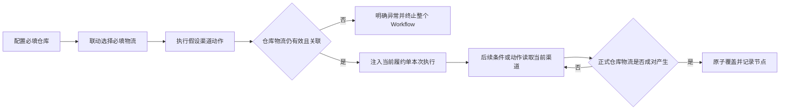

# 业务链路与模块

## 用户故事地图

| 活动 | 任务 | 子任务 | 事件 |
|---|---|---|---|
| 准备渠道 | 维护物流渠道 | 输入或清空体积重系数并保存 | E01 |
| 配置规则 | 编辑自动履约工作流 | 选择计费重量，从大于、大于等于、小于、小于等于、等于、不等于中选择比较符并输入阈值 | E02 |
| 执行履约 | 自动计算与比较 | 读取当前系数、汇总商品、比较并留痕 | E03 |
| 处理异常 | 识别计算前提不足 | 停止本条动作并提示具体缺口 | E04 |

## 模块与责任边界

| 模块 | 写入责任 | 读取责任 | 不负责 |
|---|---|---|---|
| 物流渠道配置 | 保存体积重系数 | 提供当前有效系数 | 不计算履约重量 |
| 工作流配置 | 保存条件属性、比较符和阈值 | 提供运行规则 | 不维护商品尺寸 |
| 自动履约执行 | 计算、比较、阻断、记录快照 | 读取渠道、商品、履约数据 | 不自动补齐主数据 |
| 商品主数据 | 现有模块维护重量和长宽高 | 为计算提供权威数据 | 不维护渠道系数 |

功能树叶子共 6 个：维护系数、校验系数、配置条件、校验阈值、计算并比较、异常阻断与留痕。

## 假设渠道链路补充

新增模块责任：Workflow 配置保存两个字段和后继节点；执行上下文负责隔离与来源优先级；仓库物流配置提供有效关联；执行审计保存假设值和覆盖链。四者均不负责跨执行保留临时值。
