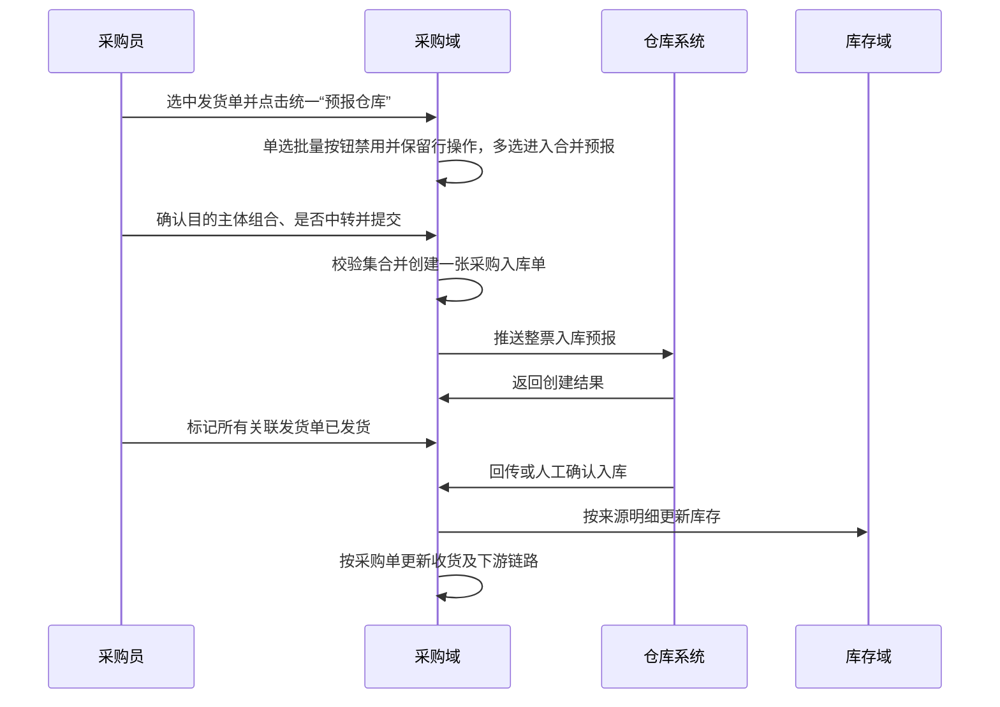

# ERP-192 多个采购发货单合并预报产品方案

> Slice ID：ERP-SLICE-PUR-001  
> 需求来源：RQ-BG、RQ-1 至 RQ-6、RQ-C1 至 RQ-C6
> 结论：能做；完整闭环作为一个端到端实现切片交付。

## 一页结论

采购员在发货列表通过标准批量操作发起合并预报：单选时批量按钮禁用且普通预报继续使用行操作，多选时批量按钮启用。多选可跨分页勾选采购主体与原目的仓库（或收货仓库）一致、供应商可不同且仍有剩余可预报量的采购发货单，一次填写整票货运和装箱信息，只生成一张采购入库单。合并页复用普通预报的目的主体所属系统、目的主体、是否中转及后续链路；目的系统为 NFL 时实时读取必填目的渠道和目的区域，区域取全部商品项目可用区域交集。系统保留每条商品来源，并将目的渠道、目的区域写入入库单持续传递但不在详情展示。[RQ-1][RQ-2][RQ-3][RQ-C2][RQ-C3][RQ-C5][RQ-C7][RQ-C8]

核心决策：部分预报单允许参与；任一筛选条件变化清空选择；全部关联发货单已发货后才能整单确认；跨来源商品不合并；基本信息展示全部供应商，合并预报和入库详情商品行均展示来源供应商；运费以本次整票填写为准。[RQ-C1][RQ-C2][RQ-C3]

仓库口径已关闭：选择资格中的“仓库一致”比较发货单原数据的目的仓库（或收货仓库）；进入合并预报页后不锁仓，用户仍可按普通预报规则修改最终入库仓库。列表资格与最终库存落点是两个独立口径。[RQ-C4]

本期不改采购单拆单和发货单创建规则，不允许跨仓合并，不支持从聚合入库单移除单张成员。全部成员未进入下一步时可整单取消后重建，任一成员已确认入库时禁止取消。[RQ-BG][RQ-1][RQ-5]

## 1. 术语与事实

| ID | 标准名称 | 定义 |
|---|---|---|
| T-01 | 采购发货单 | 采购单商品的发货载体，拥有预报状态和发货状态。 |
| T-02 | 合并预报 | 多张同仓采购发货单共同生成一张采购入库单的批量操作。 |
| T-03 | 采购入库单 | 记录预报、装箱、货运、确认和取消的聚合单据。 |
| T-04 | 来源关系 | 采购入库明细到采购发货明细、采购明细和供应商的 1:1 追溯关系。 |

事实清单以 `requirement-analysis.md` 的 F-01 至 F-13 为权威；业务决策以 `decision-log.md` 为权威。

## 2. 领域事件清单

| ID | 事件 | 类型 | 角色 | 触发与输入 | 输出与去向 | 异常与补偿 | 状态敏感 | 来源 |
|---|---|---|---|---|---|---|---|---|
| E-01a | 单张采购发货单已选择并发起普通预报 | 人的操作-单个 | 采购员 | 仅选中一张有剩余可预报量的发货单 | 复用普通预报流程 | 筛选变化清空选择 | 是 | RQ-C5 |
| E-01b | 多张采购发货单已选择并发起合并预报 | 人的操作-批量 | 采购员 | 选中多张且采购主体、原目的/收货仓库一致 | 集合进入合并预报流程 | 筛选变化清空集合；资格不一致时拒绝进入 | 是 | RQ-1、RQ-C1、RQ-C3、RQ-C5 |
| E-02 | 合并预报已提交 | 人的操作-批量 | 采购员 | 发货单集合、目的主体组合、是否中转、整票货运、装箱、仓库 | 一张采购入库单、逐行来源关系及既有下游链 | 任一组合校验或推送失败则事务回滚 | 是 | RQ-1、RQ-2、RQ-C3 |
| E-03 | 发货单预报状态已重算 | 系统触发-连锁 | 系统 | 每张发货单的发货数量与已预报数量 | 待预报、部分预报或已预报 | 并发冲突则整体失败 | 是 | RQ-2 |
| E-04 | 采购入库详情已展示 | 系统触发 | 系统 | 入库单及来源关系 | 全部发货单、全部供应商、逐行来源供应商 | 来源缺失显示数据异常并记录日志 | 否 | RQ-3、RQ-C2 |
| E-05 | 合并采购入库已确认 | 人的操作-单个 | 仓库人员 | 全部关联发货单已发货、逐行实收数量 | 采购单收货状态、库存和内采/调拨链更新 | 任一未发货或数量越界则不执行 | 是 | RQ-5、RQ-C1 |
| E-06 | 合并采购入库已取消 | 人的操作-逆向 | 采购员 | 入库单待入库且所有成员未进入不可逆阶段 | 入库作废、逐来源数量回退、逐发货单状态重算 | 任一成员已确认入库则禁止 | 是 | RQ-5 |
| E-07 | WMS 创建结果已回传 | 外部回调 | 系统 | 入库单号、WMS 单号、结果 | 成功保存 WMS 单号；失败触发整体回滚 | 入库单号作为幂等键 | 是 | RQ-5、F-02 |

事件计数：人的操作-批量 2，人的操作-单个 2，人的操作-逆向 1，系统触发 1，系统触发-连锁 1，外部回调 1，共 8 个。

## 3. 影响性与可行性

| 维度 | 结论 | 风险控制 |
|---|---|---|
| 用户与流程 | 发货列表启用多选和标准批量预报入口 | 筛选变化清空；单选批量按钮禁用且普通预报走行操作；多选校验集合资格 |
| 数据 | 单头单发货关系改为明细来源关系权威 | 历史单继续兼容单头字段 |
| 状态 | 每张发货单独立重算预报状态 | 创建、取消均使用同一状态计算器 |
| 库存 | 确认和取消按来源明细守恒 | 数量非负、逆向释放与正向占用一致 |
| 财务 | 价格、币种、核算维度不跨来源合并 | 付款来源按采购明细去重 |
| 外部系统 | WMS 仍接收一张采购入库单 | 推送失败整体回滚，禁止部分成功 |
| 跨系统与中转 | 复用普通预报的目的主体组合及自动链 | 对来源集合执行同一后端校验、幂等和取消补偿 |
| 权限与审计 | 复用预报、确认、取消权限 | 日志记录全部来源发货单号 |
| 兼容性 | 单发货预报继续可用 | 新接口兼容单元素集合 |
| 可逆性 | 待入库允许整单取消 | 已确认入库后禁止取消 |

技术、业务、时间和依赖四维均可行；主要风险为并发交叉选择、跨来源成本串线、WMS 结果未知和取消漏回退。通过集合有序锁、逐行来源关系、幂等键和全事务补偿控制。

## 4. 业务链路



异常分支：筛选变化清空选择；并发占用失败整单拒绝；WMS 推送失败整体回滚；任一发货单未发货阻断确认；已确认入库阻断取消。

## 5. 模块与功能树

```text
采购域
+-- 发货选择
|   +-- 列表启用多选
|   +-- 有选中时展示统一预报仓库按钮
|   +-- 单选批量按钮禁用并保留普通预报行操作、多选合并预报
|   +-- 多选时跨页选择同主体同原目的/收货仓库发货单
|   +-- 筛选变化清空选择
+-- 合并预报
|   +-- 校验集合资格
|   +-- 复用目的主体所属系统、目的主体、是否中转组合规则
|   +-- 保存整票货运与装箱
|   +-- 创建单张采购入库单
|   +-- 逐发货单重算预报状态
|   +-- 产品明细逐行展示来源供应商
+-- 入库详情
|   +-- 展示全部关联发货单
|   +-- 展示全部供应商与悬浮完整值
|   +-- 入库明细逐行展示来源供应商
+-- 入库执行
|   +-- 全部已发货后整单确认
|   +-- 按来源更新采购与库存
+-- 入库逆向
    +-- 待入库整单取消
    +-- 逐来源回退并重算状态
```

## 6. 功能与页面规则

| F-ID | 功能 | 前置条件 | 后置结果 | 验证重点 |
|---|---|---|---|---|
| F-01 | 列表选择与预报入口分流 | 列表选择变化 | 复用标准批量操作；单选时批量按钮禁用且普通预报走行操作，多选时启用合并预报 | 0/1/N 选中数量、筛选清空、单单兼容 |
| F-02 | 合并预报资格校验 | 至少两张发货单 | 通过后进入预报 | 后端重校验采购主体、原目的/收货仓库、状态、数量 |
| F-03 | 创建合并采购入库单 | 整票信息完整 | 只生成一张入库单 | 幂等与事务回滚 |
| F-04 | 重算发货单预报状态 | 创建或取消成功 | 每张单独得到正确状态 | 待预报、部分预报、已预报 |
| F-05 | 展示多发货与多供应商 | 入库单存在多来源 | 基本信息和明细可追溯 | 省略号与悬浮完整展示 |
| F-06 | 确认合并采购入库 | 全部发货单已发货 | 库存、采购及下游更新 | 逐来源 1:1、数量守恒 |
| F-07 | 取消合并采购入库 | 待入库且未进入不可逆阶段 | 入库作废、来源数量回退 | 全取消或全禁止 |
| F-08 | 目的主体与中转组合 | 合并集合资格通过 | 按普通预报既有流程创建或不创建中转/跨系统下游 | 组合校验、来源数量求和、幂等与补偿 |
| F-09 | 修改最终入库仓库 | 合并集合资格通过 | 按用户本次填写仓库生成入库单及库存归属 | 不反向改变原目的/收货仓库资格结论 |
| F-10 | 选择 NFL 目的渠道与区域 | 目的主体所属系统为 NFL | 实时加载 NFL 渠道；按所有商品项目计算区域交集并完成必填选择 | NFL 超时、无交集、切换系统、渠道变更、提交复核 |
| F-11 | 持续传递 NFL 目的维度 | 创建采购入库单 | 目的渠道和目的区域写入入库单并传递至后续链路 | 编码与名称快照、详情不展示、取消链兼容 |

页面变更：发货列表启用多选并复用系统标准批量操作；无选中时不展示批量操作，单选时批量“预报仓库”展示但禁用，普通预报继续使用行操作，多选时按钮启用并进入合并预报。合并资格失败由后端返回正确业务错误码和可展示信息，前端使用统一 Toast 提示，不新增专用失败弹窗。预报页加载多个发货来源并复用普通预报字段；目的系统为 NFL 时，在目的主体后显示必填的目的渠道、目的区域，渠道与区域实时读取 NFL，区域候选为所有商品项目区域集合交集。合并预报页不新增发货单号列，产品明细每行 SKU 下展示“供应商：名称”；采购入库详情不展示目的渠道、目的区域。[RQ-C7][RQ-C8]

### 6.1 交互原型

无新增专用原型。列表复用系统现有标准批量操作组件，错误反馈复用统一 Toast；合并预报页沿用普通预报布局，仅增加多来源商品数据及 SKU 下供应商展示。[RQ-C7]

## 7. 状态与不变量

| 预报状态 | 发货状态 | 合并预报 | 确认入库 | 取消入库 |
|---|---|---|---|---|
| 待预报 | 未发货 | 允许 | 禁止 | 不适用 |
| 部分预报 | 未发货 | 允许剩余量 | 禁止 | 待入库单允许整单取消 |
| 已预报 | 未发货 | 禁止 | 禁止 | 待入库单允许整单取消 |
| 部分预报 | 已发货 | 允许剩余量 | 全部关联单已发货时允许 | 待入库单允许整单取消并回退在途影响 |
| 已预报 | 已发货 | 禁止 | 全部关联单已发货时允许 | 已确认入库后禁止 |

不变量：每个发货明细的已预报数量不得小于零且不得超过发货数量；采购入库明细必须有且仅有一个来源发货明细；数量、重量和体积等可加总数据按来源求和，跨来源价格、币种、核算维度和供应商不得求和、覆盖或丢失；取消释放的数量和库存类型必须与创建或发货阶段增加的数量和库存类型一致。

## 8. 数据与接口契约

不新增逗号拼接单号字段。采购入库明细关系作为多发货事实源，查询时按入库单号聚合发货单和供应商，商品行保持来源关系 1:1。建议为入库单号与发货单号的组合查询补充索引，最终由技术方案基于执行计划确认。

接口能力包括：批量预报数据加载、NFL 目的渠道实时查询、按项目集合与渠道实时查询 NFL 区域交集、合并预报提交、入库详情多来源返回、确认入库、取消入库。提交请求携带发货单号集合、逐行发货明细标识、目的主体所属系统、目的主体、目的渠道、目的区域、是否中转及普通预报既有字段；服务端提交时重新向 NFL 校验渠道和区域交集。创建结果持久化目的渠道、目的区域编码与名称，并传递给后续链路，但入库详情响应不新增这两个展示字段。[RQ-C8]

## 9. 验收摘要

1. 无选中单据时不展示批量操作；选中一张时批量“预报仓库”展示但禁用，普通预报继续使用行操作；选中多张时批量按钮启用并执行合并预报。
2. 多选时，同采购主体、原目的仓库（或收货仓库）一致的待预报或部分预报单可跨页选择，任一筛选变化立即清空。
3. 提交时后端重新校验所有成员，只生成一张采购入库单。
4. 同 SKU 跨来源在数据和详情中保持 1:1，不合并价格、币种、核算维度或供应商。
5. 基本信息展示全部供应商；溢出时省略，悬浮显示完整集合。
6. 合并预报产品明细和入库详情入库明细均在每条 SKU 下展示对应来源供应商。
7. 只有全部关联发货单已发货才允许整单确认。
8. 取消按全部来源回退数量并逐发货单重算状态；已确认入库禁止取消。
9. WMS 失败、并发冲突或任一数据写入失败不留下部分入库单或部分状态。
10. 目的主体所属系统、目的主体、是否中转的组合及后续链路与普通预报一致；下游可加总数据为全部来源之和，非加总属性保持逐行来源。
11. 进入合并预报页后最终入库仓库不锁定；用户可修改，入库单和库存归属以本次最终填写值为准。
12. 合并资格失败时后端返回正确业务错误码和可展示信息，前端统一 Toast 提示；可预期业务失败不得以未处理 500 返回。
13. 合并预报页不新增发货单号列，产品列仅在 SKU 下展示来源供应商。
14. 目的系统为 NFL 时，目的渠道、目的区域显示且必填；数据实时读取 NFL，区域为全部商品项目可用区域交集，提交时再次实时校验。
15. 目的渠道、目的区域写入采购入库单并持续传递，但采购入库详情不展示；NFL 不可用时不降级使用 FL 本地数据。

## 10. Trace Ledger

| 对象 | ID | 上游 | 下游 | 状态 |
|---|---|---|---|---|
| 需求 | RQ-1 至 RQ-6、RQ-C3 至 RQ-C8 | Issue 原文与调整 | E-01a、E-01b、E-02 至 E-07 | 已确认 |
| 决策 | RQ-C1 至 RQ-C8 | 用户确认 | F-01 至 F-11 | 已关闭 |
| 事件 | E-01a、E-01b、E-02 至 E-07 | 需求与决策 | F-01 至 F-09 | 本期实现 |
| 功能 | F-01 至 F-11 | E-01a、E-01b、E-02 至 E-07 | ERP-SLICE-PUR-001 | 已覆盖 |
| 切片 | ERP-SLICE-PUR-001 | F-01 至 F-09 | 实现 backlog | DEFINED |

## 11. 交付与准入

本方案仅定义一个垂直切片，因为列表选择、合并创建、详情追溯、确认和取消缺少任一部分都会形成不可独立验收的半成品。切片无未合入同版本前置依赖；WMS 以显式 mock 覆盖成功、失败、重复和结果未知。实现 Issue 由 Orchestrator 以 backlog 登记，人工转为 todo 后 Developer 才执行。
