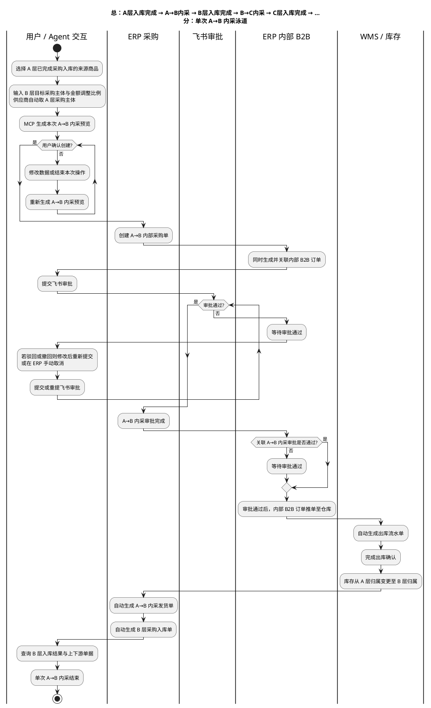

# [v0.28.7][ERP-205] 内部采购全链路 MCP PRD

> 需求版本：v0.28.7  
> 对应任务：0205 ↔ ERP-205 ↔ ERP-SLICE-PUR-001 / ERP-SLICE-PUR-002 / ERP-SLICE-PUR-003  
> 本版依据：本轮范围约束 1～3、PRD 文档要求 1～4。此前普通采购转内采、独立调拨及采购链路调拨内容退出本次范围。

## 1. 业务背景

现有内部采购需要业务人员在采购单、飞书审批、内部 B2B 订单、履约出库、采购发货和采购入库间切换页面。内部采购单成功创建时，系统会在同一创建链路中自动生成并关联内部 B2B 订单，该动作与飞书审批结果无关；业务人员仍需提交飞书审批，并执行 B2B 推仓、出库确认，之后系统联动库存、采购发货单和采购入库单。（来源：本轮范围约束§2）

多层级内采场景中，已完成入库的商品可能继续在主体间内采，并按业务约定比例调整本层金额。当前人工操作容易出现来源错配、金额计算错误、重复建单和链路中断。（来源：本轮范围约束§3）

本次把现有前端能力转换为 MCP 原子能力；Agent 负责收集意图、查询候选、组织预览和请求确认，ERP 继续负责权限、校验、飞书审批、状态、库存及自动联动。

| 范围 | 说明 |
|-|-|
| 包含 | 内部采购单筛选与查询、详情、创建、提交审批。 |
| 包含 | 内部 B2B 筛选与查询、详情、B2B标记已履约、导出 PI。 |
| 包含 | 采购入库筛选与查询、详情、从已完成入库明细发起下一层内采、按比例调整金额。 |
| 不包含 | MCP 取消采购、MCP 取消履约；上述取消操作由用户在 ERP 前端手动完成。 |
| 不包含 | 普通采购任一分支自动转内部采购；独立或采购中转调拨；MCP 审核采购单。 |

## 2. 系统使用流程图

总览仅表达 A→B→C→… 的层级递进关系；每一条相邻层级转换均复用“单次内采 A→B”泳道流程，并以本层已完成采购入库作为下一层内采的来源。下一层内采的供应商固定继承上一层采购主体：A→B 时 B 为采购方、A 为供应商；B→C 时 C 为采购方、B 为供应商。

## 3. 系统功能转换 MCP 清单

### 3.1 采购单

| 功能键 | 必须输入 | 输出 | 确认与规则 |
|-|-|-|-|
| 筛选与查询 | 分页；可选采购单号、B2B 单号、采购方、供应商、仓库、项目、渠道、区域、审批/采购状态、创建时间 | 采购单、主体、商品、数量金额、审批状态、关联 B2B/发货/入库、下一动作 | 只读；按用户权限返回。 |
| 详情 | 内部采购单号或 ID | 采购基本信息、审批/采购/付款/交付状态、采购方与供应商、收款账户、仓库、项目/渠道/区域、税率与含税口径、付款/交货条件、商品明细、数量/单价/币种/金额、收货地址、关联 B2B/发货/入库单、操作记录、下一动作 | 等同进入当前采购单详情页；只读，不触发业务状态变化。 |
| 创建内部采购单 | 3.4 全部必填字段；多层内采需来源入库单/明细、调整比例、请求标识 | 内采单号、同时生成的 B2B 单号、关联、金额摘要、审计编号 | 展示完整预览并确认；重复请求返回首次结果。 |
| 提交审批 | 内采单号/ID、预览版本、确认凭据 | 飞书审批实例、审批状态、提交时间、下一动作 | 必须确认；不得重复创建 B2B。 |

### 3.2 内部 B2B 订单

| 功能键 | 必须输入 | 输出 | 确认与规则 |
|-|-|-|-|
| 筛选与查询 | 分页；可选搜索词、PI 单号、客户、订单/支付状态、时间、销售主体、SKU、内采单号、国家、项目、渠道、区域、异常、Owner | B2B、内采单、商品与待履约量、履约单、仓库、出库状态、异常、下一动作 | 只读；支持内采单号反查。 |
| 详情 | 内部 B2B 单号或 ID | 订单基本信息、订单/支付状态、销售主体、客户与收货地址、币种和金额、商品明细、待履约/已履约数量、履约单与出库状态、仓库/货区/物流信息、PI 文件、关联内采单、异常、操作记录、下一动作 | 等同进入当前内部 B2B 详情页；只读，不执行推仓、标记履约或取消履约。 |
| 标记已履约 | B2B 单号、仓库、货区、物流渠道、商品行、数量、申报价值；按场景提供发货时间、WMS/物流单号、唯一编码 | 履约单、履约/出库状态、下一动作 | 必须确认；不得与推仓重复占用同一数量。 |
| 导出 PI | B2B 单号 | 文件名、文件类型、下载结果、生成时间 | 只读文件生成。 |

### 3.3 采购入库

| 功能键 | 必须输入 | 输出 | 确认与规则 |
|-|-|-|-|
| 筛选与查询 | 分页；可选通用搜索、供应商、收货仓库、货区、创建时间、入库状态 | 入库单/采购单、供应商、仓库货区、状态、预入库/实际入库量、明细、上下游 | 只读；已完成入库的明细可作为下一层内采的来源选择项，MCP 不提供、也不校验剩余可续采数量。 |
| 详情 | 采购入库单号或 ID | 入库单基本信息、入库状态、来源采购单/发货单、供应商、收货仓库与货区、商品明细、预入库/实际入库/差异数量、WMS 入库信息、入库时间、来源与下游内采关系、操作记录 | 等同进入当前采购入库详情页；只读，不执行入库确认。 |

### 3.5 多层级内采金额调整

1. 用户选择已完成入库明细并输入下一层采购主体、本次采购数量与本层金额调整比例；下一层供应商由系统自动取直接来源采购单的采购主体，不提供任意选择或改写。
2. 预览必须同时展示“下一层采购方”和“继承的供应商”，并展示供应商来源采购单号；来源采购主体不存在、已失效或无法作为内部供应商时不得创建。
3. 计价来源为上层采购入库单对应采购订单中的同一商品行。目标含税单价 = 上层采购订单商品行含税单价 × 调整比例；目标不含税单价 = 上层采购订单商品行不含税单价 × 调整比例。
4. 目标含税金额 = 目标含税单价 × 本次采购数量；目标不含税金额 = 目标不含税单价 × 本次采购数量。币种与税率继承上层采购订单，单价与金额按 ERP 现有精度和舍入规则处理。
5. 本次不新增多层级内采关系字段。通过 MCP 创建内部采购单时，如存在上层单据，MCP 自动将上层采购入库单单号写入本次内部采购单的备注；不存在上层单据时，不追加任何追溯备注。
6. 逐层追溯以每一层内部采购单备注中的直接上层采购入库单单号为依据：A→B 记录 A 层入库单号，B→C 记录 B 层入库单号。

### 3.6 MCP 原子能力可执行契约

稳定标识优先使用单据 ID；业务单号用于用户输入和展示，服务端解析后返回 ID 与单号。查询类统一按当前用户的数据权限过滤，默认按创建时间倒序，分页从 1 开始、默认 20 条、单页最多 100 条。

### 3.6.1 统一权限原则

- Agent 调用 MCP 使用 ERP 功能时，功能权限与数据权限必须以当前用户登录 ERP 的账号为唯一授权基准。
- MCP 必须将当前 ERP 用户身份透传至每次查询、详情、创建、审批提交、推仓、履约及导出调用，并复用 ERP 现有鉴权与数据范围规则；不得以 Agent、MCP 服务账号或技术账号扩大用户权限。
- 用户在 ERP 前端不可见的单据或不可执行的功能，通过 MCP 同样不可见、不可执行；列表、详情、关联单据、候选项与错误信息均不得泄露越权对象是否存在及其业务数据。
- 权限在预览后、写调用前发生变化时，原确认失效；MCP 返回“当前账号无权限或权限已变化”，停止后续步骤。用户完成授权后需重新查询、重新预览并再次确认，不得沿用旧确认凭据。
- 审计记录同时保存 ERP 用户标识、Agent 应用标识、MCP 原子能力、请求标识与执行结果，以便证明实际操作者及授权来源。

| 原子能力 | 操作者与权限 | 前置状态 | 必填输入/稳定标识 | 成功输出与后置状态 | 标准异常 | 幂等、确认、批量 |
|-|-|-|-|-|-|-|
| 采购单列表 | 有采购查看权限的当前用户 | 无 | page、per_page；筛选条件 | 数据、分页、排序、可执行动作；状态不变 | 无权限、筛选对象不存在 | 只读；无需确认；支持批量查询，不支持跨权限汇总 |
| 采购单详情 | 有目标采购单查看权限的当前用户 | 单据存在 | po_id 或 po_no | 3.1“详情”全量字段；状态不变 | 不存在、无权限 | 只读；无需确认；单笔 |
| 内采创建预览 | 有内采创建权限的当前用户 | 来源明细已完成入库 | 3.4 字段、source_inbound_item_id、client_request_id | preview_version、字段快照、用户输入数量、金额与预计单据；不占用数量 | 字段无效、来源状态变化 | 只读预览；无需写确认；可多明细但同一直接来源链 |
| 创建内部采购 | 有内采创建权限的当前用户 | 有效预览；用户已确认创建参数 | preview_version、confirmation_token、client_request_id | po_id/po_no、b2b_order_id/no、来源映射、审计号 | 确认失效、ERP 现有校验拒绝、结果未知 | 幂等键=用户+Agent应用+能力+client_request_id；必须确认；单次创建一张单；MCP 不做上下游数量校验 |
| 提交飞书审批 | 有采购提交权限的当前用户 | 待审批、已驳回或已撤回 | po_id/po_no、confirmation_token、client_request_id | approval_instance_id、待审批状态 | 状态不允许、飞书失败、重复提交 | 独立幂等键；必须确认；不支持批量 |
| B2B 列表 | 有 B2B 查看权限的当前用户 | 无 | page、per_page；筛选条件 | 数据、分页、排序、履约门禁；状态不变 | 无权限、筛选对象不存在 | 只读；无需确认；支持批量查询 |
| B2B 详情 | 有目标 B2B 查看权限的当前用户 | 订单存在 | b2b_order_id 或 b2b_order_no | 3.2“详情”全量字段、关联采购审批状态；状态不变 | 不存在、无权限 | 只读；无需确认；单笔 |
| 标记已履约 | 有 B2B 履约权限的当前用户 | 关联内采审批已通过；待履约量充足 | B2B ID、仓库/货区/物流、商品行、线下出库信息、确认凭据 | 履约单、履约完成状态及联动结果 | 审批未通过、重复履约、字段无效 | 独立幂等键；必须确认；不支持跨订单批量 |
| 导出 PI | 有 B2B 查看与导出权限的当前用户 | 订单存在且 PI 数据完整 | b2b_order_id/no | 文件名、类型、文件、生成时间；状态不变 | 无权限、PI 数据不完整 | 只读生成；无需二次确认；单笔 |
| 采购入库列表 | 有采购入库查看权限的当前用户 | 无 | page、per_page；筛选条件 | 数据、分页、排序；状态不变 | 无权限、筛选对象不存在 | 只读；无需确认；支持批量查询；不返回剩余可续采量 |
| 采购入库详情 | 有目标入库单查看权限的当前用户 | 单据存在 | inbound_id 或 inbound_no | 3.3“详情”全量字段；状态不变 | 不存在、无权限 | 只读；无需确认；单笔 |

## 4. 完整用户使用案例

示例：A 主体已完成商品入库，B 主体向 A 主体内采，本层金额调整为来源金额的 105%。

| 步骤 | 操作 | 输入 | 输出 | 操作确认 |
|-|-|-|-|-|
| 1 | 查询来源入库 | 状态=已完成；可选采购单、SKU、仓库、主体 | 候选入库明细、实际入库数量、来源金额 | 只读；不展示、不校验剩余可续采量。 |
| 2 | 选择来源 | 入库单号、明细 ID、目标数量 | 来源摘要或数量/状态错误 | 无写入。 |
| 3 | 补齐内采条件 | 采购方 B、比例 105%、仓库及核算维度；供应商无需用户输入 | 系统根据来源采购单将 A 层采购主体自动带为供应商 A；返回完整参数或缺失字段 | 用户确认采购方 B 与自动继承的供应商 A；供应商不得另选。 |
| 4 | 生成预览 | 必填字段、来源入库明细、数量、比例 | 上层采购订单商品行含税/不含税单价、调整后的目标含税/不含税单价与金额、预计写入备注的上层入库单号、预计内采单+B2B、预览版本 | 预览不写入；用户确认数量、比例、两种单价/金额及追溯备注。 |
| 5 | 确认创建 | 预览版本、参数摘要、请求标识、确认凭据 | 请求受理 | 明确确认主体、金额、商品、数量、仓库。 |
| 6 | 创建内采 | 已确认参数 | 内采单号、同时生成的 B2B 单号、金额摘要、备注写入结果、审计编号 | 幂等；存在上层单据时备注写入其采购入库单号，不存在时不追加；创建不代表审批通过。 |
| 6.1 | 查看采购单详情 | 内采单号 | 采购详情、商品与金额、审批状态、关联单据和操作记录 | 只读。 |
| 7 | 提交飞书审批 | 内采单号、确认凭据 | 审批实例、提交状态 | 必须确认；MCP 不审批。 |
| 8 | 查询 B2B | 内采单号/B2B 单号 | 待履约商品、仓库货区物流候选、下一动作 | 只读；B2B 已存在。 |
| 8.1 | 查看 B2B 详情 | B2B 单号 | 订单、客户、商品、金额、履约、出库、PI、异常与关联内采详情 | 只读。 |
| 9 | 查询出库 | 履约/出库单号 | 待出库、部分、完成或异常及 WMS 信息 | 只读。 |
| 10 | 确认出库 | 履约单、出库结果、确认凭据 | 履约完成、库存变化、采购发货单、采购入库单 | 库存变化前确认；重复调用幂等。 |
| 11 | 查询联动结果 | 内采单号 | 发货、入库、库存流水、上下游、异常 | 只读。 |
| 11.1 | 查看采购入库详情 | 入库单号 | 入库状态、来源单据、仓库货区、商品预入库/实际入库量、WMS 信息、下游内采关系 | 只读。 |
| 12 | 完成本层入库 | 按现有系统完成入库 | 实际入库量、完成状态 | 本需求只转换入库查询；不计算下一层可续采量。 |
| 13 | 下一层内采 | 选择本层完成入库明细、新主体、新比例，并输入目标数量 | 新一层预览及根/直接来源、层级 | 每层单独预览确认；MCP 按用户输入数量建单。 |

异常时 MCP 停止待执行步骤，返回异常对象、ERP 校验、已完成/未执行步骤和建议。用户处理并明确要求后重新查询实时状态，再重试或从最近可恢复步骤续跑；建单、审批提交、推仓和出库确认均重新确认，已成功步骤不得重复。采购取消与履约取消不由 MCP 执行，需提示用户前往 ERP 前端手动处理。

## 5. MCP交互及规则

| 类型 | 交互/规则 | 新增或映射 |
|-|-|-|
| 查询与详情 | 展示候选；用户选定稳定标识后返回与现有详情页等价的完整数据 | 现有 ERP 能力映射为 MCP |
| 创建预览 | MCP 在调用 ERP 写能力前，汇总主体、来源、商品、数量、金额口径、比例、税额、仓库和预计单据并展示给用户 | MCP 能力（非 ERP 新建能力） |
| 参数绑定确认 | MCP 将用户确认绑定到本次调用的用户、原子能力、参数摘要、预览版本与有效期，避免确认被复用于其他请求 | MCP 能力（非 ERP 新建能力） |
| 下一动作 | MCP 根据 ERP 返回的实时状态与现有门禁，向用户展示当前允许动作和禁止原因 | MCP 能力（非 ERP 新建能力） |
| 人工取消 | 取消采购、取消履约不提供 MCP；提示用户进入 ERP 前端处理 | 明确范围边界 |
| 异常续跑 | MCP 展示 ERP/外部系统异常、已完成与未执行步骤；用户处理后，MCP 重新查询实时状态并按用户指令继续 | MCP 能力（非 ERP 新建能力） |

## 6. 边界异常矩阵

| 异常 | 错误反馈 | 可重试 | 再确认 | 恢复起点 | 已成功步骤 |
|-|-|-|-|-|-|
| 输入对象不存在 | 指明字段与脱敏标识，不猜测替换 | 修正后可 | 写操作是 | 重新查询/预览 | 不重复 |
| 无权限 | 返回无权限，不泄露对象详情 | 授权后可 | 是 | 权限校验 | 不回滚 |
| 状态不允许 | 返回当前/要求状态和下一动作 | 状态变化后可 | 是 | 重新查询详情 | 不重复 |
| 预览后变化/凭据失效 | 返回变化字段和新版本 | 可 | 是 | 重新预览 | 无写入 |
| ERP 创建拒绝 | 原样返回 ERP 错误、请求 ID 与用户输入摘要 | 按 ERP 错误决定 | 按需 | 用户修正数据后重新预览 | 无 MCP 数量占用需释放 |
| 飞书审批提交失败 | 返回飞书错误、采购状态、请求 ID | 回查后可 | 是 | 提交审批 | 已建采购/B2B保留 |
| 审批驳回/撤回 | 返回原因和锁定动作 | 修改后可 | 重提是 | 修改/重提 | B2B 保留不可履约 |
| 审批重复/乱序回调 | 记录事件版本与忽略原因 | 自动幂等 | 否 | 回调消费 | 不重复、不回退 |
| 内采或 B2B 已建但响应超时 | 返回“结果未知”和请求 ID | 仅回查 | 查明未成功后是 | 幂等结果查询 | 已建单保留 |
| 推仓成功但 MCP 未收到结果 | 返回“结果未知”并回查履约 | 仅回查 | 确认未成功后是 | 履约结果查询 | 不重复推仓 |
| WMS 部分出库 | 返回逐商品已出/未出数量 | 剩余量可继续 | 是 | 剩余履约量 | 已出库不回滚 |
| WMS 重复/乱序回调 | 记录事件 ID、版本和忽略原因 | 自动幂等 | 否 | 回调消费 | 不重复扣库存 |
| 发货成功、入库失败 | 返回发货单号、失败原因、待补偿状态 | 可补偿/人工重试 | 人工重试是 | 入库生成 | 发货不重复、不静默回滚 |
| 续跑时实时状态已变 | 返回新旧状态差异，旧确认失效 | 重新规划后可 | 是 | 重新查询预览 | 已成功步骤复用 |
| 上一层采购主体无法作为下一层供应商 | 返回来源采购单、上一层采购主体及不可用原因，不允许用户绕过或改选其他供应商 | 修复主体/供应商配置后可 | 是 | 重新查询来源并预览 | 无写入 |
