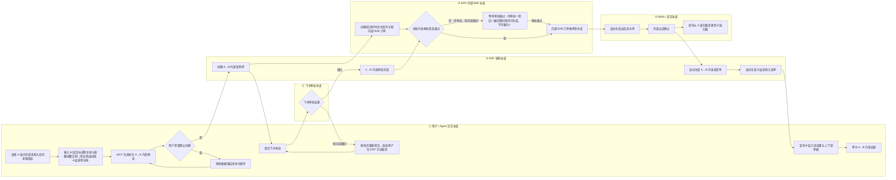

# 内部采购全链路 MCP PRD

> 需求版本：v0.28.7  
> 对应任务：0205 ↔ ERP-205 ↔ ERP-SLICE-PUR-001 / ERP-SLICE-PUR-002 / ERP-SLICE-PUR-003  
> 本版依据：本轮范围约束 1～3、PRD 文档要求 1～4。此前普通采购转内采、独立调拨及采购链路调拨内容退出本次范围。

## 1. 业务背景

现有内部采购需要业务人员在采购单、飞书审批、内部 B2B 订单、履约出库、采购发货和采购入库间切换页面。内部采购单成功创建时，系统会在同一创建链路中自动生成并关联内部 B2B 订单，该动作与飞书审批结果无关；业务人员仍需提交飞书审批，并执行 B2B 推仓、出库确认，之后系统联动库存、采购发货单和采购入库单。（来源：本轮范围约束§2）

多层级内采场景中，已完成入库的商品可能继续在主体间内采，并按业务约定比例调整本层金额。当前人工操作容易出现来源错配、金额计算错误、重复建单和链路中断。（来源：本轮范围约束§3）

本次把现有前端能力转换为 MCP 原子能力；Agent 负责收集意图、查询候选、组织预览和请求确认，ERP 继续负责权限、校验、飞书审批、状态、库存及自动联动。

| 范围 | 说明 |
|---|---|
| 包含 | 内部采购单筛选与查询、详情、创建、提交审批。 |
| 包含 | 内部 B2B 筛选与查询、详情、推单至仓库、标记已履约、导出 PI。 |
| 包含 | 采购入库筛选与查询、详情、从已完成入库明细发起下一层内采、按比例调整金额。 |
| 不包含 | MCP 取消采购、MCP 取消履约；上述取消操作由用户在 ERP 前端手动完成。 |
| 不包含 | 普通采购任一分支自动转内部采购；独立或采购中转调拨；MCP 审核采购单。 |

## 2. 系统使用泳道图

> 图示口径：飞书文档中的流程图/时序图已由业务手动调整，以飞书文档中的手动版本为准；本章文字与表 2-1 只描述业务步骤、泳道归属与流转顺序，与手动版图示冲突时以手动版图示为准。

泳道图按“总—分”拆解：2.1 总览只表达多层级采购 A→B→C→… 的层级递进关系；2.2 是其中任意一次相邻层级转换（单次内采 A→B）的泳道细节。单次流程固定 5 条泳道，每条泳道独占一列，从左到右的列序固定，不与其他泳道共用列：

| 列序 | 泳道 | 覆盖环节 |
|---|---|---|
| ① | 用户 / Agent 交互泳道 | 选源、输入目标主体与金额比例、预览与确认、提交审批、查询结果 |
| ② | ERP 采购泳道 | 创建内部采购单、审批完成、采购发货单、采购入库单 |
| ③ | 飞书审批泳道 | 审批提交与审批结果（通过 / 驳回 / 撤回） |
| ④ | ERP 内部 B2B 泳道 | B2B 生成、审批门禁、等待审批通过、推单至仓库 |
| ⑤ | WMS / 库存泳道 | 出库流水、出库确认、库存归属变更 |

### 2.1 总：多层级采购 A→B→C→…


### 2.2 分：单次内采 A→B 五列泳道



表 2-1 是同一流程的泳道矩阵：每行是一个步骤，每列是一条泳道，列序与上图一致；若渲染器自动布局与列序不一致，以本表列序为准。

| 步骤 | ① 用户 / Agent 交互 | ② ERP 采购 | ③ 飞书审批 | ④ ERP 内部 B2B | ⑤ WMS / 库存 |
|---|---|---|---|---|---|
| 1 | 选择 A 层已完成采购入库的来源商品（U0） | — | — | — | — |
| 2 | 输入 B 层目标采购主体与金额调整比例；供应商自动取 A 层采购主体（U1） | — | — | — | — |
| 3 | MCP 生成本次 A→B 内采预览（U2） | — | — | — | — |
| 4 | 是否确认创建（U3）：否 → 修改数据或结束本次操作（U4），回到第 3 步；是 → 提交创建 | — | — | — | — |
| 5 | — | 创建 A→B 内部采购单（P0） | — | 创建成功即在同一链路同步生成并关联内部 B2B 订单（B0） | — |
| 6 | 提交飞书审批（U5） | — | 接收审批提交，进入审批中（A0） | B2B 已生成、不等待审批、不可履约（B0） | — |
| 7 | — | — | 审批结果（A0）：通过 → 第 9 步；驳回 / 撤回 → 第 8 步 | — | — |
| 8 | 修改后重新提交，或由用户在 ERP 手动取消（U6）→ 重新提交审批（U5） | — | 回到审批中（A0） | 保持已生成、不可履约 | — |
| 9 | — | 内采审批完成（P1） | 审批通过（A0） | 判断关联内采审批是否通过（B1）：是 → 第 11 步；否 → 第 10 步 | — |
| 10 | — | — | 否：待审批 / 驳回 / 撤回 | 等待审批通过（B2）：不自动取消、不履约、不重复生成 B2B；审批通过后进入第 11 步 | — |
| 11 | — | — | 已通过 | 内部 B2B 订单推单至仓库（B3） | 接收推仓任务 |
| 12 | — | — | — | 履约中 | 自动生成出库流水单（W0） |
| 13 | — | — | — | 履约完成 | 完成出库确认（W1）→ 库存从 A 层归属变更至 B 层归属（W2） |
| 14 | — | 自动生成 A→B 内采发货单（P2）→ 自动生成 B 层采购入库单（P3） | — | — | 出库确认（W1）触发 |
| 15 | 查询 B 层入库结果与上下游单据（U7） | — | — | — | — |
| 16 | 单次 A→B 内采结束（U8） | — | — | — | — |

单次流程中，内部采购单与内部 B2B 订单在创建成功时一并生成并建立关联，B2B 生成不等待飞书审批。B2B 的履约门禁以审批结果为唯一入口：审批为“否”（待审批、驳回或撤回）时，B2B 不向推仓推进，而是停在“等待审批通过”；审批最终通过后，从该等待态直接进入“内部 B2B 订单推单至仓库”（B2 → B3），不重复生成 B2B、不重复扣减待履约数量。驳回或撤回须由用户修改后重提审批，重提通过后仍从等待态继续。多层级复用：总览只表达 A→B→C→… 的层级递进，每一条相邻层级转换均复用本条五列泳道，并以本层已完成采购入库作为下一层内采的来源；下一层内采的供应商固定继承上一层采购主体（A→B 时 B 为采购方、A 为供应商；B→C 时 C 为采购方、B 为供应商）。（来源：本轮范围约束§2～3、本轮需求补充及本轮泳道图调整意见）

## 3. 系统功能转换 MCP 清单

### 3.1 采购单

| 功能键 | 必须输入 | 输出 | 确认与规则 |
|---|---|---|---|
| 筛选与查询 | 分页；可选采购单号、B2B 单号、采购方、供应商、仓库、项目、渠道、区域、审批/采购状态、创建时间 | 采购单、主体、商品、数量金额、审批状态、关联 B2B/发货/入库、下一动作 | 只读；按用户权限返回。 |
| 详情 | 内部采购单号或 ID | 采购基本信息、审批/采购/付款/交付状态、采购方与供应商、收款账户、仓库、项目/渠道/区域、税率与含税口径、付款/交货条件、商品明细、数量/单价/币种/金额、收货地址、关联 B2B/发货/入库单、操作记录、下一动作 | 等同进入当前采购单详情页；只读，不触发业务状态变化。 |
| 创建内部采购单 | 3.4 全部必填字段；多层内采需来源入库单/明细、调整比例、请求标识 | 内采单号、同时生成的 B2B 单号、关联、金额摘要、审计编号 | 展示完整预览并确认；重复请求返回首次结果。 |
| 提交审批 | 内采单号/ID、预览版本、确认凭据 | 飞书审批实例、审批状态、提交时间、下一动作 | 必须确认；不得重复创建 B2B。 |

### 3.2 内部 B2B 订单

| 功能键 | 必须输入 | 输出 | 确认与规则 |
|---|---|---|---|
| 筛选与查询 | 分页；可选搜索词、PI 单号、客户、订单/支付状态、时间、销售主体、SKU、内采单号、国家、项目、渠道、区域、异常、Owner | B2B、内采单、商品与待履约量、履约单、仓库、出库状态、异常、下一动作 | 只读；支持内采单号反查。 |
| 详情 | 内部 B2B 单号或 ID | 订单基本信息、订单/支付状态、销售主体、客户与收货地址、币种和金额、商品明细、待履约/已履约数量、履约单与出库状态、仓库/货区/物流信息、PI 文件、关联内采单、异常、操作记录、下一动作 | 等同进入当前内部 B2B 详情页；只读，不执行推仓、标记履约或取消履约。 |
| 推单至仓库 | B2B 单号、仓库、货区、物流渠道、商品行、履约数量、申报价值；按需唯一编码 | 履约单、推仓结果、自动生成的出库流水单/任务、异常 | 确认仓库、商品、数量；MCP 不重复建出库流水。 |
| 标记已履约 | B2B 单号、仓库、货区、物流渠道、商品行、数量、申报价值；按场景提供发货时间、WMS/物流单号、唯一编码 | 履约单、履约/出库状态、下一动作 | 必须确认；不得与推仓重复占用同一数量。 |
| 导出 PI | B2B 单号 | 文件名、文件类型、下载结果、生成时间 | 只读文件生成。 |

### 3.3 采购入库

| 功能键 | 必须输入 | 输出 | 确认与规则 |
|---|---|---|---|
| 筛选与查询 | 分页；可选通用搜索、供应商、收货仓库、货区、创建时间、入库状态 | 入库单/采购单、供应商、仓库货区、状态、预入库/实际入库量、明细、上下游 | 只读；已完成入库的明细可作为下一层内采的来源选择项，MCP 不提供、也不校验剩余可续采数量。 |
| 详情 | 采购入库单号或 ID | 入库单基本信息、入库状态、来源采购单/发货单、供应商、收货仓库与货区、商品明细、预入库/实际入库/差异数量、WMS 入库信息、入库时间、来源与下游内采关系、操作记录 | 等同进入当前采购入库详情页；只读，不执行入库确认。 |

### 3.4 创建内部采购单必填字段

| 字段组 | 必填字段 | 规则 |
|---|---|---|
| 基本信息 | 采购方、内部供应商、收款账户、收货仓库、项目、渠道、区域 | 使用稳定标识；多层内采的内部供应商由系统根据直接来源采购单的采购主体自动带出，不允许另选；账户属于该供应商；维度存在且有权限。 |
| 报价与条件 | 报价是否含税、预计到货时间、库存金额、库存周转、付款条件、交货条件、是否特批 | 税率如填为 0～100；金额/周转不为负。 |
| 支付 | 支付方式；账期时提供起算点、天数 | 支持预付、货到付款、账期；账期 1～365 天。 |
| 商品明细 | 至少一行；每行 SKU、数量、币种、单价、项目、采购方、渠道、区域 | 数量为正整数；币种三位字母；单价不为负；禁止完全重复行。 |
| 收货地址 | 国家/地区、城市、邮编、联系人、手机号码、详细地址 1；提交还需客户邮箱 | 沿用当前格式和长度校验；其余地址字段按条件提供。 |
| 多层来源 | 来源入库单号、来源明细 ID、上一层采购主体、实际入库量、目标数量、金额调整比例 | 来源已完成入库；目标数量由用户输入，MCP 不校验剩余可续采量、不校验是否超额；上一层采购主体自动映射为下一层供应商。 |
| 幂等确认 | 请求标识、预览版本、确认凭据 | 防重复建单；数据变化后旧确认失效。 |

### 3.5 多层级内采金额调整

1. 用户选择已完成入库明细并输入下一层采购主体与本层金额调整比例；下一层供应商由系统自动取直接来源采购单的采购主体，不提供任意选择或改写。
2. 预览必须同时展示“下一层采购方”和“继承的供应商”，并展示供应商来源采购单号；来源采购主体不存在、已失效或无法作为内部供应商时不得创建。
3. 默认：目标行金额 = 目标数量对应的来源金额 × 调整比例；目标单价 = 目标行金额 ÷ 目标数量。
4. 币种、税率及含税口径默认继承来源采购单；金额按当前币种精度舍入，尾差计入最后一行。
5. 系统记录来源金额、比例、调整后金额、来源明细和主体传递关系，支持 A→B→C、A→B→A 逐层追溯。

### 3.6 MCP 原子能力可执行契约

稳定标识优先使用单据 ID；业务单号用于用户输入和展示，服务端解析后返回 ID 与单号。查询类统一按当前用户的数据权限过滤，默认按创建时间倒序，分页从 1 开始、默认 20 条、单页最多 100 条。

### 3.6.1 统一权限原则

- Agent 调用 MCP 使用 ERP 功能时，功能权限与数据权限必须以当前用户登录 ERP 的账号为唯一授权基准。
- MCP 必须将当前 ERP 用户身份透传至每次查询、详情、创建、审批提交、推仓、履约及导出调用，并复用 ERP 现有鉴权与数据范围规则；不得以 Agent、MCP 服务账号或技术账号扩大用户权限。
- 用户在 ERP 前端不可见的单据或不可执行的功能，通过 MCP 同样不可见、不可执行；列表、详情、关联单据、候选项与错误信息均不得泄露越权对象是否存在及其业务数据。
- 权限在预览后、写调用前发生变化时，原确认失效；MCP 返回“当前账号无权限或权限已变化”，停止后续步骤。用户完成授权后需重新查询、重新预览并再次确认，不得沿用旧确认凭据。
- 审计记录同时保存 ERP 用户标识、Agent 应用标识、MCP 原子能力、请求标识与执行结果，以便证明实际操作者及授权来源。

| 原子能力 | 操作者与权限 | 前置状态 | 必填输入/稳定标识 | 成功输出与后置状态 | 标准异常 | 幂等、确认、批量 |
|---|---|---|---|---|---|---|
| 采购单列表 | 有采购查看权限的当前用户 | 无 | page、per_page；筛选条件 | 数据、分页、排序、可执行动作；状态不变 | 无权限、筛选对象不存在 | 只读；无需确认；支持批量查询，不支持跨权限汇总 |
| 采购单详情 | 有目标采购单查看权限的当前用户 | 单据存在 | po_id 或 po_no | 3.1“详情”全量字段；状态不变 | 不存在、无权限 | 只读；无需确认；单笔 |
| 内采创建预览 | 有内采创建权限的当前用户 | 来源明细已完成入库；数量由用户指定 | 3.4 字段、source_inbound_item_id、client_request_id | preview_version、字段快照、数量金额、风险与预计单据；不写入、不占用数量 | 字段无效、来源状态/数量变化 | 只读预览；无需写确认；可多明细但同一直接来源链 |
| 创建内部采购 | 有内采创建权限的当前用户 | 有效预览；数量=用户输入，MCP 不做数量校验 | preview_version、confirmation_token、client_request_id | po_id/po_no、b2b_order_id/no、来源映射、审计号；不占用数量 | 确认失效、ERP 校验拒绝、结果未知 | 幂等键=用户+Agent应用+能力+client_request_id；必须确认；单次创建一张单 |
| 提交飞书审批 | 有采购提交权限的当前用户 | 待审批、已驳回或已撤回 | po_id/po_no、confirmation_token、client_request_id | approval_instance_id、待审批状态 | 状态不允许、飞书失败、重复提交 | 独立幂等键；必须确认；不支持批量 |
| B2B 列表 | 有 B2B 查看权限的当前用户 | 无 | page、per_page；筛选条件 | 数据、分页、排序、履约门禁；状态不变 | 无权限、筛选对象不存在 | 只读；无需确认；支持批量查询 |
| B2B 详情 | 有目标 B2B 查看权限的当前用户 | 订单存在 | b2b_order_id 或 b2b_order_no | 3.2“详情”全量字段、关联采购审批状态；状态不变 | 不存在、无权限 | 只读；无需确认；单笔 |
| 推单至仓库 | 有 B2B 履约权限的当前用户 | 关联内采审批已通过；待履约量充足 | B2B ID、仓库/货区/物流、商品行与数量、confirmation_token、client_request_id | 履约单、出库任务/流水、推仓状态；进入履约中 | 审批未通过、数量不足、WMS 失败/结果未知 | 独立幂等键；必须确认；一单可多商品，不支持跨订单批量 |
| 标记已履约 | 有 B2B 履约权限的当前用户 | 关联内采审批已通过；待履约量充足 | B2B ID、仓库/货区/物流、商品行、线下出库信息、确认凭据 | 履约单、履约完成状态及联动结果 | 审批未通过、重复履约、字段无效 | 独立幂等键；必须确认；不支持跨订单批量 |
| 导出 PI | 有 B2B 查看与导出权限的当前用户 | 订单存在且 PI 数据完整 | b2b_order_id/no | 文件名、类型、文件、生成时间；状态不变 | 无权限、PI 数据不完整 | 只读生成；无需二次确认；单笔 |
| 采购入库列表 | 有采购入库查看权限的当前用户 | 无 | page、per_page；筛选条件 | 数据、分页、排序；状态不变 | 无权限、筛选对象不存在 | 只读；无需确认；支持批量查询 |
| 采购入库详情 | 有目标入库单查看权限的当前用户 | 单据存在 | inbound_id 或 inbound_no | 3.3“详情”全量字段；状态不变 | 不存在、无权限 | 只读；无需确认；单笔 |

## 4. 完整用户使用案例

示例：A 主体已完成商品入库，B 主体向 A 主体内采，本层金额调整为来源金额的 105%。

| 步骤 | 操作 | 输入 | 输出 | 操作确认 |
|---|---|---|---|---|
| 1 | 查询来源入库 | 状态=已完成；可选采购单、SKU、仓库、主体 | 候选入库明细、实际入库数量、来源金额 | 只读；不展示、不校验剩余可续采量。 |
| 2 | 选择来源 | 入库单号、明细 ID、目标数量 | 来源摘要或数量/状态错误 | 无写入。 |
| 3 | 补齐内采条件 | 采购方 B、比例 105%、仓库及核算维度；供应商无需用户输入 | 系统根据来源采购单将 A 层采购主体自动带为供应商 A；返回完整参数或缺失字段 | 用户确认采购方 B 与自动继承的供应商 A；供应商不得另选。 |
| 4 | 生成预览 | 必填字段、来源、数量、比例 | 来源/目标金额、单价、税额、总额、预计内采单+B2B、预览版本 | 预览不写入。 |
| 5 | 确认创建 | 预览版本、参数摘要、请求标识、确认凭据 | 请求受理 | 明确确认主体、金额、商品、数量、仓库。 |
| 6 | 创建内采 | 已确认参数 | 内采单号、同时生成的 B2B 单号、关联、审计编号 | 幂等；创建不代表审批通过。 |
| 6.1 | 查看采购单详情 | 内采单号 | 采购详情、商品与金额、审批状态、关联单据和操作记录 | 只读。 |
| 7 | 提交飞书审批 | 内采单号、确认凭据 | 审批实例、提交状态 | 必须确认；MCP 不审批。 |
| 8 | 查询 B2B | 内采单号/B2B 单号 | 待履约商品、仓库货区物流候选、下一动作 | 只读；B2B 已存在。 |
| 8.1 | 查看 B2B 详情 | B2B 单号 | 订单、客户、商品、金额、履约、出库、PI、异常与关联内采详情 | 只读。 |
| 9 | 推单至仓库 | B2B、仓库、货区、物流、商品、数量、申报价值 | 履约单、推仓结果、出库流水单/任务 | 必须确认。 |
| 10 | 查询出库 | 履约/出库单号 | 待出库、部分、完成或异常及 WMS 信息 | 只读。 |
| 11 | 确认出库 | 履约单、出库结果、确认凭据 | 履约完成、库存变化、采购发货单、采购入库单 | 库存变化前确认；重复调用幂等。 |
| 12 | 查询联动结果 | 内采单号 | 发货、入库、库存流水、上下游、异常 | 只读。 |
| 12.1 | 查看采购入库详情 | 入库单号 | 入库状态、来源单据、仓库货区、商品预入库/实际入库量、WMS 信息、下游内采关系 | 只读。 |
| 13 | 完成本层入库 | 按现有系统完成入库 | 实际入库量、完成状态 | 本需求只转换入库查询；下一层内采数量由用户输入。 |
| 14 | 下一层内采 | 选择本层完成入库明细、新主体、新比例 | 新一层预览及根/直接来源、层级 | 每层单独预览确认。 |

异常时 MCP 停止待执行步骤，返回异常对象、ERP 校验、已完成/未执行步骤和建议。用户处理并明确要求后重新查询实时状态，再重试或从最近可恢复步骤续跑；建单、审批提交、推仓和出库确认均重新确认，已成功步骤不得重复。采购取消与履约取消不由 MCP 执行，需提示用户前往 ERP 前端手动处理。

## 5. 新增交互及规则

| 类型 | 交互/规则 | 新增或映射 |
|---|---|---|
| 查询与详情 | 展示候选；用户选定稳定标识后返回与现有详情页等价的完整数据 | 现有 ERP 能力映射为 MCP |
| 创建预览 | MCP 在调用 ERP 写能力前，汇总主体、来源、商品、数量、金额口径、比例、税额、仓库和预计单据并展示给用户 | MCP 能力（非 ERP 新建能力） |
| 参数绑定确认 | MCP 将用户确认绑定到本次调用的用户、原子能力、参数摘要、预览版本与有效期，避免确认被复用于其他请求 | MCP 能力（非 ERP 新建能力） |
| 下一动作 | MCP 根据 ERP 返回的实时状态与现有门禁，向用户展示当前允许动作和禁止原因 | MCP 能力（非 ERP 新建能力） |
| 审批门禁 | B2B 可随内采创建而生成，但现有 ERP 门禁要求采购审批通过后才能推仓或标记履约；MCP 只复用并展示校验结果 | 现有 ERP 能力映射为 MCP |
| 数量校验与占用 | 不新增续采数量字段、不做上下游数量校验；MCP 按用户提供的数据调用 ERP 创建单据，只反馈 ERP 返回结果 | 明确范围边界（已确认） |
| 人工取消 | 取消采购、取消履约不提供 MCP；提示用户进入 ERP 前端处理 | 明确范围边界 |
| 异常续跑 | MCP 展示 ERP/外部系统异常、已完成与未执行步骤；用户处理后，MCP 重新查询实时状态并按用户指令继续 | MCP 能力（非 ERP 新建能力） |

### 5.1 数量校验与占用（已确认）

- 已确认：本次系统不新增任何字段记录内采“已续采数量”“剩余可续采数量”，也不新增预占、占用或租约机制。
- 已确认：MCP 只按用户提供的数据创建单据（来源入库单/明细、目标主体、目标数量、金额调整比例等），不做任何上下游数据数量上的校验——既不校验来源入库数量是否充足，也不校验该来源是否已被其他下游内采单使用。
- “确认创建”指用户确认 MCP 展示的创建参数并授权 MCP 调用 ERP 现有“创建内部采购单”能力；“创建成功”指 ERP 创建事务返回内部采购单号及关联的内部 B2B 单号。
- 若 ERP 现有校验拒绝（字段格式、必填项、ERP 既有业务规则等），MCP 原样返回 ERP 错误与提示，不自行追加数量校验或拦截。
- 预览不写库、不占用、不参与任何“可续采量”计算；取消采购仍由用户在 ERP 前端手动完成。

## 6. 新增字段及规则

现有采购、B2B、入库业务字段继续复用；新增字段均为 MCP 治理、多层来源与计算追溯字段。

| 字段 | 规则 |
|---|---|
| client_request_id | 同一用户、Agent 应用、能力和请求 ID 唯一 |
| preview_version | 绑定来源状态、数量、价格、权限和计算结果；任一变化即失效 |
| confirmation_token | 一次性、短有效期，绑定用户、能力、参数摘要和预览版本 |
| root_po_no / direct_source_po_no | 分别记录根采购与当前层直接上游采购 |
| source_inbound_item_id | 每个目标商品行绑定直接来源入库明细 |
| source_actual_qty | 创建时来源实际入库数量快照 |
| adjustment_ratio | 大于 0 且小于等于 10，最多 6 位小数；1 表示 100% |
| source_gross_amount / target_gross_amount | 直接上游目标数量对应含税金额与调整后含税金额 |
| calc_trace | 记录口径、公式、中间精度、舍入和尾差归属 |
| audit_no / next_actions | 写操作审计编号；实时允许动作与禁止原因 |

本次不新增 `reserved_qty`、`occupied_qty`、`available_continuation_qty` 等续采数量字段，也不保存已续采/剩余可续采数量。

## 7. 数据计算逻辑

### 7.1 数量边界（本次不做计算与占用）

```text
本次不定义也不计算：
- 已续采数量（下游内采单已使用的来源数量）
- 剩余可续采量（来源入库数量 - 已使用数量）
- 预占量 / 占用租约
```

| 阶段 | 规则 |
|---|---|
| 查询/预览 | 只回显用户输入与来源单据现状，不计算余量、不占用 |
| 用户确认创建 | 按用户输入的目标数量直接调用 ERP 创建能力，不做上下游数量校验 |
| 创建成功 | 记录来源单据与明细标识用于追溯，不写任何占用数量字段 |
| 创建失败 | 直接返回 ERP 错误，不涉及预占释放 |
| 用户在 ERP 人工取消 | 由 ERP 现有逻辑处理，MCP 不参与释放 |

数量一律以用户输入为准：同一来源可被多次内采使用，MCP 不累计、不拦截、不提示超额。若后续业务需要来源余量控制，属于独立的新需求，不在本次范围。

### 7.2 金额口径、精度与舍入

1. 比例统一采用**直接上游商品行的含税金额**为基数；根来源只用于追溯。上游为未税价时先按税率折算含税价。
2. 部分续采：来源部分含税金额 = 直接上游含税单价 × 本次目标数量。
3. adjustment_ratio 大于 0 且小于等于 10，最多 6 位小数；0、负数、超过 10 或更多小数均拒绝。
4. 币种继承直接上游，不支持跨币种换算。
5. 中间值保留 8 位；含税行金额按币种精度（默认 2 位）四舍五入；含税单价 6 位；未税金额=含税金额÷(1+税率)并按币种精度舍入；税额=含税金额-未税金额。
6. 先算未舍入订单总额再逐行舍入；尾差计入 source_inbound_item_id 升序最后一行并写入 calc_trace。

**算例 A—单商品部分续采：**含税单价 100.00 元、税率 13%、续采 4 件、比例 1.05。来源部分 400.00；目标含税 420.00；目标单价 105.000000；未税 371.68；税额 48.32。

**算例 B—多商品尾差：**三行含税金额均为 1.00 元、比例 0.335。未舍入总额 1.005，订单舍入 1.01；逐行 0.335，前两行为 0.34，第三行承接 -0.01 尾差为 0.33，总额 1.01。

**算例 C—多层续采：**A→B 单价 100.00、10 件、比例 1.10，B 层金额 1,100.00、单价 110.000000。B→C 续采 4 件、比例 0.95，以 B 为直接上游：440.00×0.95=418.00；不得按 A 的 100 元计算。A→B→A 同样按直接上游计算。

## 8. 审批与履约状态门禁

| 采购审批状态 | B2B 状态 | 允许动作 | 禁止动作与提示 | 恢复 |
|---|---|---|---|---|
| 未提交/待审批 | 已生成、待审批解锁 | 查询、详情、导出 PI、查询审批 | 禁止推仓/标记履约：“采购尚未审批通过，B2B 已生成但不可履约” | 停留在“等待审批通过”，通过后进入推仓（B2→B3） |
| 已驳回 | 已生成、驳回锁定 | 查询、详情 | 禁止履约：“请修改并重提或在 ERP 手动取消” | 修改后重提，通过后进入推仓（B2→B3） |
| 已撤回 | 已生成、撤回锁定 | 查询、详情、重提审批 | 禁止履约：“采购审批已撤回” | 重提并通过后进入推仓（B2→B3） |
| 已通过 | 待履约/履约中 | 查询、详情、推仓、标记履约、导出 PI | 仍受数量、仓库、WMS 门禁 | 修正后重试 |
| 已取消 | 不可履约 | 查询、详情 | 禁止写操作 | 无 MCP 恢复 |

审批长期未完成时，B2B 保持“已生成、待审批解锁”，停留在“等待审批通过”节点，不自动取消、不履约、不重复生成；审批通过后直接转入“推单至仓库”（B2→B3）。审批与推仓并发时，以推仓写事务开始时重新读取的审批状态和版本为准；未通过或版本变化即失败。审批通过前禁止创建有效履约出库、确认出库或改变库存。重复审批回调幂等；乱序回调只接受更新版本且符合状态机的事件。

## 9. 边界异常矩阵

| 异常 | 错误反馈 | 可重试 | 再确认 | 恢复起点 | 已成功步骤 |
|---|---|---|---|---|---|
| 输入对象不存在 | 指明字段与脱敏标识，不猜测替换 | 修正后可 | 写操作是 | 重新查询/预览 | 不重复 |
| 无权限 | 返回无权限，不泄露对象详情 | 授权后可 | 是 | 权限校验 | 不回滚 |
| 状态不允许 | 返回当前/要求状态和下一动作 | 状态变化后可 | 是 | 重新查询详情 | 不重复 |
| 预览后变化/凭据失效 | 返回变化字段和新版本 | 可 | 是 | 重新预览 | 无写入 |
| 飞书审批提交失败 | 返回飞书错误、采购状态、请求 ID | 回查后可 | 是 | 提交审批 | 已建采购/B2B保留 |
| 审批驳回/撤回 | 返回原因和锁定动作 | 修改后可 | 重提是 | 修改/重提 | B2B 保留不可履约 |
| 审批重复/乱序回调 | 记录事件版本与忽略原因 | 自动幂等 | 否 | 回调消费 | 不重复、不回退 |
| 内采或 B2B 已建但响应超时 | 返回“结果未知”和请求 ID | 仅回查 | 查明未成功后是 | 幂等结果查询 | 已建单保留 |
| 推仓成功但 MCP 未收到结果 | 返回“结果未知”并回查履约 | 仅回查 | 确认未成功后是 | 履约结果查询 | 不重复推仓 |
| WMS 部分出库 | 返回逐商品已出/未出数量 | 剩余量可继续 | 是 | 剩余履约量 | 已出库不回滚 |
| WMS 重复/乱序回调 | 记录事件 ID、版本和忽略原因 | 自动幂等 | 否 | 回调消费 | 不重复扣库存 |
| 发货成功、入库失败 | 返回发货单号、失败原因、待补偿状态 | 可补偿/人工重试 | 人工重试是 | 入库生成 | 发货不重复、不静默回滚 |
| 续跑时实时状态已变 | 返回新旧状态差异，旧确认失效 | 重新规划后可 | 是 | 重新查询预览 | 已成功步骤复用 |
| 上一层采购主体无法作为下一层供应商 | 返回来源采购单、上一层采购主体及不可用原因，不允许用户绕过或改选其他供应商 | 修复主体/供应商配置后可 | 是 | 重新查询来源并预览 | 无写入 |

## 10. 需求追溯与决策记录

| 时间 | 原始诉求/调整 | 最终决策 | 对应功能 |
|---|---|---|---|
| 2026-11-22 | 输出背景、流程、交互、字段、计算、异常 | 保留既定结构并写入同一飞书文档 | 全文 |
| 2026-11-22 | 异常需反馈，处理后重试/续跑 | 增加异常矩阵、状态重查和幂等续跑 | 第 9 章 |
| 2026-11-24 | 主流程曾包含普通采购与调拨 | 最终仅保留内部采购全链路和多层内采 | 第 1～2 章 |
| 2026-11-24 | B2B 生成时点有歧义 | 内采创建成功时同步生成，与审批结果无关 | 第 2、8 章 |
| 2026-11-24 | 取消采购/履约是否转 MCP | 均不转 MCP，由用户在 ERP 前端处理 | 第 1、5、9 章 |
| 2026-11-24 | 需补当前详情页能力 | 采购、B2B、入库均提供只读详情 | 第 3 章 |
| 2026-11-25 | 5.1 数量占用与可续采量待确认 | 不新增续采数量字段、不做任何上下游数量校验，MCP 按用户输入建单 | 第 3、5.1、6、7.1、9、11 章 |
| 2026-11-25 | 时序图人工调整 | 以飞书文档中人工调整后的时序图为准 | 第 2 章 |
| 2026-11-24 | 泳道在列方向未拆分、B2B 待审批分支缺失 | 5 条泳道独占列，列序固定为交互 / 采购 / 审批 / B2B / WMS；B2B 审批为“否”时先进“等待审批通过”再推仓 | 第 2、8 章 |
| 2026-11-24 | 下一层内采供应商归属 | 由系统按直接来源采购单的采购主体自动带出，不允许另选 | 第 2、3.4、3.5 章 |
| 2026-11-24 | 有条件通过，需研发测试无歧义 | 补门禁、金额、异常、契约、验收 | 第 3.6、5～11 章 |

本表将评论中的范围决策内嵌为稳定来源；对应任务 ERP-205，事实源为 PR #13 的 `docs/v0.28.7/tasks/0205/prd-feishu.md`。

## 11. 可测试验收标准

| AC | 验收标准 | 验证方式 |
|---|---|---|
| AC-01 | 内采创建同时返回唯一采购单与 B2B；审批未通过时推仓/标记履约被拒绝，且无出库和库存变化 | E2E；飞书/WMS 显式 mock |
| AC-02 | 审批与推仓并发时仅有效“已通过”版本成功；重复/乱序审批回调不回退状态 | feature + 并发测试 |
| AC-03 | 系统不新增已续采/剩余可续采数量字段，MCP 不计算余量；同一来源可被多次创建，数量完全以用户输入为准 | unit + feature |
| AC-04 | 创建只透传用户输入数量，MCP 不做数量拦截与改写；ERP 拒绝时原样返回 ERP 错误 | feature + contract test |
| AC-05 | 部分、多次、跨层续采逐行绑定直接来源，A→B→C 与 A→B→A 可追溯根与直接来源 | E2E |
| AC-06 | 金额按直接上游含税口径、比例、币种、精度、尾差执行，三个算例结果一致 | unit |
| AC-07 | 同一幂等键重复创建、提交或推仓只产生一份结果；超时回查不重复建单/推仓 | feature；超时显式 mock |
| AC-08 | 异常矩阵每类返回错误、重试性、确认、恢复点和成功步骤；状态变化使旧确认失效 | feature |
| AC-09 | 发货成功、入库失败时只重试入库；WMS 部分/重复/乱序回调不重复扣库存 | E2E；WMS 显式 mock |
| AC-10 | 三类列表具备权限分页排序，详情返回第 3 章字段；越权不泄露对象存在性 | feature |
| AC-11 | MCP 不暴露取消采购和取消履约，相关请求提示用户前往 ERP 手动处理 | contract test |
| AC-12 | 同一 ERP 账号在前端与 Agent 调用 MCP 时获得相同的功能权限和数据范围；无权限对象在列表、详情、关联结果与错误信息中均不泄露，Agent/MCP 服务身份不得扩大权限；预览后权限变化使旧确认失效 | feature + E2E；权限矩阵显式 mock |
| AC-13 | 多层内采中下一层供应商始终等于直接上一层采购主体：A→B 时供应商=A，B→C 时供应商=B；用户无法另选或改写，来源主体失效时创建被拒绝且无单据产生 | unit + feature + E2E |

## 需求依据

- 本文第 10 章《需求追溯与决策记录》（已将评论决策内嵌，避免依赖不可访问的外部段落）。
- Multica 任务 ERP-205 及其 2026-11-22～2026-11-24 评审评论。
- 稳定文档事实源：https://github.com/arlo-hello/erp-ai-docs-arlo/pull/13
- 现有系统内部采购创建、采购操作、内部 B2B 查询与履约、采购入库列表与筛选能力。
