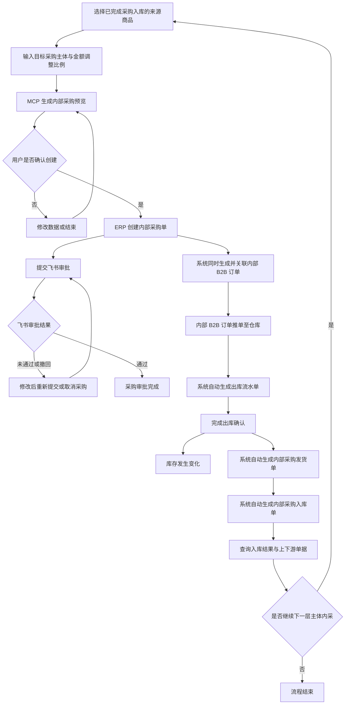

# 内部采购全链路 MCP PRD

> 需求版本：v0.28.7  
> 对应任务：0205 ↔ ERP-205 ↔ ERP-SLICE-PUR-001 / ERP-SLICE-PUR-002 / ERP-SLICE-PUR-003  
> 本版依据：本轮范围约束 1～3、PRD 文档要求 1～4。此前普通采购转内采、独立调拨及采购链路调拨内容退出本次范围。

## 1. 业务背景

现有内部采购需要业务人员在采购单、飞书审批、内部 B2B 订单、履约出库、采购发货和采购入库间切换页面。内部采购单成功创建时，系统会在同一创建链路中自动生成并关联内部 B2B 订单，该动作与飞书审批结果无关；业务人员仍需提交飞书审批，并执行 B2B 推仓、出库确认，之后系统联动库存、采购发货单和采购入库单。（来源：本轮范围约束§2）

多层级内采场景中，已完成入库的商品可能继续在主体间内采，并按业务约定比例调整本层金额。当前人工操作容易出现来源错配、金额计算错误、重复建单和链路中断。（来源：本轮范围约束§3）

本次把现有前端能力转换为 MCP 原子能力；Agent 负责收集意图、查询候选、组织预览和请求确认，ERP 继续负责权限、校验、飞书审批、状态、库存及自动联动。

| 范围 | 说明 |
|---|---|
| 包含 | 内部采购单查询、创建、提交审批、取消采购。 |
| 包含 | 内部 B2B 查询、推单至仓库、标记已履约、导出 PI、取消履约。 |
| 包含 | 采购入库查询、从已完成入库明细发起下一层内采、按比例调整金额。 |
| 不包含 | 普通采购任一分支自动转内部采购；独立或采购中转调拨；MCP 审核采购单。 |

## 2. 系统使用流程图

关键规则：内部采购单与内部 B2B 订单在创建成功时一并生成并建立关联，B2B 生成不等待飞书审批；后续推仓、出库、库存、发货和入库按 ERP 实时状态门禁执行。（来源：本轮范围约束§2）

## 3. 系统功能转换 MCP 清单

### 3.1 采购单

| 功能键 | 必须输入 | 输出 | 确认与规则 |
|---|---|---|---|
| 筛选与查询 | 分页；可选采购单号、B2B 单号、采购方、供应商、仓库、项目、渠道、区域、审批/采购状态、创建时间 | 采购单、主体、商品、数量金额、审批状态、关联 B2B/发货/入库、下一动作 | 只读；按用户权限返回。 |
| 创建内部采购单 | 3.4 全部必填字段；多层内采需来源入库单/明细、调整比例、请求标识 | 内采单号、同时生成的 B2B 单号、关联、金额摘要、审计编号 | 展示完整预览并确认；重复请求返回首次结果。 |
| 提交审批 | 内采单号/ID、预览版本、确认凭据 | 飞书审批实例、审批状态、提交时间、下一动作 | 必须确认；不得重复创建 B2B。 |
| 取消采购 | 内采单号/ID、取消原因、确认凭据 | 取消结果、关联 B2B/履约影响、不可取消原因 | 展示下游影响并确认；按现有状态校验。 |

### 3.2 内部 B2B 订单

| 功能键 | 必须输入 | 输出 | 确认与规则 |
|---|---|---|---|
| 筛选与查询 | 分页；可选搜索词、PI 单号、客户、订单/支付状态、时间、销售主体、SKU、内采单号、国家、项目、渠道、区域、异常、Owner | B2B、内采单、商品与待履约量、履约单、仓库、出库状态、异常、下一动作 | 只读；支持内采单号反查。 |
| 推单至仓库 | B2B 单号、仓库、货区、物流渠道、商品行、履约数量、申报价值；按需唯一编码 | 履约单、推仓结果、自动生成的出库流水单/任务、异常 | 确认仓库、商品、数量；MCP 不重复建出库流水。 |
| 标记已履约 | B2B 单号、仓库、货区、物流渠道、商品行、数量、申报价值；按场景提供发货时间、WMS/物流单号、唯一编码 | 履约单、履约/出库状态、下一动作 | 必须确认；不得与推仓重复占用同一数量。 |
| 导出 PI | B2B 单号 | 文件名、文件类型、下载结果、生成时间 | 只读文件生成。 |
| 取消履约 | B2B 单号、履约单号、原因、确认凭据 | 取消结果、出库/库存影响、不可取消原因、审计编号 | 逆向高风险；展示影响并确认。 |

### 3.3 采购入库

| 功能键 | 必须输入 | 输出 | 确认与规则 |
|---|---|---|---|
| 筛选与查询 | 分页；可选通用搜索、供应商、收货仓库、货区、创建时间、入库状态 | 入库单/采购单、供应商、仓库货区、状态、预入库/实际入库量、明细、可续采/已续采量、上下游 | 只读；只有已完成入库且有可续采量的明细可进入下一层预览。 |

### 3.4 创建内部采购单必填字段

| 字段组 | 必填字段 | 规则 |
|---|---|---|
| 基本信息 | 采购方、内部供应商、收款账户、收货仓库、项目、渠道、区域 | 使用稳定标识；账户属于供应商；维度存在且有权限。 |
| 报价与条件 | 报价是否含税、预计到货时间、库存金额、库存周转、付款条件、交货条件、是否特批 | 税率如填为 0～100；金额/周转不为负。 |
| 支付 | 支付方式；账期时提供起算点、天数 | 支持预付、货到付款、账期；账期 1～365 天。 |
| 商品明细 | 至少一行；每行 SKU、数量、币种、单价、项目、采购方、渠道、区域 | 数量为正整数；币种三位字母；单价不为负；禁止完全重复行。 |
| 收货地址 | 国家/地区、城市、邮编、联系人、手机号码、详细地址 1；提交还需客户邮箱 | 沿用当前格式和长度校验；其余地址字段按条件提供。 |
| 多层来源 | 来源入库单号、来源明细 ID、实际入库量、目标数量、金额调整比例 | 来源已完成入库且有可续采量，不得超额。 |
| 幂等确认 | 请求标识、预览版本、确认凭据 | 防重复建单；数据变化后旧确认失效。 |

### 3.5 多层级内采金额调整

1. 用户选择已完成入库明细并输入本层金额调整比例，预览逐行展示来源与目标金额。
2. 默认：目标行金额 = 目标数量对应的来源金额 × 调整比例；目标单价 = 目标行金额 ÷ 目标数量。
3. 币种、税率及含税口径默认继承来源采购单；金额按当前币种精度舍入，尾差计入最后一行。
4. 系统记录来源金额、比例、调整后金额和来源明细映射，支持 A→B→C、A→B→A 逐层追溯。

## 4. 完整用户使用案例

示例：A 主体已完成商品入库，B 主体向 A 主体内采，本层金额调整为来源金额的 105%。

| 步骤 | 操作 | 输入 | 输出 | 操作确认 |
|---|---|---|---|---|
| 1 | 查询来源入库 | 状态=已完成；可选采购单、SKU、仓库、主体 | 候选入库明细、实际/已续采/可续采数量、来源金额 | 只读。 |
| 2 | 选择来源 | 入库单号、明细 ID、目标数量 | 来源摘要或数量/状态错误 | 无写入。 |
| 3 | 补齐内采条件 | 采购方 B、供应商 A、比例 105%、仓库及核算维度 | 完整参数、缺失字段 | 缺失时不建单。 |
| 4 | 生成预览 | 必填字段、来源、数量、比例 | 来源/目标金额、单价、税额、总额、预计内采单+B2B、预览版本 | 预览不写入。 |
| 5 | 确认创建 | 预览版本、参数摘要、请求标识、确认凭据 | 请求受理 | 明确确认主体、金额、商品、数量、仓库。 |
| 6 | 创建内采 | 已确认参数 | 内采单号、同时生成的 B2B 单号、关联、审计编号 | 幂等；创建不代表审批通过。 |
| 7 | 提交飞书审批 | 内采单号、确认凭据 | 审批实例、提交状态 | 必须确认；MCP 不审批。 |
| 8 | 查询 B2B | 内采单号/B2B 单号 | 待履约商品、仓库货区物流候选、下一动作 | 只读；B2B 已存在。 |
| 9 | 推单至仓库 | B2B、仓库、货区、物流、商品、数量、申报价值 | 履约单、推仓结果、出库流水单/任务 | 必须确认。 |
| 10 | 查询出库 | 履约/出库单号 | 待出库、部分、完成或异常及 WMS 信息 | 只读。 |
| 11 | 确认出库 | 履约单、出库结果、确认凭据 | 履约完成、库存变化、采购发货单、采购入库单 | 库存变化前确认；重复调用幂等。 |
| 12 | 查询联动结果 | 内采单号 | 发货、入库、库存流水、上下游、异常 | 只读。 |
| 13 | 完成本层入库 | 按现有系统完成入库 | 实际入库量、完成状态、下一层可续采量 | 本需求只转换入库查询。 |
| 14 | 下一层内采 | 选择本层完成入库明细、新主体、新比例 | 新一层预览及根/直接来源、层级、占用 | 每层单独预览确认。 |

异常时 MCP 停止待执行步骤，返回异常对象、ERP 校验、已完成/未执行步骤和建议。用户处理并明确要求后重新查询实时状态，再重试或从最近可恢复步骤续跑；建单、审批提交、推仓、出库确认、取消均重新确认，已成功步骤不得重复。

## 需求依据

- 本轮范围约束§1～3。
- 本轮 PRD 文档要求§1～4。
- 现有系统内部采购创建、采购操作、内部 B2B 查询与履约、采购入库列表与筛选能力。
