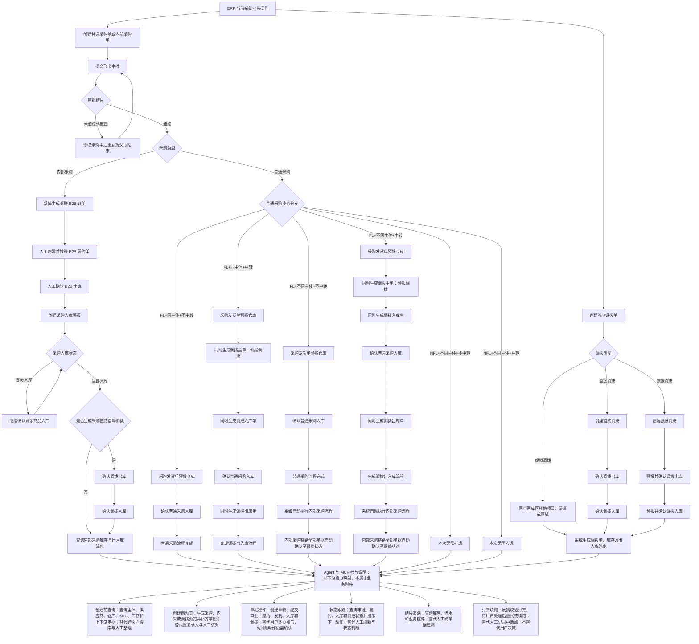

# 采购业务 MCP 与多层级采购 PRD

> 需求版本：v0.28.7  
> 对应任务：0205 ↔ ERP-205 ↔ ERP-SLICE-PUR-001 / ERP-SLICE-PUR-002 / ERP-SLICE-PUR-003 / ERP-SLICE-IMS-001
> 文档口径：以 ERP-205 原始需求、两轮业务确认、最终范围确认及已审查产品方案为依据。

## 1. 背景与问题

现有 ERP 已具备采购、采购发货、采购入库、内部采购关联 B2B、采购链路自动调拨、库存及出入库流水等基础能力，但用户在跨主体、多层级采购场景中仍需频繁切换页面、查询上下游单据并逐步完成操作。原始需求曾考虑建设 ERP 内部“自动化流程”配置模块，后经业务确认调整为：不新增流程配置页面，由外部 Agent 通过 MCP 调用现有 ERP 能力。

本期解决四个问题：

1. 用户可通过 Agent 查询采购链路、可执行动作、库存与流水，不必记忆页面入口和单据关系。
2. 用户可选择同一采购订单下一张或多张采购入库单，按实际入库明细创建并提交下一层内部采购单，支持 A→B→C 和 A→B→A。
3. 内部采购后续仍沿用现有飞书审批、B2B 订单、采购入库及采购链路自动调拨；Agent 仅在系统未自动完成时调用受控的人工操作能力。
4. 用户可通过 Agent 独立创建直接调拨、预报调拨、虚拟调拨：主体变更由内部采购完成；直接或预报调拨在当前主体内调整仓库、库区等库存归属；虚拟调拨用于同仓内转换项目、渠道、区域。

本期明确不做：MCP 审核采购单、一次性创建完整多层采购计划、新增 ERP 自动化流程配置页面、绕过现有权限或状态门禁、使用调拨代替本应进行金额调整的内部采购。

## 2. 当前需求对应用户系统操作流程图



主流程只表达 ERP 当前单据、功能操作及审批、履约、入库、自动调拨等条件或时点分支；Agent 与 MCP 以独立能力映射展示其可参与环节和替代的人工操作。手工创建内部采购单后生成的 B2B 订单固定走人工履约，不设置自动履约判断；普通采购按 FL/NFL、同/不同主体、中转/不中转拆分六种情况，其中 NFL 两种分支本次无需考虑。审批结果、单据生成时点及下一可执行动作均以 ERP 实时状态为准，Agent 不自行推断。

## 3. 新增交互及规则

| 交互 | 新增规则 |
|---|---|
| 自然语言发起任务 | Agent 先查询候选项和现有单据，不允许猜测主体、供应商、仓库、SKU、价格、税率或币种。 |
| 采购/内采预览 | 预览展示主体、供应商、仓库、SKU、数量、价格、币种、来源单据、预计生成单据和下一动作；预览不写业务单据。 |
| 创建草稿 | 创建采购草稿无需二次确认，但必须返回新单号、状态、关联单据和审计编号。 |
| 高风险动作确认 | 提交采购、B2B 履约、发货、出库、入库和逆向操作前，必须展示与本次参数绑定的摘要并取得用户明确确认。 |
| 预览失效 | 预览后数量、价格、权限或单据状态变化时，旧确认失效，用户需重新预览和确认。 |
| 下一动作提示 | 每次查询和写操作均返回 ERP 当前允许的下一动作；Agent 不得跳过状态门禁。 |
| 调拨类型预览 | Agent 根据用户意图和现有数据给出直接、预报或虚拟调拨建议，但最终类型、字段和库存影响必须展示给用户确认。 |
| 直接调拨 | 支持独立创建；用于实体库存归属调整，复用现有主体、仓库、库区、物流、商品、库存、审批和出入库校验。 |
| 预报调拨 | 支持独立创建；仅能在当前主体内调整仓库、库区等库存归属，不能调整主体；用于需要预报仓库作业的实体调拨，必须按预报出库、预报入库及确认顺序执行。 |
| 虚拟调拨 | 支持独立创建；用于同仓同库区内转换项目、渠道、区域，至少一个核算维度必须变化。 |
| 自动调拨 | 采购链路已自动生成调拨时优先返回现有单据，不得创建独立调拨重复实现同一业务目的。 |
| 审批操作 | 采购单仍通过飞书人工审批；MCP 只查询审批状态，不提供审核能力。 |
| 逆向操作 | 不提供通用“回滚”；取消、关闭、退货、冲销分别沿用各单据现有状态规则，并在执行前展示下游影响。 |
| 权限与隔离 | 使用用户本人 ERP 身份；查询和操作范围不得高于本人权限；会话、确认凭据和查询结果不得跨用户或租户复用。 |

## 4. 新增字段及规则

本期不要求 ERP 业务页面新增展示字段；新增字段主要属于 MCP 通用契约、幂等审计和多层采购追溯。

| 字段/字段组 | 规则 |
|---|---|
| 客户端请求标识 | 所有写操作必填；同一 ERP 用户、Agent 应用、工具、业务来源和请求标识重复调用时返回首次结果。 |
| 预览版本 | 提交类操作必填；业务数据变化后版本失效。 |
| 确认凭据 | 提交、履约、出库、入库和逆向操作必填；绑定用户、Agent、工具、参数摘要、预览版本和有效期，只能使用一次。 |
| 根采购单 | 下一层内部采购必须记录整条链路的首张采购单。 |
| 直接来源采购单 | 记录本层采购直接来自哪一张采购单。 |
| 来源采购入库单集合 | 可选择多张，但必须属于同一直接来源采购订单。 |
| 来源入库明细 | 每个目标商品行逐行绑定来源入库明细，不允许只记录汇总来源。 |
| 当前采购层级 | 按来源链路递增，用于 A→B→C 或 A→B→A 追溯。 |
| 上一采购主体 | 默认作为下一层内部采购的供应商。 |
| 已续采数量 | 按来源入库明细累计记录，供并发额度校验。 |
| 调拨类型 | 仅允许直接调拨、预报调拨、虚拟调拨；创建后不可通过重试切换类型。 |
| 调出/调入库存维度 | 包含主体、仓库、库区、项目、渠道、区域；直接/预报调拨按现有字段校验，虚拟调拨要求仓库与库区相同。 |
| 调拨来源业务 | 记录独立业务意图或来源采购/入库单；用于区分自动调拨与独立调拨并防止重复。 |
| Agent 应用与会话 | 审计记录调用来源；不得作为绕过用户 ERP 权限的身份。 |
| 风险等级 | 只读、草稿、提交、库存变化、逆向操作分级；用于决定确认、增强验证、人工复核或熔断。 |
| 审计编号 | 每次写操作返回；支持“业务单据→MCP 调用”和“MCP 调用→关联单据”双向追踪。 |

## 5. 数据计算逻辑

### 5.1 来源累计可用数量

对每一条来源采购入库明细计算：

```text
来源累计可用数量 = 实际已入库数量 - 已被后续内采占用数量 - 已释放前仍有效的逆向数量
```

本次续采数量必须大于 0，且不得超过所选来源明细的累计可用数量。超过可用数量的部分不能继续挂在原采购链路下，需改为无来源的新内部采购。多会话并发创建时采用原子占用，只有校验通过的请求成功。

### 5.2 多入库单明细合并

用户可选择同一采购订单下多张采购入库单。系统按来源明细逐行汇总预览，但创建后的每一目标商品行仍保留原始入库单及入库明细映射。不同直接来源采购订单的入库单不得合并到同一张下一层内采。

### 5.3 默认继承逻辑

- 商品数量默认取来源累计可用数量，用户可调小，不可调大至超过可用量。
- 供应商默认取上一层采购主体。
- 价格、税率、币种和采购条款默认继承直接来源采购单；用户仅可在现有 ERP 权限与校验允许范围内修改。
- 下一层采购主体由用户明确选择；允许与历史主体重复，因此 A→B→A 合法。

### 5.4 幂等与判重

幂等键由“ERP 用户＋Agent 应用＋工具＋业务来源＋客户端请求标识”组成。A→B→A 不按主体组合判重，而按来源单据、来源明细和请求标识判重。调用超时或网络中断时先回查原请求结果，不得盲目重建。

### 5.5 风险计算

风险等级至少考虑操作类型、是否跨主体/跨仓库、是否修改默认价格/税率/币种、数量或金额异常、短时间连续建单、多次校验失败、已有下游的逆向操作及外部系统持续超时。阈值由运营配置；超过阈值后进入增强身份验证、人工复核或写能力熔断，不允许 Agent 通过拆单规避。

### 5.6 调拨类型与库存逻辑

- 同一仓库、同一库区，仅项目、渠道或区域发生变化时使用虚拟调拨；至少一个调入维度必须不同。
- 需要改变主体时先完成内部采购。主体确定后，无需预报仓库作业时使用直接调拨调整仓库、库区等库存归属；需要预报装箱、卡板或收货作业时使用预报调拨，预报调拨不得改变主体。
- 三类调拨的每个 SKU 调拨数量必须大于 0 且不超过调出库存维度的实时可用数量。
- 调拨执行前后保持数量守恒：调出维度减少数量等于调入维度增加数量；失败或取消按现有规则恢复，不允许无来源增减库存。

## 6. 边界异常

通用恢复规则：当用户提供的数据在系统中不存在，或请求未通过现有 ERP 校验时，MCP 必须停止当前待执行步骤并向用户反馈异常对象、校验结果、已完成步骤、未执行步骤和可处理建议。只有在用户确认修正数据或处理异常并明确要求后，才可使用原请求重新执行或从最近一个已成功且可恢复的步骤继续；继续前重新查询实时状态、执行校验并按风险等级重新确认，已成功步骤不得重复执行。

| 边界/异常 | 系统处理 |
|---|---|
| 用户提供的主体、供应商、仓库、SKU、单据编号或其他业务数据在系统中不存在，或现有 ERP 校验未通过 | MCP 立即停止当前待执行步骤，向用户原样反馈异常对象、ERP 校验结果、已完成步骤、未执行步骤及可处理建议，不得猜测或自动替换数据。用户确认修正数据或处理异常后，可要求使用原请求重新执行，或从最近一个已成功且可恢复的步骤继续；继续前必须重新查询实时状态并再次校验，涉及写入、提交、履约、出入库或逆向操作时重新取得用户确认。已成功步骤通过请求标识和幂等记录复用，不得重复执行。 |
| 来源入库单不属于同一采购订单 | 阻止预览并返回冲突单据。 |
| 来源实际可用量不足 | 阻止创建并逐行返回可用数量；超量部分引导创建无来源新内采。 |
| 两个会话并发占用同一来源数量 | 原子校验，只有合法请求成功，不允许超量续采。 |
| 预览后价格、数量、权限或状态变化 | 预览及确认凭据失效，要求重新预览确认。 |
| 重复提交相同请求 | 返回首次业务结果，不重复建单、履约或出入库。 |
| 提交成功但调用超时 | 进入结果未知；按业务来源和请求标识回查，不直接重试创建。 |
| 飞书审批未完成或未通过 | 返回等待或失败原因；不得发货、入库或绕过审批。 |
| 手工内采关联 B2B 已存在履约记录 | 返回现有履约与下一动作，不重复创建履约；手工创建内部采购单的 B2B 不设置自动履约分支。 |
| 自动调拨尚未生成 | 返回等待系统链路及可查询状态，不由 MCP 创建调拨。 |
| 自动调拨已存在但用户又要求独立调拨 | 展示现有自动调拨及业务目的，阻止静默重复；仅当用户确认是新的独立归属调整时继续。 |
| 虚拟调拨调出/调入项目、渠道、区域完全相同 | 阻止创建，要求至少明确一个需要转换的核算维度。 |
| 直接/预报调拨数量超过可用库存 | 阻止创建或执行，返回逐 SKU 实时可用数量。 |
| 直接/预报调拨越序出入库 | 按现有状态门禁拒绝并返回下一合法动作。 |
| 调拨未出库却请求入库 | 按现有状态门禁拒绝，并返回正确下一动作。 |
| 用户拒绝确认或确认过期 | 不发生写入或库存变化。 |
| 用户无权限访问单据 | 不返回业务数据，也不通过错误信息泄露单据是否存在。 |
| 中间层采购取消、退货或冲销 | 沿用现有合法逆向能力；已产生下游时列出受影响单据并分别处理，不做级联静默回滚。 |
| 部分步骤成功 | 返回逐步骤结果；重试时不得重复执行已成功步骤。 |
| 外部文本诱导忽略规则或直接执行 | 视为不可信输入；不改变权限、确认、状态或额度策略。 |
| 连续异常、越权或状态未知达到阈值 | 熔断写工具并告警，保留只读查询供人工排查。 |

## 需求依据

- ERP-205 原始需求及后续业务答复。
- `requirement-analysis.md`：范围、Open Decisions Closed、现有能力事实与核心不变量。
- `product-plan.md`：MCP 能力地图、通用工具契约、状态决策、AI Agent 风险治理与异常补偿。
- `ERP-SLICE-PUR-001`、`ERP-SLICE-PUR-002`、`ERP-SLICE-PUR-003`、`ERP-SLICE-IMS-001`：可独立验证的实现与联调边界。
