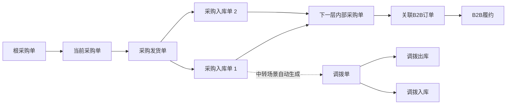
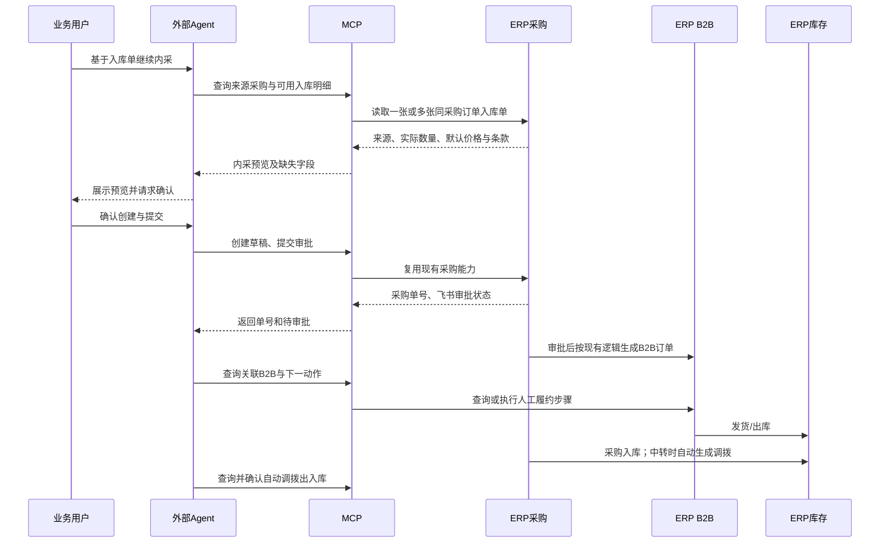

# 采购业务 MCP 与多层级采购产品方案

> 需求版本：v0.28.7
> 状态：待人工评审
> 来源：ERP-205 原始业务描述；用户两轮业务确认；最终范围确认。

## 一页结论

本期把现有采购、发货、采购入库、B2B履约、采购链路自动调拨、库存及出入库流水能力抽象为 MCP，供外部 Agent 使用当前登录用户的 ERP 身份调用。MCP承担“意图转成受控业务动作、补齐信息、展示预览、请求确认、返回结果”，ERP继续承担权限、审批、状态、库存和单据规则。（来源：原始描述“通过agent工具调用MCP”；最终确认“采用用户本人ERP身份”）

多层采购不预建完整计划。每次由用户选择同一采购订单下一张或多张采购入库单，系统按实际入库明细生成下一层内部采购预览；用户可修改现有系统允许修改的数量、价格和条款，确认后创建并提交。采购单仍由飞书人工审核；内部采购自动产生B2B订单，未自动履约的订单由Agent调用MCP逐步履约；采购链路自动产生的调拨仅允许查询和确认出入库，不允许MCP独立创建。（来源：用户答复1至10及第二轮确认1至6）

## 1. 角色与责任边界

| 参与方 | 负责 | 不负责 |
|---|---|---|
| 业务用户 | 提供业务意图、选择候选项、确认写操作及库存变化 | 记忆接口字段和单据状态 |
| 外部Agent | 理解意图、调用查询工具、补齐缺口、展示预览和结果 | 猜测关键主数据、绕过确认或审批 |
| MCP服务 | 身份透传、工具契约、幂等、审计、错误语义和下一动作提示 | 重写ERP领域规则 |
| ERP采购域 | 采购创建、提交、飞书审批状态、发货、入库及内采关系 | 接受MCP越权审批 |
| ERP B2B域 | 内采关联订单、履约及状态 | 替Agent决定业务意图 |
| ERP库存域 | 自动调拨、出入库确认、库存及流水 | 接受MCP独立创建调拨 |

## 2. 核心概念关系

下一层内部采购单必须保留根采购单、直接来源采购单、来源采购入库单集合、来源入库明细、当前层级和上一采购主体。允许A→B→A，链路是否重复只依据来源和幂等请求，不依据主体是否重复。

## 3. 领域事件

| ID | 事件 | 输入 | 输出 | 关键约束 | 来源 |
|---|---|---|---|---|---|
| E01 | 用户授权Agent访问ERP | 用户登录态与授权范围 | 用户身份上下文 | 权限不得高于本人 | 最终确认身份模式 |
| E02 | Agent查询业务候选 | 搜索条件 | 主体、供应商、仓库、SKU、单据候选 | 不允许猜测关键值 | 原始描述；D09 |
| E03 | Agent创建采购预览 | 首层采购字段或来源入库单集合 | 字段、明细、校验、后续动作摘要 | 预览不写业务单据 | D02、D06、D11 |
| E04 | 用户确认创建采购草稿 | 预览版本与客户端请求标识 | 采购单号 | 重复请求返回首次结果 | D01、D13 |
| E05 | 用户确认提交采购单 | 采购单号与当前摘要 | 审批中状态 | 不执行审核 | D01、D13 |
| E06 | 飞书回写审核结果 | 审批结果 | 通过、不通过或撤销 | MCP只查询 | D01 |
| E07 | 用户执行采购发货步骤 | 已审核采购单与发货输入 | 发货单及下一动作 | 沿用现有状态门禁 | D10 |
| E08 | 用户确认采购入库 | 入库单、实际数量、附件等 | 部分收货或已入库 | 库存变化前确认 | D03、D13 |
| E09 | 系统生成内部采购关联B2B订单 | 内部采购单 | B2B订单及关系 | 系统已有自动关系 | D07 |
| E10 | Agent处理B2B履约 | B2B订单与履约输入 | 履约、出库及状态 | 原子步骤分别校验 | D07、D13 |
| E11 | 系统生成中转调拨 | 采购入库与中转条件 | 关联调拨单 | MCP不得重复创建 | D08 |
| E12 | Agent处理自动调拨 | 已有关联调拨 | 出库、入库状态 | 仅采购链路调拨 | D08、D13 |
| E13 | Agent查询库存与流水 | 主体、项目、渠道、区域、仓库、SKU | 库存及出入库流水 | 用户数据权限过滤 | 原始描述模块范围 |
| E14 | Agent执行合法逆向操作 | 单据、原因、当前状态 | 取消、关闭、退货或冲销结果 | 每类操作独立确认，不提供通用回滚 | D10 |

## 4. 主链路

## 5. MCP能力地图

### 5.1 查询工具

| 产品能力名 | 用途 | 主要输出 |
|---|---|---|
| 查询基础资料候选 | 按名称或编码查询主体、供应商、账户、仓库、库区、SKU、项目、渠道、区域 | 唯一标识、名称、可用状态、权限提示 |
| 查询采购单 | 获取普通/内部采购详情、商品、审批、付款、发货和入库摘要 | 当前状态、关联单据、下一可执行动作 |
| 查询采购入库来源 | 查询同采购订单下一张或多张入库单及逐行实际入库数量 | 来源明细、已续采数量、可用数量、默认继承值 |
| 查询采购链路 | 从任一采购、入库或B2B单据追溯根采购与上下游 | 层级、主体迁移、关联单据图 |
| 查询B2B订单及履约 | 查询内部采购关联B2B订单、履约和错误 | 是否自动履约、人工待办、下一动作 |
| 查询自动调拨 | 按采购入库单查询系统自动生成的调拨、出库和入库 | 状态、待办、失败原因 |
| 查询库存 | 按核算维度及SKU查询可用库存 | 数量、时间、维度 |
| 查询出入库流水 | 查询采购、B2B和自动调拨产生的库存流水 | 来源、数量、方向、时间 |

### 5.2 写工具

| 产品能力名 | 前置条件 | 写入结果 | 用户确认 |
|---|---|---|---|
| 生成采购预览 | 首层字段齐全，或来源入库单属于同一采购订单 | 不写单；返回规范化预览 | 否 |
| 创建普通采购草稿 | 无来源场景，字段通过现有校验 | 普通采购草稿 | 否 |
| 创建内部采购草稿 | 无来源新内采，或来源累计可用数量充足 | 内部采购草稿及来源追溯 | 否 |
| 提交采购单 | 草稿可提交且摘要未变化 | 进入飞书审批 | 是 |
| 创建B2B履约 | 关联B2B订单允许人工履约 | 履约记录 | 是 |
| 推送B2B履约 | 履约可推送且库存、地址满足要求 | 仓库出库任务 | 是 |
| 确认B2B出库 | 当前履约允许确认 | 出库完成及流水 | 是 |
| 创建或更新采购发货 | 采购通过且现有规则允许 | 发货单或更新结果 | 是 |
| 创建采购入库预报 | 发货单允许预报 | 采购入库单 | 是 |
| 确认采购入库 | 入库单待处理，实际数量合法 | 部分收货或已入库及流水 | 是 |
| 确认自动调拨出库 | 调拨由采购链路生成且状态允许 | 调拨出库及流水 | 是 |
| 确认自动调拨入库 | 对应调拨出库满足入库条件 | 调拨入库及流水 | 是 |
| 执行合法逆向操作 | 当前单据状态允许对应操作 | 取消、关闭、退货或冲销 | 是 |

本期没有“创建调拨单”工具，也没有“审核采购单”工具。

## 6. 通用Tool契约

每个写工具必须具备以下输入与输出，不允许各模块自行省略。

| 契约项 | 规则 |
|---|---|
| 身份 | 从用户ERP登录授权中取得，不接受Agent传入任意用户ID |
| 客户端请求标识 | 写操作必填；重试使用同一标识 |
| 预览版本 | 提交类工具携带最近预览版本；数据已变化时拒绝并要求重新预览 |
| 业务输入 | 使用ERP稳定标识；名称只能用于搜索，不能直接作为写入主键 |
| 确认凭据 | 提交、履约、出库、入库和逆向操作必填 |
| 成功输出 | 业务单号、状态、关联单据、下一可执行动作、审计编号 |
| 失败输出 | 稳定错误码、用户可理解说明、字段问题、是否可重试、建议下一动作 |
| 幂等 | 同一身份、工具、来源和客户端请求标识返回首次业务结果 |
| 审计 | 记录默认建议值、用户确认值、ERP最终值；价格页面无需展示修改前值 |

### 6.1 基于入库创建内采的专用输入

| 字段组 | 规则 |
|---|---|
| 来源 | 一张或多张采购入库单；必须属于同一直接来源采购订单 |
| 商品 | 每行绑定来源入库明细；默认取尚未用于续采的实际入库数量 |
| 数量 | 大于0且不超过来源累计可用数量；超量必须改走无来源新内采 |
| 供应商 | 默认等于上一层采购主体 |
| 采购主体 | 用户指定下一层主体；允许与历史主体重复 |
| 价格与条款 | 默认继承来源采购订单，允许按现有权限修改 |
| 链路 | 写入根采购、直接来源采购、来源入库明细集合、层级和上一主体 |

## 7. 状态与操作决策

| 对象状态 | 允许查询 | 允许写操作 | 禁止或等待 |
|---|---|---|---|
| 采购草稿/已创建 | 是 | 编辑、提交、符合规则时取消 | 发货、入库、MCP审核 |
| 采购审批中 | 是 | 现有系统允许时撤回/取消 | MCP审核、发货、入库 |
| 采购审批通过 | 是 | 发货、入库预报及现有合法操作 | 再次提交 |
| 采购审批拒绝/撤销 | 是 | 现有规则允许的修改或重提 | 发货、入库 |
| 入库待处理 | 是 | 确认实际入库、合法取消 | 重复确认 |
| 入库部分收货 | 是 | 可作为续采来源；剩余部分继续入库 | 使用超过实际可用量 |
| 入库已完成 | 是 | 可作为续采来源 | 重复确认 |
| B2B待履约 | 是 | 创建/推送履约 | 跳过前置直接确认出库 |
| B2B已自动履约 | 是 | 仅执行系统返回的下一动作 | 重复创建履约 |
| 自动调拨待出库 | 是 | 确认出库 | MCP新建调拨、提前入库 |
| 自动调拨待入库 | 是 | 确认入库 | MCP新建调拨、重复出库 |

## 8. 权限、确认、幂等与审计

1. MCP采用用户本人ERP身份，所有服务端权限校验与页面操作一致。
2. 查询结果按用户的数据权限过滤；工具不能通过报错泄露无权访问单据是否存在。
3. 创建草稿无需二次确认；提交采购、B2B履约、发货、采购入库、调拨出入库和逆向操作必须展示摘要并确认。
4. 确认摘要至少包含主体、供应商、仓库、SKU、数量、价格/币种、来源单据和预计生成单据。
5. 每次写调用记录ERP用户、Agent应用、工具、请求标识、参数摘要、确认摘要、结果和关联单据。
6. 业务超时不得直接重试创建，必须先按来源与请求标识查询已存在结果。
7. Agent仅能调用当前状态返回的下一动作；不得根据自然语言自行跳过状态门禁。

## 9. 异常与补偿

| 场景 | 处理 |
|---|---|
| 来源入库单不属于同一采购订单 | 阻止预览，返回冲突单据 |
| 来源实际可用量不足 | 阻止创建，返回逐明细可用量；超量改走新采购 |
| 预览后价格、数量或状态变化 | 使预览失效，要求重新生成并确认 |
| 提交成功但返回超时 | 按请求标识查询采购单，不重复提交 |
| 飞书审批未完成 | 返回等待审批，不提供绕过能力 |
| B2B已自动履约 | 返回现有履约及下一动作，不重复创建 |
| 自动调拨尚未生成 | 返回等待系统链路及可查询状态，不创建调拨 |
| 中间层取消、退货或冲销 | 执行现有合法动作；已产生下游时列出受影响单据并要求分别处理 |
| 部分成功 | 返回每个步骤成功/失败结果；成功步骤不得因重试重复执行 |

## 10. 验收场景

| AC | 场景 | 预期 | 验证层级 |
|---|---|---|---|
| AC01 | 用户本人授权后查询采购和入库 | 只返回本人有权访问的数据 | feature、E2E |
| AC02 | 基于同一采购订单两张部分入库单创建下一层内采 | 预览合并明细且逐行保留来源，确认后只生成一张内采单 | unit、feature、E2E |
| AC03 | 来源数量默认后由用户调小 | 按确认数量创建，记录默认值与最终值 | feature |
| AC04 | 用户输入超过累计可用量 | 阻止来源续采并提示创建新内采 | unit、feature |
| AC05 | A→B入库后继续B→A | 合法创建且链路层级正确 | feature、E2E |
| AC06 | 创建并提交采购单 | 进入飞书审批，MCP无法审核 | feature、权限测试 |
| AC07 | 重复发送相同请求标识 | 返回同一采购单，不产生重复单 | 幂等并发测试 |
| AC08 | 内采自动生成B2B且不自动履约 | Agent按原子步骤完成履约和出库 | integration、E2E |
| AC09 | B2B已自动履约 | MCP返回现有结果，不重复履约 | integration |
| AC10 | FL+不同主体+中转自动生成调拨 | MCP仅查询并确认自动调拨出入库 | integration、E2E |
| AC11 | 用户尝试独立创建调拨 | 能力不存在或明确拒绝 | contract |
| AC12 | 入库确认前用户拒绝摘要 | 不发生库存变化 | E2E |
| AC13 | 任一步超时后重试 | 先回查，已成功步骤不重复 | 故障注入 |
| AC14 | 无权限用户读取或操作单据 | 不泄露数据且不发生变更 | 权限测试 |
| AC15 | 中间层单据需要取消/退货 | 仅开放当前状态合法操作并返回下游影响 | integration |

## 11. 切片方案

| Slice ID | 业务结果 | 类型 | 独立验证方式 |
|---|---|---|---|
| ERP-SLICE-PUR-001 | Agent以用户本人ERP身份安全查询采购链路及下一动作 | implementation | 使用现有只读数据fixture验证权限、查询与链路聚合 |
| ERP-SLICE-PUR-002 | 用户可基于采购入库创建并提交可追溯的下一层内部采购 | implementation | B2B、飞书和库存以契约Mock隔离，独立验证来源、数量、继承、幂等与提交 |
| ERP-SLICE-PUR-003 | 内采生成B2B后可完成履约、入库及采购链路自动调拨处理 | final | 前两切片合并后进行B2B、采购入库、自动调拨及流水端到端联调 |

实现切片需默认进入待规划 backlog；人工改为 todo 后 Developer 才会执行。

## 12. Trace Ledger

| 需求/决策 | 事件 | 能力 | 切片 |
|---|---|---|---|
| 用户本人身份 | E01-E02 | 授权、查询、审计 | PUR-001 |
| 多入库部分续采 | E03-E05 | 预览、创建、提交 | PUR-002 |
| 飞书人工审核 | E05-E06 | 提交、审批查询 | PUR-002 |
| B2B人工履约 | E09-E10 | B2B查询与履约 | PUR-003 |
| 调拨仅自动链路 | E11-E12 | 自动调拨查询与确认 | PUR-003 |
| 库存与流水 | E08、E10、E12-E13 | 入库、出库、流水查询 | PUR-001、PUR-003 |
| 现有逆向逻辑 | E14 | 合法取消/关闭/退货/冲销 | PUR-003 |
