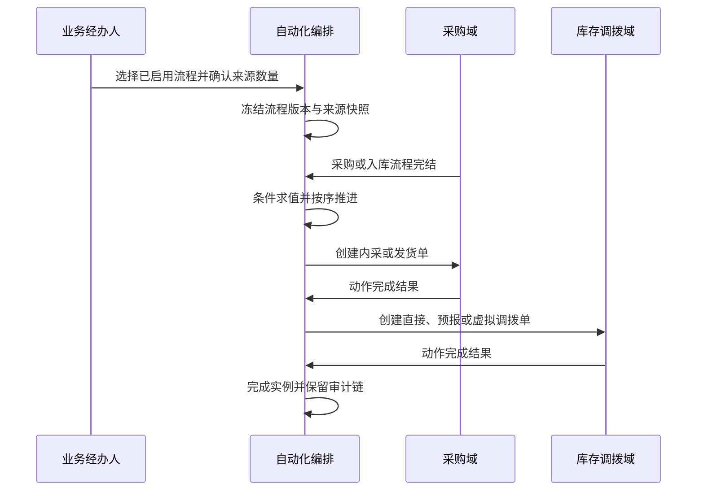

# 采购入库与调拨配置自动化产品方案

> 需求版本：v0.28.7（来源：ERP-205 触发评论“本次需求版本为0.28.7”）
> 状态：待人工评审；当前结论：有条件可做。  
> 来源：ERP-205 Issue§1至§14、§动作语义、§流程完结节点、§既有自动化保留；附件§一至§六。

## 一页结论

新增一个面向采购与库存业务的自动化编排模块：负责人配置流程版本，业务在来源单据上选择已启用流程，系统冻结版本与来源数量；当来源单据达到对应完结节点后，按顺序执行内采、发货或调拨动作，并以幂等账本记录结果。编辑、删除和禁用只影响新实例，运行中实例继续使用原快照。（来源：Issue§2至§14）

本方案不替换现有采购自动链。旧链与新流程对同一来源数量互斥，避免重复建单。（来源：Issue末段；附件§六）自动匹配、分批推进、自动审批、跨主体虚拟调拨在业务确认前不放行。（来源：附件§2.1、§2.3、§六）

## 1. 领域事件与链路

| ID | 事件 | 输入 | 输出 | 异常/幂等 | 来源 |
|---|---|---|---|---|---|
| E01 | 负责人保存流程草稿 | 基础信息、节点、条件、动作、连线 | 草稿版本 | 图校验失败不保存 | Issue§3至§10 |
| E02 | 负责人启用流程版本 | 完整草稿、负责人权限 | 不可变可选版本 | 缺字段、断链、循环时拒绝 | Issue§14 |
| E03 | 业务选择自动化流程 | 来源单据、明细数量、流程版本 | 运行实例与数量占用 | 同一来源数量重复占用时拒绝 | Issue动作语义；附件§三 |
| E04 | 系统判定来源流程完结 | 单据类型与全量完成状态 | 可执行实例 | 重复事件按来源完成事实去重 | Issue流程完结节点1至9 |
| E05 | 系统计算条件结果 | 冻结来源快照、条件组 | 命中/不命中及证据 | 字段缺失进入异常待处理 | Issue§5 |
| E06 | 系统执行动作节点 | 上一步结果、动作配置、商品明细 | 后继单据与关联 | 实例+节点作为幂等键；结果未知先查询再重试 | Issue§6至§10 |
| E07 | 系统推进下一节点 | 已成功动作输出 | 更新后的当前归属与待执行节点 | 上一步未成功不得越过 | 附件§2.2、§2.4 |
| E08 | 异常负责人恢复执行 | 失败节点、纠正后的主数据 | 从失败节点继续 | 已成功节点禁止重复创建 | 附件§三、§六 |
| E09 | 负责人编辑/删除流程 | 当前配置 | 新版本或不可选状态 | 运行实例继续旧版本 | Issue§11至§12 |
| E10 | 系统完成实例 | 所有末端节点成功/不命中 | 释放占用、形成审计结果 | 部分成功不得标记完成 | Issue动作语义 |



## 2. 模块与责任边界

| 模块 | 负责 | 不负责 |
|---|---|---|
| 流程配置 | 基础信息、负责人、版本、启停、删除、节点图校验 | 修改运行实例 |
| 流程选择 | 校验入口、适用条件、数量与旧自动链互斥 | 自动替用户任取多个匹配流程 |
| 运行编排 | 完结判定、条件求值、有序动作、幂等、重试、审计 | 重写内采和调拨单据自身业务规则 |
| 动作适配 | 把冻结配置转换为现有单据创建输入并回写关联 | 绕过既有审批和库存校验 |
| 异常中心 | 展示失败节点、原因、已成功结果并允许恢复 | 回滚已发生的交易或实物收发 |

## 3. 页面与交互

### 3.1 页面清单

| 页面 | 核心内容 | 来源 |
|---|---|---|
| 自动化流程列表 | 名称、入口、启用状态、负责人、版本、更新时间；新建在右上角，其他操作收进“···” | Issue§2 |
| 基础信息 | 名称、描述、启用、负责人多选 | Issue§3 |
| 流程编辑 | 开始、条件、动作节点与连线，保存前做图校验 | Issue§3至§10 |
| 流程详情 | 基础信息、只读流程图、版本、运行统计入口 | Issue§13 |
| 运行详情 | 来源、冻结版本、节点状态、后继单据、异常与重试记录 | 附件§2.4、§三 |
| 来源单据选择弹窗 | 合法流程、适用/不适用原因、商品数量、预期变更摘要 | 附件§2.1、§三 |

### 3.2 列表线框

```text
+---------------------- 自动化流程 ----------------------+
| [名称________] [入口 v] [状态 v] [负责人 v] [查询] [重置] |
|                                                [+ 新建] |
|---------------------------------------------------------|
| 名称 | 入口 | 状态 | 负责人 | 当前版本 | 更新时间 | 操作 |
| ...  | 入库 | 启用 | 张三   | V3       | ...      | ···  |
|---------------------------------------------------------|
| ···：详情 / 编辑 / 启用或禁用 / 删除                    |
+---------------------------------------------------------+
```

### 3.3 流程编辑线框

```text
+---------------------- 流程编辑 ------------------------+
| [基础信息] [流程编辑]                    [保存草稿] [启用] |
| 节点库              | 画布                              |
| + 开始节点          | [入库完成] --> [条件] --> [内采]  |
| + 条件节点          |                         --> [调拨] |
| + 内采动作          |                                    |
| + 发货动作          | 节点属性                           |
| + 三类调拨动作      | [字段配置........................] |
+---------------------------------------------------------+
```

## 4. 关键业务规则

1. 开始节点一条流程只能有一个；动作可分支展示，但每条运行路径必须有确定顺序，不允许循环。（来源：Issue§4、§6）
2. 条件组支持组间和组内且/或；同一层级必须显式保存运算关系，禁止依赖界面顺序猜测。（来源：Issue§5）
3. 启用生成不可变版本；实例绑定版本、来源单据和来源明细数量快照。（来源：Issue§11至§12；附件§六）
4. 删除采用不可选语义，不物理删除被实例引用的版本。（来源：Issue§11）
5. 完结判定严格按单据类型执行：采购场景覆盖 FL/NFL、同/不同主体、中转/不中转；入库要求全部入库；直接/预报调拨要求全部出入库；虚拟调拨保存成功即完成。（来源：Issue流程完结节点1至9）
6. 动作失败时停止后续节点；恢复前先查询是否已生成目标单据，禁止盲目重建。（来源：附件§六“两端一致”）
7. 全部商品沿用上游实际可承接数量；部分商品必须校验所选数量大于0且不超过剩余可处理数量。（来源：Issue§7至§9；附件§六“来源与数量”）
8. 内采价格统一按动作配置比例乘以上游对应含税/不含税价，价格口径与币种缺失时不得默认原价继续。（来源：Issue§7；附件§2.2）
9. 旧采购自动链与新流程互斥：来源选择新流程前必须判定是否已进入旧链；已进入任一链后不得切换造成重复单据。（来源：Issue末段；附件§六）
10. 已发生交易、出库或入库的节点不提供通用回滚；按原单据纠正流程处理。（来源：附件§三、§六）

## 5. 状态设计

### 5.1 流程配置

`草稿 → 已启用 → 已禁用`；任一已启用版本被编辑时创建新草稿，启用新版本后旧版本仅供历史实例读取。删除后进入“已删除/不可选”，历史版本仍可审计。

### 5.2 运行实例

`待触发 → 执行中 → 已完成`；执行中可进入`异常待处理`，修复后回到执行中；业务明确取消且尚无已执行动作时可进入`已取消`。存在已成功动作时不得通用取消。

| 状态 | 编辑配置 | 执行动作 | 重试 | 取消 |
|---|---|---|---|---|
| 待触发 | 不影响实例快照 | 否 | 否 | 允许，释放占用 |
| 执行中 | 不影响实例快照 | 按序 | 仅当前失败节点 | 无已成功不可逆动作时允许 |
| 异常待处理 | 不影响实例快照 | 停止后续 | 先查后重试 | 已有交易时禁止 |
| 已完成 | 不影响 | 否 | 否 | 禁止 |

## 6. 动作字段摘要

| 动作 | 配置输入 | 沿用输入 |
|---|---|---|
| 内采 | 目的采购主体、收款账户、仓库、渠道、区域、含税、付款类型、付款条件、交货条件、单价比例、商品范围 | 沿用时取 SKU、采购数量、含税价、不含税价 |
| 直接调拨 | 调入仓库、调入库区、国家/地区、商品范围与数量 | 主体、调出仓库、调出库区、物流渠道 |
| 预报调拨 | 调入仓库、调入库区、国家/地区、商品范围与数量 | 主体、调出仓库、调出库区、物流渠道 |
| 虚拟调拨 | 调入项目、渠道、区域 | 主体、调拨仓库、库区、调出项目、渠道、区域 |
| 发货 | 待业务补充完整字段 | 不得仅凭动作名进入实现 |

## 7. 权限、异常与审计

- 仅负责人可编辑、启停、删除；查看和选择权限沿用业务模块数据权限，服务端必须复核。（来源：Issue§3）
- 每次保存、启用、禁用、删除记录操作者、时间、版本和差异；每个节点记录输入摘要、幂等键、目标单据、尝试次数和错误。（来源：附件§2.4、§六）
- 重复完成事件返回已处理结果；乱序事件等待前置节点；并发选择使用来源明细数量锁；跨系统超时标记结果未知并先查询。（来源：附件§六“两端一致”“来源与数量”）

## 8. 切片方案

| Slice ID | 业务结果 | 类型 | 依赖与独立验证 |
|---|---|---|---|
| ERP-SLICE-PUR-001 | 负责人可安全配置并发布不可变自动化流程 | implementation | 无前置；独立验证配置、权限、版本 |
| ERP-SLICE-PUR-002 | 来源单据完成后可幂等执行单动作并追溯结果 | implementation | 依赖001的配置契约；合并前用固定版本 fixture 验证 |
| ERP-SLICE-PUR-003 | 采购、入库与调拨可按多动作流程端到端接续 | final | 依赖001/002；只有依赖合并后才做真实联调 |

当前三个切片均为 `CANDIDATE`。D01至D04及“发货动作字段”关闭、契约检查通过后，才可改为 `DEFINED`；人工评审后才可升 `READY`。

## 9. Trace Ledger

| 对象 | ID | 上游 | 下游 | 状态 |
|---|---|---|---|---|
| 事件 | E01-E02 | Issue§2至§14 | PUR-001 | 候选 |
| 事件 | E03-E08 | Issue动作语义、附件§三/§六 | PUR-002 | 候选 |
| 事件 | E09-E10 | Issue§11至§12 | PUR-001/PUR-003 | 候选 |
| 缺口 | D01-D04 | 附件§2.1/§2.3/§六 | 三个切片准入 | 未确认 |
| 风险 | R01 | 旧链与新链重复消费 | PUR-002/PUR-003 | 必须控制 |
| 风险 | R02 | 跨系统超时重复建单 | PUR-002/PUR-003 | 必须控制 |
| 风险 | R03 | 数量并发超占 | PUR-002/PUR-003 | 必须控制 |

## 10. 评审结论

方案已覆盖配置、权限、版本、条件、动作、完结判定、运行状态、幂等、兼容与切片路径，但业务决策 frontier 尚未关闭。建议业务负责人先确认 D01至D04及发货动作字段，再由 PM 更新 Definition revision 并运行准入检查。
