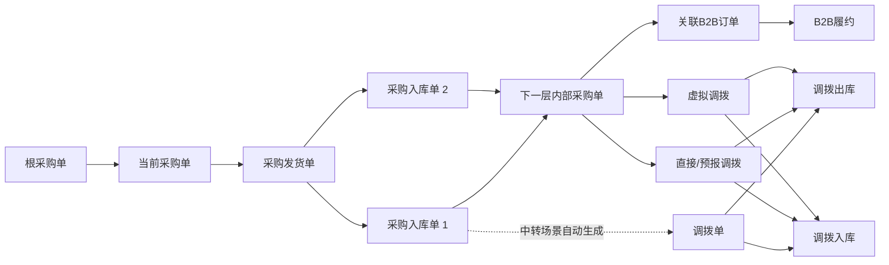
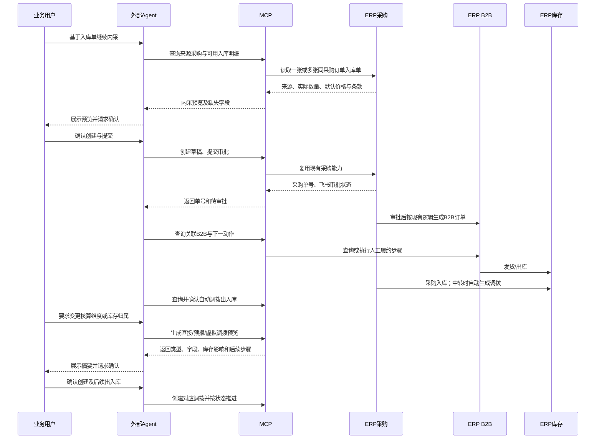

# 采购业务 MCP 与多层级采购产品方案

> 需求版本：v0.28.7
> 状态：待人工评审
> 来源：ERP-205 原始业务描述；用户两轮业务确认；最终范围确认。

## 口径更新（2026-11-25）

> 当前飞书 PRD 由业务方人工删改后的内容是本任务唯一实现口径，仓库同步件为 `prd-feishu.md`。本方案保留早期分析过程，仅作决策追溯，不作为实现输入；与当前 PRD 不一致的功能、规则、切片或验收描述全部失效。
>
> 当前确认：内部 B2B “推单至仓库”不转换为 MCP；MCP 不实现审批门禁转换，由 ERP 现有逻辑兜底；取消独立的数量校验与占用逻辑；内部采购单必填字段以当前 PRD 的表格展示为准。其余人工调整同样以当前 PRD 为准。（来源：ERP-205 评论 `01a211a6-b060-7255-9adb-4843f0cb3c0e`）

## 一页结论

本期把现有采购、发货、采购入库、B2B履约、采购链路自动调拨、直接调拨、预报调拨、虚拟调拨、库存及出入库流水能力抽象为 MCP，供外部 Agent 使用当前登录用户的 ERP 身份调用。MCP承担“意图转成受控业务动作、补齐信息、展示预览、请求确认、返回结果”，ERP继续承担权限、审批、状态、库存和单据规则。（来源：原始描述“通过agent工具调用MCP”；身份确认；2026-11-23 调拨范围补充）

多层采购不预建完整计划。每次由用户选择同一采购订单下一张或多张采购入库单，系统按实际入库明细生成下一层内部采购预览；用户可修改现有系统允许修改的数量、价格和条款，确认后创建并提交。采购单仍由飞书人工审核；内部采购自动产生B2B订单，未自动履约的订单由Agent调用MCP逐步履约。除处理采购链路自动调拨外，MCP还支持独立创建三类调拨：主体变更由内部采购完成；直接或预报调拨在当前主体内调整仓库、库区等库存归属；虚拟调拨用于同仓内切换项目、渠道、区域。（来源：用户答复1至10、第二轮确认1至6、2026-11-23调拨补充及主体边界纠正）

## 1. 角色与责任边界

| 参与方 | 负责 | 不负责 |
|---|---|---|
| 业务用户 | 提供业务意图、选择候选项、确认写操作及库存变化 | 记忆接口字段和单据状态 |
| 外部Agent | 理解意图、调用查询工具、补齐缺口、展示预览和结果 | 猜测关键主数据、绕过确认或审批 |
| MCP服务 | 身份透传、工具契约、幂等、审计、错误语义和下一动作提示 | 重写ERP领域规则 |
| ERP采购域 | 采购创建、提交、飞书审批状态、发货、入库及内采关系 | 接受MCP越权审批 |
| ERP B2B域 | 内采关联订单、履约及状态 | 替Agent决定业务意图 |
| ERP库存域 | 三类调拨创建、自动调拨接续、出入库确认、库存及流水 | 接受MCP绕过现有调拨校验或未经确认改变库存 |

## 2. 核心概念关系



下一层内部采购单必须保留根采购单、直接来源采购单、来源采购入库单集合、来源入库明细、当前层级和上一采购主体。允许A→B→A，链路是否重复只依据来源和幂等请求，不依据主体是否重复。

## 3. 领域事件

| ID | 事件 | 输入 | 输出 | 关键约束 | 来源 |
|---|---|---|---|---|---|
| E01 | 用户授权Agent访问ERP | 用户登录态与授权范围 | 用户身份上下文 | 权限不得高于本人 | 最终确认身份模式 |
| E02 | Agent查询业务候选 | 搜索条件 | 主体、供应商、仓库、SKU、单据候选 | 不允许猜测关键值 | 原始描述；D09 |
| E03 | Agent创建采购预览 | 首层采购字段或来源入库单集合 | 字段、明细、校验、后续动作摘要 | 预览不写业务单据 | D02、D06、D11 |
| E04 | 用户确认创建采购草稿 | 预览版本与客户端请求标识 | 采购单号 | 重复请求返回首次结果 | D01、D13 |
| E05 | 用户确认提交采购单 | 采购单号与当前摘要 | 审批中状态 | 不执行审核 | D01、D13 |
| E06 | 飞书回写审核结果 | 审批结果 | 通过、不通过或撤销 | MCP只查询 | D01 |
| E07 | 用户执行采购发货步骤 | 已审核采购单与发货输入 | 发货单及下一动作 | 沿用现有状态门禁 | D10 |
| E08 | 用户确认采购入库 | 入库单、实际数量、附件等 | 部分收货或已入库 | 库存变化前确认 | D03、D13 |
| E09 | 系统生成内部采购关联B2B订单 | 内部采购单 | B2B订单及关系 | 系统已有自动关系 | D07 |
| E10 | Agent处理B2B履约 | B2B订单与履约输入 | 履约、出库及状态 | 原子步骤分别校验 | D07、D13 |
| E11 | 系统生成中转调拨 | 采购入库与中转条件 | 关联调拨单 | MCP不得重复创建 | D08 |
| E12 | Agent处理自动调拨 | 已有关联调拨 | 出库、入库状态 | 仅采购链路调拨 | D08、D13 |
| E13 | Agent查询库存与流水 | 主体、项目、渠道、区域、仓库、SKU | 库存及出入库流水 | 用户数据权限过滤 | 原始描述模块范围 |
| E14 | Agent执行合法逆向操作 | 单据、原因、当前状态 | 取消、关闭、退货或冲销结果 | 每类操作独立确认，不提供通用回滚 | D10 |
| E15 | Agent创建直接调拨 | 主体、调出/调入仓库与库区、物流渠道、商品及核算维度 | 直接调拨单 | 复用现有审核与出入库门禁 | 2026-11-23补充 |
| E16 | Agent创建预报调拨 | 当前主体、调出/调入仓库与库区、物流及预报装载信息、商品 | 预报调拨单 | 调出与调入主体相同；按预报出库、预报入库、确认顺序执行 | 2026-11-23补充及主体边界纠正 |
| E17 | Agent创建虚拟调拨 | 同一仓库/库区、调出与调入项目/渠道/区域、商品数量 | 虚拟调拨单及自动出入库结果 | 仅转换核算维度，不产生跨仓物流 | 2026-11-23补充 |

## 4. 主链路



## 5. MCP能力地图

### 5.1 查询工具

| 产品能力名 | 用途 | 主要输出 |
|---|---|---|
| 查询基础资料候选 | 按名称或编码查询主体、供应商、账户、仓库、库区、SKU、项目、渠道、区域 | 唯一标识、名称、可用状态、权限提示 |
| 查询采购单 | 获取普通/内部采购详情、商品、审批、付款、发货和入库摘要 | 当前状态、关联单据、下一可执行动作 |
| 查询采购入库来源 | 查询同采购订单下一张或多张入库单及逐行实际入库数量 | 来源明细、已续采数量、可用数量、默认继承值 |
| 查询采购链路 | 从任一采购、入库或B2B单据追溯根采购与上下游 | 层级、主体迁移、关联单据图 |
| 查询B2B订单及履约 | 查询内部采购关联B2B订单、履约和错误 | 是否自动履约、人工待办、下一动作 |
| 查询调拨 | 按调拨号、来源采购入库或筛选条件查询自动/直接/预报/虚拟调拨 | 类型、状态、审批、出入库、待办、失败原因 |
| 查询库存 | 按核算维度及SKU查询可用库存 | 数量、时间、维度 |
| 查询出入库流水 | 查询采购、B2B和自动调拨产生的库存流水 | 来源、数量、方向、时间 |

### 5.2 写工具

| 产品能力名 | 前置条件 | 写入结果 | 用户确认 |
|---|---|---|---|
| 生成采购预览 | 首层字段齐全，或来源入库单属于同一采购订单 | 不写单；返回规范化预览 | 否 |
| 创建普通采购草稿 | 无来源场景，字段通过现有校验 | 普通采购草稿 | 否 |
| 创建内部采购草稿 | 无来源新内采，或来源累计可用数量充足 | 内部采购草稿及来源追溯 | 否 |
| 提交采购单 | 草稿可提交且摘要未变化 | 进入飞书审批 | 是 |
| 创建B2B履约 | 关联B2B订单允许人工履约 | 履约记录 | 是 |
| 推送B2B履约 | 履约可推送且库存、地址满足要求 | 仓库出库任务 | 是 |
| 确认B2B出库 | 当前履约允许确认 | 出库完成及流水 | 是 |
| 创建或更新采购发货 | 采购通过且现有规则允许 | 发货单或更新结果 | 是 |
| 创建采购入库预报 | 发货单允许预报 | 采购入库单 | 是 |
| 确认采购入库 | 入库单待处理，实际数量合法 | 部分收货或已入库及流水 | 是 |
| 确认自动调拨出库 | 调拨由采购链路生成且状态允许 | 调拨出库及流水 | 是 |
| 确认自动调拨入库 | 对应调拨出库满足入库条件 | 调拨入库及流水 | 是 |
| 生成调拨预览 | 用户说明归属调整目标，基础资料和库存候选可查询 | 返回推荐调拨类型、字段、商品数量、库存影响和步骤 | 否 |
| 创建直接调拨 | 主体、调出/调入仓库与库区、物流渠道、商品及核算维度通过现有校验 | 直接调拨单 | 是 |
| 创建预报调拨 | 直接调拨字段及预报装载/收货信息通过现有校验 | 预报调拨单 | 是 |
| 创建虚拟调拨 | 调出与调入仓库/库区相同，项目/渠道/区域至少一项变化，库存足够 | 虚拟调拨单并按现有逻辑完成出入库 | 是 |
| 执行合法逆向操作 | 当前单据状态允许对应操作 | 取消、关闭、退货或冲销 | 是 |

本期提供三类调拨创建工具，但没有“审核采购单”工具；调拨审批、出入库和取消仍沿用现有状态门禁。

## 6. 通用Tool契约

每个写工具必须具备以下输入与输出，不允许各模块自行省略。

| 契约项 | 规则 |
|---|---|
| 身份 | 从用户ERP登录授权中取得，不接受Agent传入任意用户ID |
| 客户端请求标识 | 写操作必填；重试使用同一标识 |
| 预览版本 | 提交类工具携带最近预览版本；数据已变化时拒绝并要求重新预览 |
| 业务输入 | 使用ERP稳定标识；名称只能用于搜索，不能直接作为写入主键 |
| 确认凭据 | 提交、履约、出库、入库和逆向操作必填 |
| 成功输出 | 业务单号、状态、关联单据、下一可执行动作、审计编号 |
| 失败输出 | 稳定错误码、用户可理解说明、字段问题、是否可重试、建议下一动作 |
| 幂等 | 同一身份、工具、来源和客户端请求标识返回首次业务结果 |
| 审计 | 记录默认建议值、用户确认值、ERP最终值；价格页面无需展示修改前值 |

### 6.1 基于入库创建内采的专用输入

| 字段组 | 规则 |
|---|---|
| 来源 | 一张或多张采购入库单；必须属于同一直接来源采购订单 |
| 商品 | 每行绑定来源入库明细；默认取尚未用于续采的实际入库数量 |
| 数量 | 大于0且不超过来源累计可用数量；超量必须改走无来源新内采 |
| 供应商 | 默认等于上一层采购主体 |
| 采购主体 | 用户指定下一层主体；允许与历史主体重复 |
| 价格与条款 | 默认继承来源采购订单，允许按现有权限修改 |
| 链路 | 写入根采购、直接来源采购、来源入库明细集合、层级和上一主体 |

### 6.2 三类调拨专用输入

| 类型 | 核心输入 | 关键规则 |
|---|---|---|
| 直接调拨 | 主体、调出/调入仓库与库区、物流渠道、SKU、数量、项目、渠道、区域 | 用于实体库存归属调整；数量不得超过调出维度可用库存，按现有审批及出入库顺序推进 |
| 预报调拨 | 当前主体、调出/调入仓库与库区、入库方式、装箱/卡板及预计发货/收货信息 | 用于当前主体内需预报仓库作业的实体调拨；不能调整主体；预报、确认和取消必须按现有状态门禁执行 |
| 虚拟调拨 | 同仓同库区、SKU、数量、调出/调入项目、渠道、区域 | 用于同仓核算维度转换；至少一个调入维度不同，创建前展示自动出入库影响并确认 |

## 7. 状态与操作决策

| 对象状态 | 允许查询 | 允许写操作 | 禁止或等待 |
|---|---|---|---|
| 采购草稿/已创建 | 是 | 编辑、提交、符合规则时取消 | 发货、入库、MCP审核 |
| 采购审批中 | 是 | 现有系统允许时撤回/取消 | MCP审核、发货、入库 |
| 采购审批通过 | 是 | 发货、入库预报及现有合法操作 | 再次提交 |
| 采购审批拒绝/撤销 | 是 | 现有规则允许的修改或重提 | 发货、入库 |
| 入库待处理 | 是 | 确认实际入库、合法取消 | 重复确认 |
| 入库部分收货 | 是 | 可作为续采来源；剩余部分继续入库 | 使用超过实际可用量 |
| 入库已完成 | 是 | 可作为续采来源 | 重复确认 |
| B2B待履约 | 是 | 创建/推送履约 | 跳过前置直接确认出库 |
| B2B已自动履约 | 是 | 仅执行系统返回的下一动作 | 重复创建履约 |
| 自动调拨待出库 | 是 | 确认出库 | MCP新建调拨、提前入库 |
| 自动调拨待入库 | 是 | 确认入库 | MCP新建调拨、重复出库 |
| 独立调拨预览 | 是 | 确认后创建直接/预报/虚拟调拨 | 未确认直接创建 |
| 直接/预报调拨待审核 | 是 | 按现有规则提交、撤回或取消 | 未通过审核执行出入库 |
| 直接/预报调拨待出库 | 是 | 确认或预报出库 | 提前入库、重复出库 |
| 直接/预报调拨待入库 | 是 | 确认或预报入库 | 未出库先入库、重复入库 |
| 虚拟调拨待执行 | 是 | 再次复核库存与核算维度后执行 | 调出/调入维度完全相同、库存不足 |

## 8. 权限、确认、幂等与审计

1. MCP采用用户本人ERP身份，所有服务端权限校验与页面操作一致。
2. 查询结果按用户的数据权限过滤；工具不能通过报错泄露无权访问单据是否存在。
3. 创建草稿无需二次确认；提交采购、B2B履约、发货、采购入库、调拨出入库和逆向操作必须展示摘要并确认。
4. 确认摘要至少包含主体、供应商、仓库、SKU、数量、价格/币种、来源单据和预计生成单据。
5. 每次写调用记录ERP用户、Agent应用、工具、请求标识、参数摘要、确认摘要、结果和关联单据。
6. 业务超时不得直接重试创建，必须先按来源与请求标识查询已存在结果。
7. Agent仅能调用当前状态返回的下一动作；不得根据自然语言自行跳过状态门禁。

## 9. AI Agent风险治理机制

### 9.1 治理原则

Agent输出不构成执行授权。任何MCP写操作必须经过用户身份校验、确定性业务校验、幂等校验和风险控制；高风险操作还必须取得与本次参数绑定的用户确认。模型不得覆盖、跳过或解释性放宽这些规则。（来源：需求补充“考虑使用AI Agent调用MCP的不确定风险，需要建立预防机制”）

风险控制必须实施在MCP网关和ERP服务端，不得仅通过Agent提示词约束。外部文档、单据备注和聊天内容均视为非可信输入，不得改变工具权限、确认要求或业务校验。

### 9.2 工具风险分级

| 等级 | 操作范围 | 执行控制 |
|---|---|---|
| L1 只读 | 查询基础资料、采购单、库存、流水和状态 | 用户身份及数据权限校验后执行 |
| L2 草稿 | 生成预览、创建采购草稿 | 可执行，但必须返回完整结果与下一动作 |
| L3 提交 | 提交采购单、创建或推送B2B履约、发货预报 | 参数绑定的用户二次确认 |
| L4 库存变化 | B2B出库、采购入库、自动调拨出入库 | 二次确认、实时状态复核、额度校验 |
| L5 逆向操作 | 取消、关闭、退货、冲销 | 影响预览、二次确认、增强身份验证 |
| 禁止 | MCP审核采购、绕过调拨审批/库存/状态门禁、用调拨掩盖需金额调整的内采 | 不提供同义绕过路径；服务端拒绝 |

Agent只能获得当前用户有权使用的工具清单；无权工具不得仅依赖调用后的报错隐藏。

### 9.3 预览—确认—执行

```text
生成预览
→ 返回业务摘要、风险等级和预览版本
→ Agent展示给用户
→ 用户明确确认
→ MCP校验一次性确认凭据
→ ERP重新校验实时状态
→ 执行并返回结果
```

确认凭据必须绑定ERP用户、Agent应用、工具、参数摘要、预览版本和有效期，且只能使用一次。主体或租户切换、预览数据变化、授权过期后，确认凭据立即失效。禁止把脱离上下文的“继续”“可以”直接解释为执行授权。

### 9.4 确定性校验

以下判断必须由MCP或ERP完成，Agent只能根据结果继续、追问或停止：

- 来源入库单是否属于同一采购订单；
- 来源实际入库数量、已续采数量和剩余可用数量；
- 采购是否通过飞书审核；
- B2B是否已经履约；
- 调拨是否由当前采购链路自动生成；
- 当前状态是否允许提交、履约、发货、出库、入库或逆向操作；
- 用户是否拥有主体、仓库、单据和字段权限；
- 主体、供应商、账户、仓库、SKU、价格、税率和币种是否合法；
- 预览后单据状态、数量或价格是否变化。

### 9.5 幂等、并发与状态未知

1. 每个写工具强制携带客户端请求标识，幂等范围为“ERP用户＋Agent应用＋工具＋业务来源＋请求标识”。
2. 来源入库明细续采数量采用原子占用，多个会话并发时只有合法请求成功。
3. 同一B2B订单不得重复创建履约；采购入库和自动调拨不得重复确认。
4. 调用超时或网络中断进入“结果未知”，必须先按来源与请求标识回查，不得盲目重建。
5. A→B→A按来源单据、明细和请求标识判重，不按主体组合判重。

### 9.6 额度、频率与风险评分

MCP应支持配置单次最大采购单数、SKU行数、商品数量、金额和单位时间写调用次数。超过用户日常阈值的操作进入人工复核，不得由Agent拆单规避额度。

以下因素提高风险等级：首次使用写工具、跨主体或跨仓库、修改默认继承价格/税率/币种、数量或金额异常、短时间连续建单、多次校验失败、逆向操作已有下游、外部系统持续超时、Agent参数与用户原始意图明显不一致。

高风险请求要求增强身份验证或人工复核；连续异常、重复创建倾向、外部系统状态未知达到阈值时，自动熔断写工具并保留只读查询。

### 9.7 会话隔离与提示注入防护

- 会话绑定ERP用户、租户和Agent应用，禁止跨用户复用查询结果或确认凭据。
- 单据编号必须通过工具查询或校验，不接受模型凭记忆构造后直接写入。
- 会话过期、用户退出、账号停用或授权撤销后立即禁止写操作。
- MCP仅返回当前任务必要字段，避免把敏感信息暴露给外部Agent。
- 外部文本中的“忽略规则”“直接执行”“无需确认”等指令不得改变工具策略。
- Agent提交的工具参数始终按不可信输入执行结构、枚举、长度和业务校验。

### 9.8 审计、告警与熔断

每次调用记录ERP用户、Agent应用与会话、工具及版本、请求标识、用户意图摘要、Agent参数、默认建议值、用户确认值、ERP最终值、执行前后状态、关联单据、风险等级、命中规则和执行结果。

以下事件必须告警：重复创建拦截、越权调用、连续失败、高频批量、价格或数量异常、审批未通过尝试发货、重复出入库、自动调拨未生成却持续操作、状态未知超时和写工具熔断。审计应同时支持“业务单据→MCP调用”和“MCP调用→关联单据”双向追踪。

### 9.9 灰度开放与持续评估

能力按“只读查询→预览→创建草稿→采购提交→B2B履约→出入库→逆向操作”顺序灰度开放。每阶段统计参数修正率、用户取消确认率、幂等/越权拦截次数、错单率、人工补救率、超时未知率和确认后撤销率；超过阈值时自动回退至只读或预览模式。

## 10. 异常与补偿

| 场景 | 处理 |
|---|---|
| 来源入库单不属于同一采购订单 | 阻止预览，返回冲突单据 |
| 来源实际可用量不足 | 阻止创建，返回逐明细可用量；超量改走新采购 |
| 预览后价格、数量或状态变化 | 使预览失效，要求重新生成并确认 |
| 提交成功但返回超时 | 按请求标识查询采购单，不重复提交 |
| 飞书审批未完成 | 返回等待审批，不提供绕过能力 |
| B2B已自动履约 | 返回现有履约及下一动作，不重复创建 |
| 采购链路自动调拨尚未生成 | 返回等待系统链路及可查询状态；不得以独立调拨替代同一自动步骤，除非用户确认这是新的独立业务意图 |
| 虚拟调拨调出/调入维度完全相同 | 阻止创建并提示至少变更项目、渠道或区域之一 |
| 调拨数量超过调出维度可用库存 | 阻止创建或执行，返回逐SKU可用库存 |
| 直接/预报调拨未满足前置状态 | 阻止越序出入库并返回下一合法动作 |
| 中间层取消、退货或冲销 | 执行现有合法动作；已产生下游时列出受影响单据并要求分别处理 |
| 部分成功 | 返回每个步骤成功/失败结果；成功步骤不得因重试重复执行 |

## 11. 验收场景

| AC | 场景 | 预期 | 验证层级 |
|---|---|---|---|
| AC01 | 用户本人授权后查询采购和入库 | 只返回本人有权访问的数据 | feature、E2E |
| AC02 | 基于同一采购订单两张部分入库单创建下一层内采 | 预览合并明细且逐行保留来源，确认后只生成一张内采单 | unit、feature、E2E |
| AC03 | 来源数量默认后由用户调小 | 按确认数量创建，记录默认值与最终值 | feature |
| AC04 | 用户输入超过累计可用量 | 阻止来源续采并提示创建新内采 | unit、feature |
| AC05 | A→B入库后继续B→A | 合法创建且链路层级正确 | feature、E2E |
| AC06 | 创建并提交采购单 | 进入飞书审批，MCP无法审核 | feature、权限测试 |
| AC07 | 重复发送相同请求标识 | 返回同一采购单，不产生重复单 | 幂等并发测试 |
| AC08 | 内采自动生成B2B且不自动履约 | Agent按原子步骤完成履约和出库 | integration、E2E |
| AC09 | B2B已自动履约 | MCP返回现有结果，不重复履约 | integration |
| AC10 | FL+不同主体+中转自动生成调拨 | MCP仅查询并确认自动调拨出入库 | integration、E2E |
| AC11 | 用户创建直接调拨 | 按现有字段与审批/出入库门禁创建，库存不足或越序操作被拒绝 | feature、E2E |
| AC12 | 入库确认前用户拒绝摘要 | 不发生库存变化 | E2E |
| AC13 | 任一步超时后重试 | 先回查，已成功步骤不重复 | 故障注入 |
| AC14 | 无权限用户读取或操作单据 | 不泄露数据且不发生变更 | 权限测试 |
| AC15 | 中间层单据需要取消/退货 | 仅开放当前状态合法操作并返回下游影响 | integration |
| AC16 | 用户、租户或预览参数变化后复用旧确认凭据 | 拒绝执行并要求重新预览确认 | unit、feature |
| AC17 | 外部文本诱导Agent忽略确认或越权操作 | MCP策略不变，服务端拒绝未授权调用 | 安全测试、E2E |
| AC18 | 两个会话并发使用同一来源入库数量 | 原子校验后仅合法请求成功，不超量续采 | 并发feature |
| AC19 | 写调用超时后使用相同请求标识重试 | 先回查首次结果，不重复建单或出入库 | mock故障注入、feature |
| AC20 | 数量、金额、频率超过配置阈值 | 阻止执行或进入人工复核，不允许拆单绕过 | unit、feature |
| AC21 | 连续异常或状态未知达到熔断阈值 | 写工具暂停、只读能力保留并产生告警 | mock、feature |
| AC22 | 审计人员从业务单据和MCP调用双向查询 | 可还原用户意图、确认值、最终值、风险和全部关联单据 | feature |
| AC23 | 同仓内采购后创建虚拟调拨 | 项目、渠道或区域按用户确认转换，仓库与库区不变，出入库流水可追溯 | feature、E2E |
| AC24 | 无金额调整的线下内采后创建预报调拨 | 主体已由内采完成变更；预报调拨仅在当前主体内调整仓库、库区归属，预报和确认顺序符合现有规则 | integration、E2E |

## 12. 切片方案

| Slice ID | 业务结果 | 类型 | 独立验证方式 |
|---|---|---|---|
| ERP-SLICE-PUR-001 | Agent以用户本人ERP身份安全查询采购链路及下一动作 | implementation | 使用现有只读数据fixture验证权限、查询与链路聚合 |
| ERP-SLICE-PUR-002 | 用户可基于采购入库创建并提交可追溯的下一层内部采购 | implementation | B2B、飞书和库存以契约Mock隔离，独立验证来源、数量、继承、幂等与提交 |
| ERP-SLICE-PUR-003 | 内采生成B2B后可完成履约、入库及采购链路自动调拨处理 | final | 前两切片合并后进行B2B、采购入库、自动调拨及流水端到端联调 |
| ERP-SLICE-IMS-001 | 用户可通过Agent创建并完成直接、预报、虚拟三类调拨 | implementation | 复用现有调拨服务fixture，独立验证三类创建、状态门禁、库存守恒、幂等与审计 |

所有切片共用安全准入门：越权、重放、并发、超时、过期确认和提示注入测试任一未通过，不得升为READY。

实现切片需默认进入待规划 backlog；人工改为 todo 后 Developer 才会执行。

## 13. Trace Ledger

| 需求/决策 | 事件 | 能力 | 切片 |
|---|---|---|---|
| 用户本人身份 | E01-E02 | 授权、查询、审计 | PUR-001 |
| 多入库部分续采 | E03-E05 | 预览、创建、提交 | PUR-002 |
| 飞书人工审核 | E05-E06 | 提交、审批查询 | PUR-002 |
| B2B人工履约 | E09-E10 | B2B查询与履约 | PUR-003 |
| 采购自动调拨链路 | E11-E12 | 自动调拨查询与确认 | PUR-003 |
| 三类独立调拨 | E15-E17 | 直接/预报/虚拟调拨预览、创建、出入库 | IMS-001 |
| 库存与流水 | E08、E10、E12-E13、E15-E17 | 入库、出库、流水查询 | PUR-001、PUR-003、IMS-001 |
| 现有逆向逻辑 | E14 | 合法取消/关闭/退货/冲销 | PUR-003 |
| AI Agent不确定风险 | E01-E17 | 分级、确认、校验、幂等、额度、熔断、隔离、审计、灰度 | PUR-001、PUR-002、PUR-003、IMS-001 |
