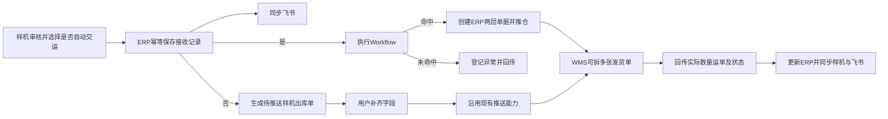
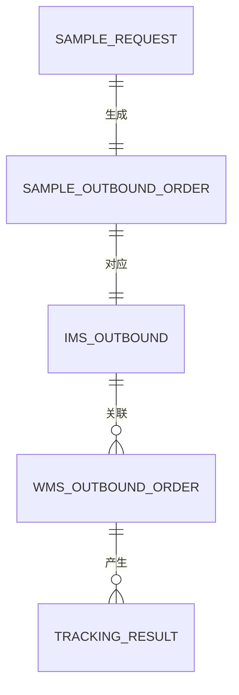

# ERP-208 样机出库跨系统自动化产品方案

## 一页结论

**结论：有条件可做。**复用 ERP 既有样机出库、推仓与 Workflow 能力，以 ERP 为状态权威源；新增样机请求接收、自动/人工分流、飞书同步和 WMS 多发货单关联。上线条件是外部接口幂等、WMS 1:N 关联和结果不明查单机制通过验收。

| 问题 | 结论 |
|---|---|
| 本期解决 | 消除样机申请导出、补模板、导入和逐票放行；自动单命中即推仓，人工单补齐后推送 |
| 不解决 | 飞书审批、主动拆多张 ERP 单、修改两端既有编辑权限、自动替换货况或归属 |
| 核心决策 | 样机侧分流；ERP 为权威源；ERP 单据 1:1、WMS 发货单 1:N |
| 主要风险 | 外部重复请求、推仓结果未知、全组合开放配置质量、旧单据单值 WMS 字段兼容 |
| 下一步 | 人工评审后由 Orchestrator 将实现切片从 backlog 改为 todo |

## 1. 术语与对象

| ID | 标准名称 | 定义 |
|---|---|---|
| T-01 | 样机申请 | 外部样机系统审核后的发货需求 |
| T-02 | 样机出库单 | ERP 业务单据 `ims_other_outbound`，一申请一张 |
| T-03 | 出库流水 | ERP 库存执行单据 `ims_outbound`，与样机出库单 1:1 |
| T-04 | WMS 发货单 | 仓库执行单据，与一张出库流水 1:N |
| T-05 | 待推送 | 已生成 ERP 单据但字段未补齐或尚未人工推仓 |
| T-06 | 接收记录 | 保存外部原请求、版本、办理方式、幂等与历次结果的权威记录 |

## 2. 领域事件

| ID | 事件 | 类型 | 输入 | 输出 | 来源 |
|---|---|---|---|---|---|
| E-01 | 样机申请已接收 | 外部回调 | 申请号、版本、是否自动交运、申请资料 | 接收记录 | 原文§1；D-01 |
| E-02 | 飞书请求已同步 | 系统触发 | 接收记录 | 飞书记录 ID | 原文§1、§5 |
| E-03 | 自动交运已触发 | 系统触发 | 自动交运申请 | Workflow 执行实例 | 原文§2.1 |
| E-04 | 样机推仓动作已执行 | 系统连锁 | 命中规则、仓库、库区、物流、主体、渠道、区域 | 样机出库单、出库流水、WMS 推仓请求 | Issue 描述§3 |
| E-05 | 待推送样机出库单已生成 | 系统触发 | 非自动申请 | 状态=待推送的样机出库单 | 补充说明 |
| E-06 | 待推送单已补齐 | 人的操作-单个 | 用户编辑字段 | 可推送单据 | 补充说明 |
| E-07 | 待推送单已人工推仓 | 人的操作-单个 | 可推送单据 | WMS 推仓请求 | 补充说明 |
| E-08 | WMS 发货单已关联 | 外部回调 | WMS 单号、数量、状态、运单 | 1:N 关联记录 | Q3 |
| E-09 | 办理状态已回传 | 系统连锁 | ERP 权威状态 | 样机与飞书状态 | Q6 |
| E-10 | 异常已登记 | 系统补偿 | 失败环节、原因、责任方 | 可处理异常 | 原文§4 |
| E-11 | 原申请已幂等重推 | 外部回调 | 同申请号、新版本 | 原记录接续 | 原文§4 |
| E-12 | 审批通过已自动推送 | 系统触发 | 已过审申请、申请版本 | ERP 接收请求 | D-10 |
| E-13 | 原申请链路已级联取消 | 人的操作-逆向 | 取消请求、全商品实发数量为 0 | 接收记录、样机出库单、出库流水、WMS 未出库任务取消 | D-11、D-12 |
| E-14 | 编辑申请已重新审批推送 | 系统连锁 | 原链路取消成功、编辑完成、重新审批通过 | 新版本 ERP 接收请求与新办理链路 | D-12 |

事件总数 N=14，全部纳入本期。

## 3. 主流程与责任



| 阶段 | 主责 | 权威数据 | 失败责任 |
|---|---|---|---|
| 申请与分流 | 样机系统 | 样机申请、是否自动交运 | 样机系统 |
| 接收与办理 | ERP | 接收记录、ERP 单据、办理状态 | ERP/OPS |
| 仓库执行 | WMS | WMS 发货单、实际数量、运单 | 仓库/物流 |
| 沟通查看 | 飞书 | ERP 同步副本、沟通字段 | ERP 同步任务 |

## 4. 功能清单

| ID | 功能 | 前置 | 结果 | 异常 |
|---|---|---|---|---|
| F-01 | 幂等接收样机申请 | 申请已审核 | 建立或更新接收记录 | 版本旧则拒绝覆盖 |
| F-02 | 同步飞书原记录 | 接收成功 | 新建或更新同一行 | 失败仅补同步，不重跑发货 |
| F-03 | 按是否自动交运分流 | 字段有值 | 进入唯一办理路径 | 缺值拒绝接收 |
| F-04 | 执行样机 Workflow | 自动交运=是 | 记录命中与动作 | 未命中进入异常 |
| F-05 | 自动创建并推送样机出库 | 动作配置完整 | ERP 两层单据各一张并推仓 | 结果不明进入查单 |
| F-06 | 生成待推送样机出库单 | 自动交运=否 | 单据可带空字段保存 | 不运行 Workflow |
| F-07 | 编辑待推送单 | 状态=待推送 | 保存两端既有允许字段 | 不扩大权限 |
| F-08 | 校验并人工推送 | 必填字段完整 | 沿用现有推送链路 | 缺字段逐项提示 |
| F-09 | 关联多张 WMS 发货单 | WMS 回调有效 | 建立 1:N 关联 | 重复回调幂等 |
| F-10 | 汇总部分出库结果 | 至少一张 WMS 单回传 | 汇总实际数量与状态 | 不以部分成功覆盖失败明细 |
| F-11 | 回传样机与飞书状态 | ERP 状态变化 | 两端同口径更新 | 失败仅补传结果 |
| F-12 | 处理重推与并发 | 同申请重复到达 | 单一有效办理实例 | 手动与定时互斥 |
| F-13 | 处理取消与拦截 | 有效取消申请 | 未发部分停止、已发部分保留 | 已出库转拦截/RMA |
| F-14 | 查询异常与责任方 | 存在异常 | 样机与飞书可见用户化原因 | 内部报错不得直接外显 |
| F-15 | 审批通过自动推送申请 | 样机申请审批通过 | 以申请号与版本自动调用 ERP | 推送失败保留待补推状态 |
| F-16 | 校验零实发并级联取消 | 所有出库商品实发数量为 0 | 原链路全部单据进入取消并同步结果 | 任一实发数量大于 0 时禁止；WMS 结果不明时保持取消中 |
| F-17 | 编辑后重新审批并创建新版本链路 | 原链路取消成功 | 编辑保存后重新审批，通过后推送新版本 | 取消未完成不得创建新办理链路 |

功能点 M=17，M≥N=14；每个事件至少由一个功能覆盖。

## 5. 状态设计

### 5.1 接收记录状态

`已接收 → 自动处理中/待推送 → 推仓处理中 → 推仓成功 → 部分出库 → 已出库`

任一处理中状态可进入“异常”；取消路径为“取消中 → 已取消/取消失败”。“结果不明”是独立状态，禁止当作失败重推。

### 5.2 状态×操作决策摘要

| 状态 | 编辑 | 推送 | 重推 | 取消 |
|---|---|---|---|---|
| 待推送 | ERP 可补齐字段；样机侧编辑须先校验全商品实发为 0 并取消原链路 | 字段完整时允许 | 不适用 | 全商品实发为 0 时允许 |
| 自动处理中 | 样机侧仅在全商品实发为 0 时可发起编辑并先取消原链路 | 系统执行 | 防并发拒绝 | 全商品实发为 0 时允许 |
| 异常 | 样机侧仅在全商品实发为 0 时可发起编辑并先取消原链路 | 修正后按原路径继续 | 允许且接续原记录 | 全商品实发为 0 时允许 |
| 结果不明 | 禁止重复推送 | 禁止 | 仅查单 | 进入取消需先确认仓库事实 |
| 推仓成功 | WMS 实发为 0 时允许样机侧发起编辑并进入级联取消 | 禁止 | 禁止 | 实发为 0 时发起仓库取消，确认后完成 |
| 部分出库 | 禁止，提示已有出库商品 | 禁止 | 禁止 | 禁止，提示已有出库商品 |
| 已出库 | 禁止，提示已有出库商品 | 禁止 | 禁止 | 禁止，提示已有出库商品 |
| 已取消 | 只读 | 禁止 | 禁止 | 禁止；再发需新申请 |

## 6. 单据关系与不变量



- 同一外部申请号只能有一个有效接收记录和一张有效样机出库单。
- 一张样机出库单只能对应一张 ERP 出库流水。
- 多张 WMS 发货单实际数量之和不得超过 ERP 计划数量。
- 接收与 Workflow 匹配不占用库存；正式出库单按既有规则占用；失败/取消仅释放实际已占用量。
- 旧版本回调不得覆盖新版本成功结果。
- 编辑产生的新版本必须等待旧版本全链路取消成功且重新审批通过后才能推送；旧版本与新版本链路分别留存审计。
- “无出库商品”的机械判定为该申请关联 ERP 出库流水下所有商品 `actual_qty = 0`；任一商品 `actual_qty > 0` 即禁止样机侧编辑和取消。

## 7. 页面与交互

本期复用样机出库列表、详情、编辑和推送入口，增加来源申请号、是否自动交运、当前环节、同步状态、异常责任方、WMS 发货单明细。飞书提供“全部请求”“待推送”“异常待处理”视图，不提供 Workflow 放行按钮。

### 样机出库详情线框

```text
+ 样机出库详情 [待推送] --------------------------------+
| 来源申请号 | 是否自动交运: 否 | 当前环节 | 最近同步时间 |
| 仓库* [空] | 库区* [空] | 物流渠道* [空]              |
| 主体*      | 渠道*      | 区域*      | 收件资料       |
| 商品明细: SKU | 计划数量 | 已发数量 | 货况            |
| WMS发货单: WMS单号 | 状态 | 实发数量 | 运单           |
| [保存] [校验并推送] [取消] [查看操作日志]               |
+----------------------------------------------------------+
```

## 8. 接口与数据变更

| 接口 | 用途 | 幂等键 |
|---|---|---|
| POST `/sample-outbound/requests` | 接收或更新样机申请 | 申请号+版本 |
| POST `/sample-outbound/{no}/push` | 人工推送待推送单 | 出库单号+操作版本 |
| POST `/sample-outbound/{no}/retry` | 原路径重试 | 申请号+处理版本 |
| POST `/callbacks/wms/sample-outbound` | 回传多张 WMS 发货单结果 | WMS单号+事件号 |
| GET `/sample-outbound/{no}` | 查询权威进度 | 无 |

数据变更以需求分析第5章为边界：新增请求表、WMS 1:N 关联表和同步任务表；既有 `wms_outbound_no` 保留兼容，不再作为多单场景的唯一事实源。

## 9. 异常与补偿

- ERP 未接收：样机补推同一申请号。
- 飞书或样机回传失败：只补传，不重跑 Workflow 或推仓。
- Workflow 无匹配：记录具体缺口和 OPS 责任，不绕过规则。
- 推仓超时：进入结果不明，按 ERP 单号查 WMS；确认不存在后才允许重推。
- 并发重推：按申请号加锁，只保留一个执行实例。
- 部分出库：逐 WMS 单保存事实，汇总状态为部分出库；因已存在实发商品，样机系统禁止取消和编辑。
- 审批通过：样机系统自动推送 ERP；失败仅补推同一申请版本。
- 取消：先校验所有商品实发数量为 0，再将 ERP 本地链路原子标记为取消中；已推 WMS 的任务待仓库确认取消后，整条链路才进入已取消。
- 编辑：复用取消守卫；旧链路取消成功后允许修改并重新审批，审批通过自动推送新版本，禁止复活旧链路。

## 10. 验收摘要

1. 自动交运申请无需飞书放行即可执行 Workflow 并推仓。
2. 非自动申请生成待推送单，允许空字段保存，字段不完整时禁止推送。
3. 同一申请重复提交不生成第二张有效 ERP 样机出库单。
4. 一张 ERP 出库流水可关联多张 WMS 发货单并汇总实际数量、运单和状态。
5. 同步失败、结果回传失败不触发重复发货。
6. 结果不明时只查单，不盲目重推。
7. 样机申请审批通过后自动推送 ERP，重复审批事件不产生第二个办理实例。
8. 任一出库商品实发数量大于 0 时，样机系统禁止取消和编辑并提示“当前样机申请已有出库商品，不允许取消与编辑”。
9. 全商品实发数量为 0 时，取消可级联取消原链路；编辑须在旧链路取消成功后重新审批并推送新版本。

## 11. 风险

| ID | 风险 | 应对 |
|---|---|---|
| R-01 | 首期全部组合开放导致配置缺失 | Workflow 未命中转明确异常；上线前全量配置巡检 |
| R-02 | 单值 WMS 字段造成多单丢失 | 新增 1:N 关联表，旧字段仅兼容首单 |
| R-03 | 两端均可修改造成乱序覆盖 | 版本号、字段归属与旧版本拒绝覆盖 |
| R-04 | 推仓结果不明造成重复发货 | 查单优先、幂等键、单实例锁 |

## 12. Trace Ledger

| 决策 | 事件 | 功能 | 切片 |
|---|---|---|---|
| D-01～D-05、D-10～D-12 | E-01～E-07、E-12～E-14 | F-01～F-08、F-12～F-17 | ERP-SLICE-ORD-001 |
| D-06 | E-08 | F-09～F-10 | ERP-SLICE-IMS-001 |
| D-09 | E-02、E-09 | F-02、F-11 | ERP-SLICE-PLAT-001 |

