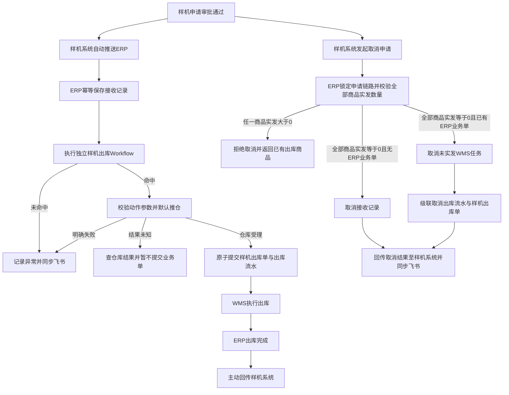

# ERP-208 样机出库跨系统自动化产品方案

## 一页结论

**审批通过后的样机申请统一进入全新的“样机出库” Workflow；只有规则命中且仓库受理成功，ERP 才提交样机出库单和出库流水。** Workflow 未命中、推仓明确失败或结果未知均只保留接收/异常事实并同步飞书，不向样机系统回传异常。样机出库完成后 ERP 主动回传完成结果；审批通过后禁止编辑，只允许零实发取消。

| 项目 | 最新方案 |
|---|---|
| 唯一路径 | 审批通过 → 推送 ERP → 样机 Workflow → 默认推仓 |
| 失败边界 | 失败不生成样机出库单、出库流水或其他自动单据 |
| Workflow | 独立对象、独立条件、独立动作处理，不复用订单条件组 |
| WMS | 一张 ERP 出库流水最多一张 WMS 物流单，不考虑分批发货 |
| 逆向 | 审批后禁止编辑；全部商品实发为 0 才可取消并级联取消 |
| 外部同步 | 异常只同步飞书；出库完成主动回传样机系统 |

## 1. 术语与数据域

| ID | 标准名称 | 定义 |
|---|---|---|
| T-01 | 样机申请 | 外部样机系统审批通过的出库需求 |
| T-02 | 样机物流渠道 | 样机系统新增非必填字段，选项由业务另行提供，与 ERP 基础物流渠道无关 |
| T-03 | ERP 物流渠道 | ERP“仓库&配送/物流渠道”基础数据，用于动作推仓配置 |
| T-04 | 样机接收记录 | ERP 保存请求快照、Workflow 结果、异常和同步状态的技术/审计记录，不是出库业务单据 |
| T-05 | 样机出库单 | Workflow 成功且仓库受理后提交的 ERP 业务单据 |
| T-06 | 出库流水 | 与样机出库单 1:1 的 ERP 库存执行单据 |
| T-07 | WMS 物流单 | 与出库流水 0..1 关联的仓库执行单据 |

## 2. 领域事件

| ID | 事件 | 输入 | 输出 | 异常输出 | 来源 |
|---|---|---|---|---|---|
| E-01 | 已过审样机申请已接收 | 申请号、渠道、样机物流渠道、设备状态、活动、计划、SKU、收件与商品资料 | 样机接收记录 | 接收异常同步飞书 | 补充§1.2 |
| E-02 | 样机 Workflow 已匹配 | 六个条件值、已发布规则快照 | 唯一命中结果与动作参数 | 未命中异常，不建业务单 | 补充§1.2.2、§2.1 |
| E-03 | 仓库推送已受理 | 动作参数、商品与收件资料、幂等键 | WMS 物流单号 | 明确失败/结果未知，不提交业务单 | 补充§1.2.2、§3 |
| E-04 | ERP 单据链已提交 | 仓库已受理事实 | 一张样机出库单、一张出库流水 | 事务回滚并进入补偿 | 补充§1.2.2 |
| E-05 | 异常已同步飞书 | 接收记录、失败环节和原因 | 原飞书行新增/更新 | 独立补偿，不重跑 Workflow | 补充§1.2.2 |
| E-06 | 样机出库已完成 | 出库流水完成、实际数量、WMS 物流单号 | 样机系统完成结果 | 回传补偿任务 | 补充§5 |
| E-07 | 样机取消已受理 | 取消请求、全部商品实发为 0 | ERP 全链路取消中 | 有实发则拒绝 | 补充§6–6.1 |
| E-08 | ERP 全链路已取消 | 仓库取消确认、本地单据状态 | 接收记录、出库单、流水、仓库任务均取消 | 取消失败/结果未知 | 补充§6.1 |

事件总数 N=8，全部纳入本期。

## 3. 主流程与责任



| 阶段 | 主责 | 权威事实 | 不做什么 |
|---|---|---|---|
| 申请与审批 | 样机系统 | 申请内容、样机物流渠道、审批结果 | 不再提供是否自动交运；审批后不允许编辑 |
| 接收与匹配 | ERP ORD | 接收记录、规则快照、命中结果 | 不复用订单条件对象 |
| 推仓与出库 | ERP IMS/WMS | 单据链、库存、WMS 物流单、实发数量 | 不拆多张 WMS 单 |
| 异常沟通 | 飞书 | ERP 同步副本 | 不触发 Workflow，不改 ERP 业务事实 |

## 4. Workflow 设计

### 4.1 触发器与条件组

触发器名称为“样机出库”。这是全新触发器对象，必须拥有独立的对象属性、操作符判断、动作处理器和最终处理器，不能引用现有订单创建、订单履约或订单活动的条件组。触发器配置中的“项目”为必填字段，并受当前账号 TAP 数据权限约束。触发器与条件按 ERP 现有交互分开展示和配置，不在触发器抽屉中内嵌条件组。

```text
+ 触发器配置：样机出库 -----------------------------------+
| Workflow名称* [____________________________________]    |
| 项目*          [请选择项目 v]                           |
|                仅展示当前账号 TAP 授权项目              |
| 触发器*        [样机出库 v]                             |
|                                                        |
|                                      [取消] [应用配置]  |
+--------------------------------------------------------+
```

```text
+ 编辑配置：条件 -----------------------------------------+
| 条件描述                                                |
| [____________________________________________________]  |
|                                                        |
| 包含内容                                                |
|                                                        |
| 关系                                                    |
| [且 v]                                                 |
|                                                        |
| +----------------------------------------------------+ |
| |                                              [删除] | |
| | 条件字段                                           | |
| | [请选择条件字段 v]                                 | |
| +----------------------------------------------------+ |
|                                                        |
| [                    + 添加条件                      ]  |
|                                                        |
|                                      [取消] [应用配置]  |
+--------------------------------------------------------+
```

线稿约束：第一张为触发器配置，仅展示 Workflow 名称、项目、触发器；第二张为独立条件“编辑配置”抽屉，沿用现有条件描述、包含内容、关系、条件卡片、删除、添加条件、取消和应用配置结构。选择“条件字段”后，再按字段类型展示对应操作符和值控件。物流渠道候选值来自样机系统独立选项，不调用 ERP 基础物流渠道；未选择物流渠道时仍允许保存条件配置。样机条件字段仅提供渠道、物流渠道、设备状态、活动、计划、SKU，不展示订单触发器已有条件。

项目权限规则：

1. 项目下拉只返回当前登录账号经 TAP 数据权限过滤后的项目，不得返回或搜索到未授权项目。
2. 保存、更新和发布 Workflow 时，服务端必须重新校验所选项目仍在当前账号授权范围内；直接构造未授权项目 ID 的请求应被拒绝。
3. 本规则仅约束 Workflow 配置时的项目可见、可选和可提交范围，不改变已发布规则的运行时匹配语义。

| 条件 | 来源 | 类型 | 规则 |
|---|---|---|---|
| 渠道 | 样机系统 | 单选/文本 | 按样机原值匹配 |
| 物流渠道 | 样机系统 | 非必填独立枚举 | 不调用 ERP 基础物流渠道枚举；空值可作为条件 |
| 设备状态 | 样机系统 | 单选/文本 | 按样机原值匹配 |
| 活动 | 样机系统 | 单选/文本 | 按样机原值匹配 |
| 计划 | 样机系统 | 单选/文本 | 按样机原值匹配 |
| SKU | 样机系统商品明细 | 多值 | 支持包含/任一命中类操作符 |

### 4.2 动作

动作“样机出库推仓”保留仓库、库区、ERP 物流渠道、主体、ERP 渠道、ERP 区域六个必填配置；删除“是否推单至仓库”，命中后始终推仓。仓库变化时清空库区和 ERP 物流渠道，二者仅可选择该仓库下有效项。

```text
+ 动作配置：样机出库推仓 --------------------------------+
| 仓库*          [请选择仓库 v]                           |
| 库区*          [请先选择仓库 v]                         |
| ERP物流渠道*   [仅展示当前仓库下渠道 v]                 |
| 主体*          [请选择主体 v]                           |
| ERP渠道*       [请选择渠道 v]                           |
| ERP区域*       [请选择区域 v]                           |
| 提示：保存并发布后，命中该动作将默认推送仓库。          |
|                                        [取消] [保存]    |
+--------------------------------------------------------+
```

## 5. 功能清单

| ID | 功能 | 通过结果 | 失败结果 |
|---|---|---|---|
| F-01 | 幂等接收已过审申请 | 保存唯一接收记录与请求快照 | 记录接收失败并同步飞书 |
| F-02 | 读取独立样机条件 | 六个条件按样机数据匹配 | 字段/选项非法进入异常 |
| F-03 | 执行样机 Workflow | 得到唯一动作参数和规则快照 | 未命中且不建业务单 |
| F-04 | 默认推送仓库 | WMS 返回受理与唯一物流单号 | 明确失败不建业务单；未知先查单 |
| F-05 | 原子提交 ERP 单据链 | 出库单与流水各一张、WMS 单最多一张 | 任一步失败整体回滚 |
| F-06 | 同步异常至飞书 | 原申请行展示环节和原因 | 仅补飞书，不重跑业务 |
| F-07 | 接收 WMS 出库结果 | 更新单一流水、库存与完成状态 | 重复回调幂等、乱序不回退 |
| F-08 | 主动回传出库完成 | 样机系统收到完成结果 | 独立重试，不重复出库 |
| F-09 | 校验取消资格 | 全部商品实发为 0 时允许 | 任一实发大于 0 时拒绝 |
| F-10 | 级联取消全链路 | ERP 单据与未实发仓库任务全部取消 | 结果未知保持取消中 |
| F-11 | 禁止审批后编辑 | 编辑入口不可用/请求被拒绝 | 不产生新版本链路 |
| F-12 | 校验 Workflow 项目权限 | 仅展示并接受当前账号 TAP 授权项目 | 未授权项目不可见且提交被拒绝 |

功能点 M=12，M≥N=8。

## 6. 取消与权限

| 前置事实 | 样机侧编辑 | 样机侧取消 | ERP 行为 |
|---|---|---|---|
| 审批通过但未生成 ERP 业务单 | 禁止 | 允许撤销接收记录 | 终止未开始/失败处理 |
| 已生成单据且所有商品实发为 0 | 禁止 | 允许 | 取消仓库任务并级联取消 ERP 单据链 |
| 任一商品实发大于 0 | 禁止 | 禁止 | 返回“当前样机申请已有出库商品，不允许取消” |
| 已取消 | 禁止 | 禁止重复取消 | 只读审计 |

机械判定：关联出库流水所有商品 `actual_qty = 0` 才可取消；任一商品 `actual_qty > 0` 即禁止。取消与 WMS 回调并发时，以库存/实发事实加锁复核，禁止先取消后接收实发回调造成状态倒挂。

## 7. 同步规则

- Workflow 未命中、推仓失败和结果未知：同步飞书当前异常，不回传样机系统。
- 出库完成：ERP 主动向样机系统推送申请号、样机出库单号、出库流水号、WMS 物流单号、实际出库数量和完成时间。
- 完成回传幂等键为申请号+完成事件号；回传失败只补传，不重复建单、推仓或扣减库存。
- 飞书表格字段与视图本次保持不变。

## 8. 异常与补偿

| 场景 | 业务单据 | 外部同步 | 恢复策略 |
|---|---|---|---|
| Workflow 未命中 | 不生成 | 飞书展示规则未命中 | 修改并发布规则后人工触发原接收记录重算；不新建申请行 |
| WMS 明确拒绝 | 不生成 | 飞书展示仓库失败原因 | 修复资料后沿原接收记录重试 |
| WMS 超时/结果未知 | 暂不生成 | 飞书展示结果未知 | 查仓库；查到受理后提交单据，确认不存在后才可重试 |
| ERP 单据事务失败 | 整体回滚 | 飞书展示 ERP 异常 | 以仓库受理幂等键补提交，禁止再次推仓 |
| 完成回传样机失败 | 已完成事实不回退 | 飞书保持完成 | 仅重试回传 |
| 取消与出库并发 | 以锁内实发事实决定 | 飞书同步最终结果 | 有实发则取消失败，无实发才继续取消 |

## 9. 验收摘要

1. 审批通过申请无需“是否自动交运”即可自动进入独立样机 Workflow。
2. 条件组只有渠道、样机物流渠道、设备状态、活动、计划、SKU，且不复用订单条件与 ERP 物流渠道值域。
3. Workflow 未命中或 WMS 明确失败时 ERP 业务单据数量为 0，接收/异常记录存在且飞书可见。
4. 动作无“是否推单至仓库”字段，命中后必定调用 WMS 一次。
5. 一申请对应至多一张样机出库单、一张出库流水和一张 WMS 物流单。
6. 出库完成后 ERP 主动回传样机系统；异常不回传样机系统。
7. 审批通过后编辑始终禁止；全商品实发为 0 才允许取消并级联取消。
8. 飞书表结构在本次变更中保持不变。
9. 两个 TAP 项目权限范围不同的账号配置“样机出库”触发器时，只能查看并选择各自授权项目；伪造未授权项目 ID 保存或发布会被拒绝。
10. 触发器与条件分别在独立配置界面展示；触发器界面不出现条件组，条件界面沿用现有“编辑配置”抽屉并仅提供六个样机条件字段。

## 10. 风险与开放项

| ID | 风险/缺口 | 应对 |
|---|---|---|
| G-01 | 样机物流渠道选项与编码未提供 | 使用独立非必填值域占位；正式规则配置前由业务确认 |
| R-01 | 仓库已受理但 ERP 事务失败 | 按仓库幂等键补提交，禁止重复推仓 |
| R-02 | 订单条件代码被误复用 | 独立 SampleOutbound 对象/属性/操作符/动作/final handler，并做契约测试 |
| R-03 | 取消与 WMS 实发回调并发 | 同一出库流水锁内复核 actual_qty |

## 11. Trace Ledger

| 决策 | 事件 | 功能 | 切片 |
|---|---|---|---|
| D-01～D-06、D-13～D-14 | E-01～E-05 | F-01～F-06、F-12 | ERP-SLICE-ORD-001 |
| D-07、D-09～D-11 | E-03、E-04、E-07、E-08 | F-04、F-05、F-07、F-09～F-11 | ERP-SLICE-IMS-001 |
| D-08、D-12 | E-05、E-06 | F-06、F-08 | ERP-SLICE-PLAT-001 |
