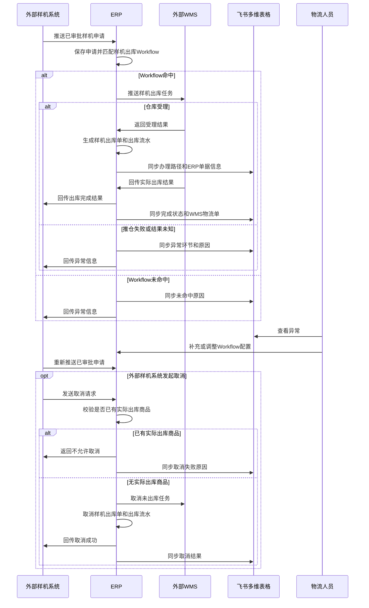

# ERP-208 样机出库跨系统自动化 PRD

## 1. 业务背景

当前样机出库需要业务人员从样机系统导出已确认申请，按 ERP 导入模板补全数据后导入 ERP，再人工生成样机出库单并处理推仓。随着单据量增加，重复导出、补录和导入成为效率瓶颈。[来源：Issue 需求背景]

本次 PRD 仅描述 ERP 系统和飞书多维表格需要开发的内容。样机系统与 WMS 仅作为外部协作系统出现在业务时序中，不展开其页面、字段或系统改造要求。[来源：需求范围确认 2026-11-25]

| 开发范围 | 本期目标 | 来源 |
|---|---|---|
| ERP 系统 | 接收已审批样机申请，执行独立“样机出库” Workflow，完成规则匹配、推仓、样机出库单及出库流水生成、状态回传和取消处理 | 需求§3、需求补充 2026-11-22 |
| 飞书多维表格 | 展示样机申请、ERP 办理路径、当前环节、ERP 单据、WMS 物流单和异常信息，供业务及物流人员查询 | 需求§1、飞书字段确认 2026-11-23 |
| 不在本文描述 | 样机系统新增页面、字段和交互；WMS 内部出库功能；ERP 现有通用技术基建 | 需求范围确认 2026-11-25 |

## 2. 系统使用时序图



时序图中的外部系统只用于说明 ERP 与飞书的输入、输出和业务协作关系，不代表本 PRD 对样机系统或 WMS 提出开发要求。[来源：需求范围确认 2026-11-25]

## 3. 功能清单

| ID | 开发端 | 功能模块 | 功能结果 | 来源 |
|---|---|---|---|---|
| F-01 | ERP | 样机出库 Workflow 配置 | 独立配置触发器、条件和推仓动作 | 需求§3、需求补充 2026-11-24 |
| F-02 | ERP | 样机申请接收与自动办理 | 接收申请后匹配 Workflow，命中并推仓成功后生成样机出库单和出库流水 | 需求补充 2026-11-22 |
| F-03 | ERP | 办理结果同步 | 将办理状态、异常、ERP 单据和完成结果同步至飞书及外部样机系统 | 需求§2.3、对话确认 2026-11-25 |
| F-04 | ERP | 取消与单据联动 | 无实际出库商品时取消 ERP 单据链，已有实际出库商品时拒绝取消 | 需求补充 2026-11-22 |
| F-05 | 飞书 | 样机出库跟踪表 | 汇总展示样机申请、办理路径、当前环节、ERP 单据、WMS 物流单和异常 | 需求§1、飞书字段确认 2026-11-23 |

### 3.1 ERP：样机出库 Workflow 配置

#### 3.1.1 功能描述

ERP 新增“样机出库”触发器和“样机出库推仓”动作。该触发器拥有独立的条件和动作配置，不复用订单 Workflow 的条件。触发器中的项目受 TAP 数据权限约束；条件仅提供渠道、样机物流渠道、设备状态、活动、计划、SKU；动作配置仓库、库区、ERP 物流渠道、主体、ERP 渠道和 ERP 区域。[来源：需求§3、需求补充 2026-11-23、2026-11-24]

#### 3.1.2 新增交互逻辑

- 触发器配置与条件编辑使用两个独立抽屉，不在触发器抽屉中展示条件组。
- 项目下拉仅展示当前账号 TAP 授权项目。
- 选择条件字段后，展示对应的操作符和值控件。
- 选择仓库后，库区和 ERP 物流渠道仅展示该仓库下的有效选项；切换仓库时清空原选择。
- 动作不展示“是否推送至仓库”，Workflow 命中后默认推仓。

#### 3.1.2.1 文字线稿图

```text
+ 触发器配置：样机出库 ---------------------------------+
| Workflow名称* [____________________________________]  |
| 项目*          [请选择授权项目 v]                     |
| 触发器*        [样机出库 v]                           |
|                                      [取消] [应用配置]|
+--------------------------------------------------------+
```

```text
+ 编辑配置：条件 ---------------------------------------+
| 条件描述 [__________________________________________]  |
| 关系     [且 v]                                       |
| 条件字段 [渠道/物流渠道/设备状态/活动/计划/SKU v]     |
| 操作符   [请选择 v]                                   |
| 条件值   [________________________________________]   |
| [                 + 添加条件                       ]  |
|                                      [取消] [应用配置]|
+--------------------------------------------------------+
```

```text
+ 动作配置：样机出库推仓 -------------------------------+
| 仓库*        [请选择仓库 v]                           |
| 库区*        [仅展示所选仓库下库区 v]                 |
| ERP物流渠道* [仅展示所选仓库下渠道 v]                 |
| 主体*        [请选择主体 v]                           |
| ERP渠道*     [请选择渠道 v]                           |
| ERP区域*     [请选择区域 v]                           |
| 提示：命中该动作后默认推送仓库。                      |
|                                          [取消] [保存]|
+--------------------------------------------------------+
```

#### 3.1.3 新增字段要求

| 配置对象 | 字段 | 类型 | 必填 | 规则 |
|---|---|---|---|---|
| 触发器 | Workflow 名称 | 文本 | 是 | 沿用现有名称校验 |
| 触发器 | 项目 | 单选 | 是 | 仅展示当前账号 TAP 授权项目 |
| 触发器 | 触发器 | 单选 | 是 | 可选择“样机出库” |
| 条件 | 条件字段 | 单选 | 是 | 仅渠道、样机物流渠道、设备状态、活动、计划、SKU |
| 动作 | 仓库、库区、ERP 物流渠道 | 级联单选 | 是 | 库区和物流渠道受仓库过滤 |
| 动作 | 主体、ERP 渠道、ERP 区域 | 单选 | 是 | 沿用样机出库单现有值域 |

### 3.2 ERP：样机申请接收与自动办理

#### 3.2.1 功能描述

ERP 接收外部推送的已审批样机申请，保存申请内容并执行已发布的样机出库 Workflow。Workflow 命中后按动作配置推送仓库；仓库受理后，ERP 生成一张样机出库单和一张出库流水，并持续接收实际出库结果。[来源：需求补充 2026-11-22、澄清 Q3]

Workflow 未命中、推仓失败或结果未知时，ERP 不生成样机出库单和出库流水，将失败环节和原因同步至飞书并回传外部样机系统。[来源：对话确认 2026-11-25]

#### 3.2.2 新增交互逻辑

无。该模块为 ERP 自动办理流程，不新增人工操作页面。

#### 3.2.2.1 文字线稿图

无。

#### 3.2.3 新增字段要求

| 字段 | 展示/记录位置 | 规则 |
|---|---|---|
| 外部样机申请单号 | 样机出库单、出库流水 | 用于查询申请对应的 ERP 单据链 |
| 办理路径 | 样机申请接收记录 | 展示“自动 Workflow”或“待人工补齐推送” |
| 当前环节 | 样机申请接收记录 | 未接收、待匹配、待推仓、仓库处理中、已完成、异常、已取消 |
| 异常环节 | 样机申请接收记录 | Workflow 未命中、推仓失败、结果未知 |
| 异常原因 | 样机申请接收记录 | 保存业务人员可理解的失败原因 |

### 3.3 ERP：办理结果同步

#### 3.3.1 功能描述

ERP 将样机申请的办理路径、当前环节、样机出库单、出库流水、WMS 物流单、实际出库结果和异常信息同步到飞书。出库完成后，ERP 将完成结果回传外部样机系统；发生 Workflow 未命中或推仓异常时，ERP 同样回传异常，但不影响外部申请的原审批状态。[来源：需求§2.3、对话确认 2026-11-25]

物流人员根据飞书异常调整 ERP Workflow 后，后续由外部样机系统重新推送已审批申请；ERP 不在原异常记录上提供“继续办理”或“重新执行”操作。[来源：对话确认 2026-11-25]

#### 3.3.2 新增交互逻辑

无。同步由 ERP 自动执行，不新增 ERP 人工操作入口。

#### 3.3.2.1 文字线稿图

无。

#### 3.3.3 新增字段要求

无。该模块使用“样机申请接收与自动办理”中的办理状态、异常信息和单据关联字段。

### 3.4 ERP：取消与单据联动

#### 3.4.1 功能描述

ERP 收到取消请求后检查关联出库流水的实际出库数量。全部商品实际出库数量均为 0 时允许取消：尚未生成 ERP 业务单时取消接收记录；已生成业务单时先取消未出库仓库任务，再取消出库流水和样机出库单。任一商品已有实际出库数量时拒绝取消。[来源：需求补充 2026-11-22]

#### 3.4.2 新增交互逻辑

无。取消由外部系统发起，ERP 本次不新增人工取消入口。

#### 3.4.2.1 文字线稿图

无。

#### 3.4.3 新增字段要求

| 字段 | 展示/记录位置 | 规则 |
|---|---|---|
| 取消状态 | 样机申请接收记录 | 取消中、已取消、取消失败 |
| 取消失败原因 | 样机申请接收记录 | 已有实际出库商品、仓库未取消等业务原因 |

### 3.5 飞书：样机出库跟踪表

#### 3.5.1 功能描述

飞书多维表格统一记录外部样机申请及其 ERP 办理结果。即使 ERP 接收或办理失败，也需生成对应记录，供业务和物流人员筛查。飞书只展示 ERP 同步数据，不提供触发 Workflow、修改 ERP 单据或重试原办理流程的能力。[来源：需求§1、需求补充 2026-11-23、对话确认 2026-11-25]

#### 3.5.2 新增交互逻辑

- ERP 首次接收申请后在飞书新增记录；后续按外部样机申请单号更新同一业务记录。
- 记录按“样机申请、ERP 接收与办理、WMS 物流”三组展示。
- 物流人员可按办理路径、当前环节和异常原因筛选需要处理的申请。
- 外部申请重新推送并形成新一轮 ERP 办理后，飞书更新为最新单据链和办理结果。
- 业务流程完成后，飞书记录只读，不支持反复修改。

#### 3.5.2.1 文字线稿图

```text
+ 样机出库跟踪表 ----------------------------------------------------------------+
| 筛选：申请单号 [________] 办理路径 [全部 v] 当前环节 [全部 v] [查询] [重置] |
+--------------------------------------------------------------------------------+
| 样机申请                    | ERP接收与办理                | WMS物流             |
| 申请单号 | 申请人 | 客户   | 办理路径 | 当前环节 | 异常 | 物流单号 | 出库状态 |
+--------------------------------------------------------------------------------+
| SA-001   | 张三   | 客户A  | 自动流程 | 已完成   | --   | WMS-001  | 已出库   |
| SA-002   | 李四   | 客户B  | 自动流程 | 异常     | 未命中| --       | --       |
+--------------------------------------------------------------------------------+
```

#### 3.5.3 新增字段要求

| 编组 | 字段 |
|---|---|
| 样机申请 | 样机申请单号、申请人、客户名称、国家/地区、城市、地址、邮政编码、项目、渠道、设备状态、活动、计划、样机物流渠道、商品及数量、审批状态、单据状态 |
| ERP 接收与办理 | 办理路径、当前环节、样机出库单号、出库流水号、异常环节、异常原因 |
| WMS 物流 | WMS 物流单号、实际出库数量、出库状态、完成时间 |

字段约束：不包含“申请版本号码”“指定发货说明”“是否自动交运”；样机物流渠道展示外部传入值，不映射为 ERP 基础物流渠道。[来源：飞书字段确认 2026-11-23]

## 4. 边界异常

本章只描述业务人员可感知、且需要 ERP 或飞书明确处理的业务边界；ERP 现有通用技术基建异常不在本文展开。[来源：需求范围确认 2026-11-25]

| 业务场景 | ERP 处理 | 飞书展示 | 后续处理 | 来源 |
|---|---|---|---|---|
| Workflow 未命中 | 不生成样机出库单和出库流水，回传未命中原因 | 当前环节标记异常，展示异常原因 | 物流调整 Workflow 后，由外部样机系统重新推送 | 对话确认 2026-11-25 |
| 推仓失败或结果未知 | 不生成样机出库单和出库流水，回传推仓异常 | 当前环节标记异常，展示仓库反馈或结果未知 | 物流检查并调整 Workflow 后，由外部样机系统重新推送 | 对话确认 2026-11-25 |
| 外部申请重新推送 | ERP 开启新一轮办理，不继续原异常流程 | 更新为最新办理结果和单据链 | 原异常信息保留业务追溯 | 对话确认 2026-11-25 |
| 取消时已有实际出库商品 | ERP 拒绝取消并返回“当前样机申请已有出库商品” | 展示取消失败及原因 | 保持现有单据和出库状态 | 需求补充 2026-11-22 |
| 取消时无实际出库商品 | 取消未出库任务及 ERP 单据链 | 展示已取消 | 流程结束，不允许重复取消 | 需求补充 2026-11-22 |
| Workflow 项目无权限 | 不允许选择或保存未授权项目 | 无 | 使用有权限的项目重新配置 | 需求补充 2026-11-24 |
| 样机物流渠道为空 | 允许接收并参与 Workflow 匹配 | 物流渠道显示为空 | 按已配置的空值条件决定是否命中 | 需求补充 2026-11-23 |
| 流程已完成 | ERP 单据保持完成状态 | 记录只读，不支持反复修改 | 如需更正，按后续业务流程另行处理 | 需求§2.2 |

开放项：样机物流渠道的正式选项和编码尚待业务提供；在此之前按独立、非必填值域处理，不映射为 ERP 基础物流渠道。[来源：需求补充 2026-11-23]
