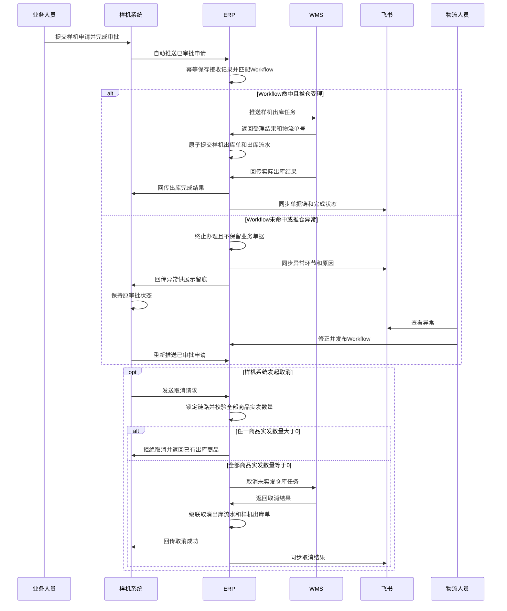

# ERP-208 样机出库跨系统自动化 PRD

## 1. 业务背景

当前线下样机出库需要业务人员从样机系统导出已确认申请，按 ERP 导入模板补全数据，再导入 ERP 生成人工样机出库单并处理推仓。随着单据量增加，重复导出、补录和导入成为效率瓶颈，因此本次打通样机系统、ERP、WMS 与飞书，实现审批后自动接收、规则匹配、推仓、状态同步及逆向取消。[来源：Issue 需求背景、需求§1]

| 项目 | 本期方案 | 来源 |
|---|---|---|
| 正向主链路 | 审批通过后自动推送 ERP，执行独立“样机出库” Workflow；仅规则命中且仓库受理后提交样机出库单和出库流水 | 需求补充§1、对话确认 2026-11-22 |
| 异常处理 | 未命中、推仓明确失败或结果未知时终止办理，不保留业务单据；异常同步飞书并回传样机系统，但不改变审批 | 对话确认 2026-11-25 |
| 异常恢复 | 物流修正 Workflow 后，由样机系统重新推送已审批申请；原接收记录不重算、不重试、不续跑 | 对话确认 2026-11-25 |
| 单据关系 | 一张申请至多对应一张样机出库单、一张出库流水和一张 WMS 物流单，不支持分批发货 | 澄清 Q3 |
| 逆向处理 | 审批后禁止编辑；全部商品实发数量为 0 才允许取消并级联取消 ERP/WMS 单据链 | 需求补充 2026-11-22 |
| 飞书定位 | 飞书是跨系统进度与异常展示副本，不触发 Workflow，不写入 ERP 业务事实 | 需求§1、对话确认 2026-11-25 |

## 2. 系统使用时序图



异常回传只用于样机系统展示和留痕，不得驳回、撤销或阻断原审批；重新办理必须由样机系统发出新请求，ERP 不沿原接收记录续跑。[来源：对话确认 2026-11-25]

## 3. 功能清单

| ID | 功能模块 | 功能结果 | 失败或限制 | 来源 |
|---|---|---|---|---|
| F-01 | 样机申请与自动推送 | 审批通过后自动推送并保存唯一请求快照 | 重复请求幂等；审批后禁止编辑 | 需求补充 2026-11-22 |
| F-02 | 样机出库 Workflow 配置 | 独立配置触发器、条件和动作 | 不复用订单条件；未授权项目不可提交 | 需求§3、需求补充 2026-11-24 |
| F-03 | ERP 接收、匹配与推仓 | 命中后默认推仓，受理后原子提交单据链 | 未命中、失败、未知均不保留业务单据 | 对话确认 2026-11-25 |
| F-04 | WMS 出库与完成回传 | 更新实际出库、库存和完成状态并回传 | 重复回调幂等；回传失败不重复出库 | 澄清 Q3、需求补充 2026-11-22 |
| F-05 | 飞书进度与异常同步 | 展示申请、单据链、当前环节和异常 | 不触发 Workflow，不修改 ERP 事实 | 需求§1、飞书字段确认 2026-11-23 |
| F-06 | 异常恢复 | 修正规则后由样机系统重新推送 | 原接收记录只读，不重算、不重试、不续跑 | 对话确认 2026-11-25 |
| F-07 | 取消与级联作废 | 零实发时取消仓库任务和 ERP 单据链 | 任一商品实发大于 0 时拒绝 | 需求补充 2026-11-22 |

### 3.1 样机申请与自动推送

#### 3.1.1 功能描述

样机申请完成审批后，样机系统自动向 ERP 推送申请号、申请人、客户及地址、项目、渠道、设备状态、活动、计划、样机物流渠道、商品和数量。ERP 以申请号和请求标识幂等接收并保存快照。审批通过后不允许编辑；样机物流渠道为新增非必填独立选项，不使用 ERP 基础物流渠道。[来源：需求补充 2026-11-22、2026-11-23]

#### 3.1.2 新增交互逻辑

- 审批通过自动推送，无需再次点击“推送 ERP”。
- ERP 异常回传后仅展示异常，不改变审批状态。
- Workflow 修正后，由样机系统重新推送已审批申请。

#### 3.1.2.1 文字线稿图

```text
+ 样机申请详情 ------------------------------------------+
| 申请单号：SA-XXXXXX          审批状态：已通过          |
| 样机物流渠道：[可选值 v]                               |
| ERP办理状态：异常 / 办理中 / 已完成 / 已取消           |
| 异常环节：Workflow未命中                               |
| 异常原因：未匹配已发布规则                             |
| 审批通过后：[编辑（禁用）] [取消申请]                  |
+--------------------------------------------------------+
```

#### 3.1.3 新增字段要求

| 字段 | 类型 | 必填 | 规则 |
|---|---|---|---|
| 样机物流渠道 | 单选 | 否 | 独立业务选项；不调用 ERP 基础物流渠道 |
| ERP 办理状态 | 枚举展示 | 系统回传 | 办理中、异常、已完成、已取消 |
| 异常环节 | 枚举展示 | 异常时必有 | 接收、Workflow、推仓、ERP 提交、取消 |
| 异常原因 | 文本展示 | 异常时必有 | 展示 ERP 回传的异常码和原因 |

### 3.2 样机出库 Workflow 配置

#### 3.2.1 功能描述

ERP 新增“样机出库”触发器和“样机出库推仓”动作。触发器、条件和动作均为独立配置对象，不复用订单 Workflow 条件或处理器。项目受 TAP 权限约束；条件仅提供渠道、样机物流渠道、设备状态、活动、计划、SKU；动作配置仓库、库区、ERP 物流渠道、主体、ERP 渠道、ERP 区域，命中后始终推仓。[来源：需求§3、需求补充 2026-11-23、2026-11-24]

#### 3.2.2 新增交互逻辑

- 触发器与条件分别在两个抽屉配置。
- 项目仅展示当前账号 TAP 授权数据，保存、更新和发布时再次校验。
- 选择条件字段后，按字段类型展示操作符和值控件。
- 仓库变化时清空库区和 ERP 物流渠道，二者按仓库过滤。
- 动作不展示“是否推送至仓库”，命中后默认推仓。

#### 3.2.2.1 文字线稿图

```text
+ 触发器配置：样机出库 ---------------------------------+
| Workflow名称* [____________________________________]  |
| 项目*          [请选择授权项目 v]                     |
| 触发器*        [样机出库 v]                           |
|                                      [取消] [应用配置]|
+--------------------------------------------------------+
```

```text
+ 编辑配置：条件 ---------------------------------------+
| 条件描述 [__________________________________________]  |
| 关系     [且 v]                                       |
| 条件字段 [渠道/物流渠道/设备状态/活动/计划/SKU v]     |
| 操作符   [按字段类型展示 v]                           |
| 条件值   [________________________________________]   |
| [                 + 添加条件                       ]  |
|                                      [取消] [应用配置]|
+--------------------------------------------------------+
```

```text
+ 动作配置：样机出库推仓 -------------------------------+
| 仓库*        [请选择仓库 v]                           |
| 库区*        [仅展示所选仓库下库区 v]                 |
| ERP物流渠道* [仅展示所选仓库下渠道 v]                 |
| 主体*        [请选择主体 v]                           |
| ERP渠道*     [请选择渠道 v]                           |
| ERP区域*     [请选择区域 v]                           |
| 提示：命中该动作后默认推送仓库。                      |
|                                          [取消] [保存]|
+--------------------------------------------------------+
```

#### 3.2.3 新增字段要求

| 配置对象 | 字段 | 类型 | 必填 | 规则 |
|---|---|---|---|---|
| 触发器 | Workflow 名称 | 文本 | 是 | 沿用现有校验 |
| 触发器 | 项目 | 单选 | 是 | 仅当前账号 TAP 授权项目 |
| 触发器 | 触发器 | 单选 | 是 | 固定可选“样机出库” |
| 条件 | 条件字段 | 单选 | 是 | 仅六个样机条件字段 |
| 动作 | 仓库、库区、ERP 物流渠道 | 级联单选 | 是 | 库区和物流渠道受仓库过滤 |
| 动作 | 主体、ERP 渠道、ERP 区域 | 单选 | 是 | 沿用样机出库单值域 |

### 3.3 ERP 接收、匹配与推仓

#### 3.3.1 功能描述

ERP 保存接收记录后读取已发布样机 Workflow。命中时校验动作参数并推仓；仅 WMS 明确受理后，才在同一事务中提交一张样机出库单和一张出库流水。未命中、明确失败或结果未知时终止办理，不保留业务单据。[来源：对话确认 2026-11-25]

#### 3.3.2 新增交互逻辑

无。该模块为系统自动处理，不新增业务人员操作界面。

#### 3.3.2.1 文字线稿图

无。

#### 3.3.3 新增字段要求

| 字段 | 类型 | 必填 | 规则 |
|---|---|---|---|
| 外部申请号 | 文本 | 是 | 跨系统追溯和幂等 |
| 请求标识 | 文本 | 是 | 区分重新推送产生的新一轮办理 |
| 规则快照 | 结构化快照 | 执行时必有 | 记录发布版本和动作参数 |
| 办理结果 | 枚举 | 是 | 处理中、已受理、异常、已完成、已取消 |
| 异常明细 | 结构化异常 | 异常时必有 | 环节、异常码、原因和发生时间 |

### 3.4 WMS 出库与完成回传

#### 3.4.1 功能描述

WMS 受理后生成最多一张物流单并执行出库；ERP 接收实际出库结果，更新出库流水、库存和完成状态，再向样机系统回传样机出库单号、出库流水号、WMS 物流单号、实际出库数量和完成时间。[来源：澄清 Q3、需求补充 2026-11-22]

#### 3.4.2 新增交互逻辑

无。沿用 ERP 与 WMS 的系统回调和库存处理交互。

#### 3.4.2.1 文字线稿图

无。

#### 3.4.3 新增字段要求

| 字段 | 类型 | 必填 | 规则 |
|---|---|---|---|
| WMS 物流单号 | 文本 | 仓库受理后必有 | 一张出库流水最多关联一张 |
| 实际出库数量 | 数值 | 出库回传时必有 | 用于库存更新和取消判断 |
| 完成事件号 | 文本 | 完成回传时必有 | 与申请号组成回传幂等键 |
| 完成时间 | 日期时间 | 完成回传时必有 | 以 ERP 确认时间为准 |

### 3.5 飞书进度、异常同步与恢复

#### 3.5.1 功能描述

飞书记录所有样机申请及其 ERP 办理路径、当前环节、单据链、WMS 物流单和异常。异常同时回传样机系统，但飞书仍是物流人员查看和筛查异常的主要入口。物流修正 Workflow 后，不重试原记录，由样机系统重新推送。[来源：需求§1、飞书字段确认 2026-11-23、对话确认 2026-11-25]

#### 3.5.2 新增交互逻辑

- 飞书新增或更新申请记录，展示当前环节和异常原因。
- 飞书只展示 ERP 副本，不提供 Workflow 触发、原流程重试或 ERP 事实修改能力。
- 物流人员在 ERP 修正 Workflow，修正后由样机系统重新推送。

#### 3.5.2.1 文字线稿图

无。飞书多维表格沿用业务已确认的现有表结构。

#### 3.5.3 新增字段要求

无。飞书字段与视图沿用已确认结构，本次仅调整同步内容和状态规则。[来源：飞书字段确认 2026-11-23]

### 3.6 取消与级联作废

#### 3.6.1 功能描述

样机系统发起取消后，ERP 锁定关联链路并检查全部商品的实际出库数量。全部为 0 时允许取消：无 ERP 业务单则取消接收记录；已有业务单则先取消未实发 WMS 任务，再级联取消出库流水和样机出库单。任一商品实际出库数量大于 0 时拒绝。[来源：需求补充 2026-11-22]

#### 3.6.2 新增交互逻辑

- 审批通过后编辑入口禁用，服务端同样拒绝编辑。
- 取消请求进入处理中，避免与 WMS 实发回调并发造成状态倒挂。
- 取消成功或拒绝均回传样机系统，最终结果同步飞书。

#### 3.6.2.1 文字线稿图

无。取消入口位于样机系统，ERP 本次不新增人工取消页面。

#### 3.6.3 新增字段要求

| 字段 | 类型 | 必填 | 规则 |
|---|---|---|---|
| 取消状态 | 枚举 | 发起后必有 | 取消中、已取消、取消失败 |
| 取消原因 | 文本 | 否 | 记录样机系统发起原因 |
| 取消失败原因 | 文本 | 失败时必有 | 有实发、仓库拒绝、结果未知等 |
| 实际出库数量 | 数值 | 是 | 任一商品大于 0 即禁止取消 |

## 4. 边界异常

| 场景 | 系统处理 | 业务单据结果 | 外部同步 | 恢复或限制 | 来源 |
|---|---|---|---|---|---|
| 重复推送同一请求 | 按申请号与请求标识幂等接收 | 不重复建单 | 返回原办理结果 | 新一轮必须使用新请求标识 | 需求补充 2026-11-22 |
| Workflow 未命中 | 终止办理 | 不生成业务单据 | 同步飞书并回传样机系统；审批不变 | 修正规则后重新推送 | 对话确认 2026-11-25 |
| WMS 明确拒绝 | 终止办理 | 不生成业务单据 | 同步失败原因；审批不变 | 修正后重新推送，不续跑原记录 | 对话确认 2026-11-25 |
| WMS 超时或结果未知 | 查询仓库结果并终止办理 | 不保留业务单据 | 同步结果未知；审批不变 | 禁止沿原记录续跑 | 对话确认 2026-11-25 |
| 仓库已受理但 ERP 事务失败 | 回滚 ERP 事务 | 单据链不部分成功 | 飞书记录 ERP 异常 | 按受理幂等键补提交，禁止再次推仓 | 产品决策 D-06 |
| 飞书同步失败 | 主链路不回滚 | ERP/WMS 事实保持 | 进入独立补偿 | 补传飞书，不重跑 Workflow | 需求§2.3 |
| 异常回传样机系统失败 | 主链路不回滚 | ERP/WMS 事实保持 | 进入独立补偿 | 只重试回传，不改变审批 | 对话确认 2026-11-25 |
| 完成回传失败 | 完成事实不回退 | 单据与库存保持完成 | 进入独立补偿 | 不重复建单、推仓或扣库存 | 需求补充 2026-11-22 |
| 取消时已有实发 | 拒绝取消 | 单据保持原状态 | 回传已有出库商品 | 不允许人工绕过 | 需求补充 2026-11-22 |
| 取消与 WMS 回调并发 | 锁内复核实发数量 | 以锁内最终事实决定 | 同步最终结果 | 有实发则拒绝 | 需求补充 2026-11-22 |
| 取消仓库任务结果未知 | 保持取消中 | 不提前取消 ERP 单据 | 同步取消中 | 查明仓库结果后继续级联 | 需求§2.3 |
| TAP 项目越权 | 拒绝保存、更新或发布 | Workflow 不生效 | 返回权限错误 | 未授权项目不可见、不可提交 | 需求补充 2026-11-24 |
| 样机物流渠道为空 | 允许接收和保存 | 不直接阻断申请 | 按空值参与条件判断 | 非必填独立值域 | 需求补充 2026-11-23 |

开放项：样机物流渠道的正式选项和编码尚待业务提供；在此之前按独立、非必填值域设计，不得映射为 ERP 基础物流渠道。[来源：需求补充 2026-11-23]
