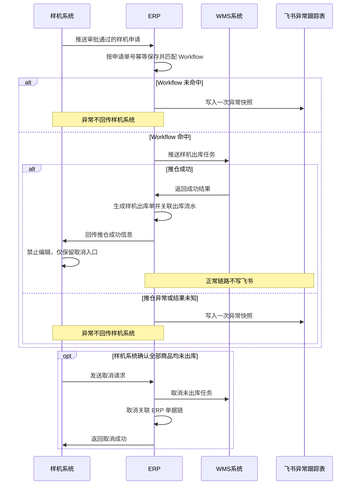

# [v0.28.7] ERP-210 样机出库自动化 PRD

## 1. 业务背景

当前样机出库需要业务人员从样机系统导出已确认申请，按 ERP 导入模板补全数据后导入 ERP，再人工生成样机出库单并处理推仓。随着单据量增加，重复导出、补录和导入成为效率瓶颈。

本期由 ERP 接收样机系统已审批申请，自动匹配样机出库 Workflow 并推仓，同时接收样机系统完成资格校验后的取消请求。ERP 保存所有推送申请；只有形成可识别异常的申请才写入飞书异常跟踪表，正常单据不写飞书，异常记录写入后不持续更新。

本 PRD 仅定义 ERP 系统功能。样机系统和仓库系统仅作为外部输入或输出对象，不展开内部实现。

## 2. 系统使用泳道图



飞书写入均为异常形成时的一次性快照，不因后续处理或状态变化持续更新。[来源：确认 D4]

## 3. 功能清单

| ID | 功能 | 业务结果 |
|-|-|-|
| F-01 | 样机出库 Workflow 配置 | 独立配置样机触发器、条件和推仓动作 |
| F-02 | 样机申请接收与记录 | 记录全部推送申请，重复推送不重复建单 |
| F-03 | 自动匹配与推仓 | 命中后自动推仓，异常时终止自动办理 |
| F-04 | 飞书异常快照 | 可识别异常写入一次异常记录，不回传样机系统 |
| F-05 | 取消请求与单据联动 | 样机系统校验允许取消后，ERP 取消关联单据链 |

### 3.1 样机出库 Workflow 配置

#### 3.1.1 功能描述

ERP Workflow 新增“样机出库”触发器、样机申请条件和“样机出库推仓”动作。触发器、条件和动作沿用现有分步配置结构，样机申请与订单 Workflow 的条件值域相互隔离。

#### 3.1.2 新增交互及规则

- 触发器、条件和动作分开展示。
- 项目仅可选择当前账号 TAP 数据权限范围。
- 条件支持：指定物流渠道、设备状态、活动、计划、SKU、国家、邮编、邮箱。
- 选择仓库后，库区和物流渠道仅展示该仓库下有效选项；切换仓库时清空原选择。
- Workflow 命中后默认推仓。

#### 3.1.2.1 文字线稿图

```text
+ 触发器配置：样机出库 ---------------------------------+
| Workflow名称* [____________________________________]  |
| 项目*          [请选择授权项目 v]                     |
| 触发器*        [样机出库 v]                           |
|                                      [取消] [应用配置]|
+--------------------------------------------------------+

+ 编辑配置：条件 ---------------------------------------+
| 条件字段 [指定物流渠道/设备状态/活动/计划/SKU/国家/邮编/邮箱 v] |
| 操作符   [请选择 v]    条件值 [____________________]  |
| [ + 添加条件 ]                       [取消] [应用配置]|
+--------------------------------------------------------+

+ 动作配置：样机出库推仓 -------------------------------+
| 仓库* [请选择 v]  库区* [所选仓库下库区 v]           |
| ERP物流渠道* [所选仓库下渠道 v]                       |
| 主体* [请选择 v] ERP渠道* [请选择 v] ERP区域* [请选择]|
|                                          [取消] [保存]|
+--------------------------------------------------------+
```

#### 3.1.3 新增字段及规则

| 对象 | 字段 | 必填 | 规则 | 来源 |
|-|-|-|-|-|
| 触发器 | Workflow 名称、项目、触发器 | 是 | 项目受 TAP 权限；新增“样机出库” | ERP-210 第 1 条；ERP-208 PRD 3.1 |
| 条件 | 条件字段、操作符、条件值 | 是 | 字段限指定物流渠道、设备状态、活动、计划、SKU、国家、邮编、邮箱；项目仅在触发器中配置 | ERP-210 最新确认；ERP-208 PRD 3.1 |
| 动作 | 仓库、库区、ERP 物流渠道、主体、ERP 渠道、ERP 区域 | 是 | 库区和物流渠道受仓库过滤 | ERP-208 PRD 3.1 |

### 3.2 样机申请接收与记录

#### 3.2.1 功能描述

ERP 接收已审批申请并按样机申请单号保存。ERP 记录全部推送申请；相同申请重复推送不得重复生成样机出库单或重复推仓。

#### 3.2.2 新增交互及规则

无。该功能为自动处理，不新增 ERP 人工页面。

#### 3.2.2.1 文字线稿图

无。

#### 3.2.3 新增字段及规则

无。

### 3.3 自动匹配与推仓

#### 3.3.1 功能描述

ERP 接收成功后匹配已启用的样机出库 Workflow。命中时按动作配置推仓；未命中、推仓失败或结果未知时终止本次自动办理并形成可识别异常。

#### 3.3.2 新增交互及规则

无。匹配和推仓由 ERP 自动执行。

#### 3.3.2.1 文字线稿图

无。

#### 3.3.3 新增字段及规则

无。

### 3.4 异常记录与飞书快照

#### 3.4.1 功能描述

ERP 接收申请后，Workflow 未命中、推仓失败或推仓结果未知时，不回传样机系统，仅在飞书异常跟踪表新增一条快照。系统联调保证不存在“推送后 ERP 接收失败且可识别”的业务分支，因此不设计对应回传和飞书写入。正常申请不写飞书；异常记录写入后不持续更新。

#### 3.4.2 新增交互及规则

- 飞书仅承接 ERP 自动写入，不提供重试或修改 ERP 单据入口。
- 同一次异常重复通知不得重复新增。
- 正常接收、命中、推仓成功和出库完成均不写飞书。
- 异常快照形成后保持不变，最新更新时间记录首次成功写入时间。

#### 3.4.3 飞书表格链接（仅参考）

<cite doc-id="SrGQbq8qxanHWEsGJ0ecWxv8nMc" file-type="bitable" table-id="tblzkYrDwrcY8WWT" title="ERP-208 样机出库全流程沟通查看表" type="doc" view-id="vewei7CvvH"></cite>

| 字段 | 必填 | 规则 | 来源 |
|-|-|-|-|
| 样机申请单号 | 是 | 标识异常所属申请 | ERP-210 第 4 条 |
| 当前异常 | 是 | 展示异常环节与业务可理解原因 | ERP-210 第 4 条 |
| 最新更新时间 | 是 | 异常快照首次写入时间，后续不持续更新 | ERP-210 第 4 条；确认 D4 |

### 3.5 取消校验与单据联动

#### 3.5.1 功能描述

成功推仓后，ERP 将推仓成功信息回传样机系统。样机系统禁止再次编辑该申请，仅保留取消入口；取消资格仅由样机系统依据关联样机出库单和出库流水的实际出库情况校验。仅当全部商品均未出库时，样机系统才向 ERP 发送取消请求；ERP 不重复校验取消资格，收到请求后取消关联单据链。

#### 3.5.2 新增交互及规则

无。取消由样机系统发起，ERP 不新增人工取消入口。

#### 3.5.2.1 文字线稿图

无。

#### 3.5.3 新增字段及规则

无。

## 4. 边界异常

| 场景 | ERP 处理 | 飞书处理 | 返回样机系统 | 来源 |
|-|-|-|-|-|
| Workflow 未命中 | 终止自动办理 | 新增一次快照 | 不回传 | ERP-210 第 2 条；最新确认 |
| 推仓失败或结果未知 | 不按成功继续办理 | 新增一次快照 | 不回传 | ERP-210 第 2 条；最新确认 |
| 正常办理成功 | 继续 ERP 与仓库链路 | 不写飞书 | 正常结果 | 确认 D1、D3、D4 |
| 同一异常重复通知 | 保留原异常结果 | 不重复新增 | 不回传 | ERP-210 第 5 条；最新确认 |
| 异常后重新推送 | 按幂等和业务状态处理新一轮 | 原快照不更新；新异常新增快照 | 不回传 | 最新确认 |
| 取消时已有实际出库 | 不接收取消请求，保留单据链 | 不写飞书 | 样机系统内部拒绝，不发生 ERP 回传 | ERP-210 第 3 条；最新确认 |
| 取消时无实际出库 | 取消任务和关联单据链 | 不写飞书 | 取消成功 | ERP-210 第 3 条；确认 D1 |


